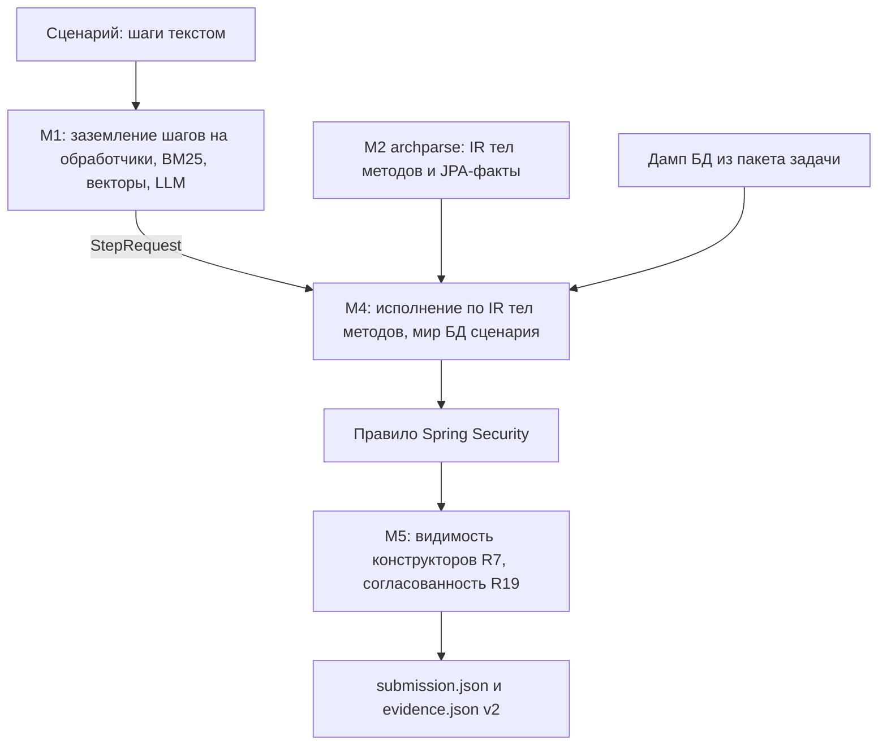

# Archonity

Статический анализатор для предсказания исполнения пользовательских сценариев в микросервисных проектах (бенчмарк Train Ticket, хакатон TechArena 2026).

По тексту сценария, исходникам сервисов и графу-скелету определяет:
- какие методы реально исполняются (`executes`),
- вызовы методов внутри сервиса (`calls`),
- межсервисные сетевые запросы (`remote`),
- SQL-обращения к таблицам базы данных (`data`).

Проект работает по принципу **Strict Local-First**:
- Только статический анализ — целевой микросервисный проект не запускается и не инструментируется в рантайме.
- Никаких внешних облачных API. Модели эмбеддингов и LLM работают локально; все ответы закешированы в репозиторий, поэтому воспроизведение работает полностью офлайн и без GPU.

---

## Быстрый старт

### Требования
- Python 3.11+ (рекомендуется Python 3.13)
- Java 17+ (требуется только для пересборки AST в модуле `archparse`)

### Установка зависимостей
```bash
pip install -r requirements.txt
```
или через `uv`:
```bash
uv sync --locked
```

Запуск на машине организаторов (Linux, A100 40 ГБ) одной командой: модели докачиваются по `models/manifest.json`, `llama-server` поднимается сам на первом промахе кеша. Подробно — [docs/run_on_a100.md](docs/run_on_a100.md).

```bash
scripts/run_final.sh <файлы сценариев>   # без аргументов — S0–S7
```

### Воспроизведение сабмишна

Запуск полного пайплайна генерации графов по всем сценариям (S0–S7):

```bash
python run_eval.py -o output/submission.json
```

Под Windows (PowerShell) для корректного UTF-8 вывода:
```powershell
$env:PYTHONUTF8=1; python run_eval.py -o output/submission.json
```

Команда автоматически запустит официальный валидатор `evaluate_golden.py` на калибровочном сценарии S0 и выведет метрики IoU. Выдача совпадает с эталонным рекордом 1.00000 байт в байт.

### Проверка без кеша

Ответы LLM (`cache/llm/`) и векторы эмбеддера (`cache/emb/`) лежат в репозитории. Ключ каждого ответа — sha256 от имени модели, версии промпта, текста сообщений и JSON-схемы ответа, поэтому любая правка промпта в коде — промах кеша. В конце прогона печатается итог M1 (он же — `m1_report.json` рядом с выдачей):

```text
M1: режим full. Шагов 103: выбрано моделью 103, первым кандидатом поиска 0
    ответы LLM: из кеша 687, от сервера 0, без ответа 0, ошибок 0; промахов кеша векторов 0
```

- `python run_eval.py --require-cache` — прогон только из кеша; код выхода 2, если хоть одного ответа LLM в кеше нет.
- `python scripts/verify_llm_cache.py` — проверка кеша без GPU: ключ каждой записи пересчитывается из записанных промпта, схемы и модели, ответ проверяется по схеме; затем прогон с `--require-cache` сверяет, что каждый запрос текущего кода к LLM найден в кеше. Итог: ответы записаны на промпты, которые строит текущий код. Что ответы дала модель, а не человек, доказывает только перепроверка с сервером LLM: `--recheck N` спрашивает N случайных записей заново и сравнивает ответы (на другом железе часть может отличаться).
- Без кеша и без сервера LLM прогон не падает, а идёт в режиме `emergency`: шаг сценария сопоставляется с первым кандидатом поиска (BM25), без параметров и ссылок от модели, итог печатается с предупреждением. Качество в этом режиме ниже: замер 20.10 — около 0.575 против 1.0. Основная потеря — выбор обработчика: верный есть среди кандидатов поиска в 99 шагах из 103, но выбрать его без модели не удаётся ([исследование](docs/researches/gpu_dependence_and_cpu_fallback_study.md), раздел 7).
- Пересобрать кеш: сервер `llama.cpp` с `Qwen3.6-35B-A3B-UD-IQ4_XS` (`scripts/start_llm.ps1`, видеокарта 16 ГБ), затем `python run_eval.py --no-cache`. На GPU 16 ГБ ответы `m1-v8` заняли около 32 минут (сумма времени ответов в кеше — 1923 с). На другом железе ответы модели могут чуть отличаться.
- Без видеокарты — режим CPU: малая модель через `llama.cpp` на процессоре. Пример (Qwen3-4B Q4_K_M, нужно ~7 ГБ свободной памяти):

  ```powershell
  llama-server -m Qwen3-4B-Q4_K_M.gguf -t 4 -np 2 -c 12288 -fa off --cache-ram 2048 --port 8090
  $env:ARCHONITY_LLM_URL="http://127.0.0.1:8090"; $env:ARCHONITY_LLM_MODEL="Qwen3-4B-Q4_K_M"; $env:NO_PROXY="127.0.0.1,localhost"
  python run_eval.py --m1-index off --m1-top-k 5 --select-votes 0 --llm-timeout 900 --llm-cache output/llm_cpu -o output/submission.json
  ```

  Замер 21.10 на Ryzen 3 4300U (4 ядра): 2 часа, итог 0.614 против 1.0 из кеша и 0.575 без модели — малая модель выбирает обработчик хуже большой. Режим показывает, что код работает без GPU, но рекорд не воспроизводит ([исследование](docs/researches/gpu_dependence_and_cpu_fallback_study.md), разделы 7.5–7.6). `-fa off` на CPU вдвое ускоряет ответ модели; `NO_PROXY` нужен, если в системе задан прокси.

### Сборка архива для тестирующей системы (NSUTS)

```bash
python pack_submission.py
```

Скрипт соберёт `output/submission.zip`. В корне — `submission.json`, `evidence.json` и `RUN.md` с командами воспроизведения. В `code/` — всё для запуска из этого каталога: код (`run_eval.py`, `engine/`, исходники `archparse/`), артефакты M2 (`data/`), кеши M1 (`cache/`), зависимости (`pyproject.toml`, `uv.lock`, `requirements.txt`), манифест моделей (`models/manifest.json`), скрипты запуска (`scripts/run_final.sh`, `scripts/fetch_models.py`) и `docs/run_on_a100.md`. Модели и пакет организаторов в архив не входят. Текст — с LF, скрипты `.sh` — исполняемые.

---

## Архитектура решения

Пайплайн состоит из нескольких независимых модулей (подробнее см. [ADR-005](docs/adr/adr-005_scenario_execution_pipeline.md)):



- **M1 (Заземление шагов, `engine/grounding/`):** сопоставляет шаги сценария на естественном языке с методами контроллеров через комбинацию BM25, эмбеддингов (`Qwen3-Embedding-4B`) и компактной LLM (`Qwen3.6-35B-A3B`). Промпт не содержит слов предметной области: описание домена и правила сервисов-близнецов строит сама модель по README, `context` скелета и коду UI (профиль проекта), виды сущностей для ссылок берутся из `@Entity` скелета ([ADR-007](docs/adr/adr-007_project_profile.md)). Все предсказания сохранены в `cache/` для мгновенного детерминированного воспроизведения.
- **M2 (Парсер тел методов, `archparse/`):** Java-приложение на базе JavaParser. Извлекает дерево операторов и вызовов методов в `data/ir/<module>.json`, а также факты о JPA-сущностях, связях и вызовах репозиториев в `data/entity_ir.json`.
- **M4 (Интерпретатор исполнения, `engine/executor/`):** пошагово исполняет сценарий по сгенерированному IR. Вычисляет условия ветвлений (`if/else`, `switch`) по данным сценария, отслеживает вызовы и межсервисные переходы. Мир БД сценария — форк дампа из пакета задачи: записи, созданные шагом, видны следующим шагам.
- **Правило Spring Security (`engine/spring_security.py`):** вход через `AuthenticationManager` достраивает по контракту фреймворка `loadUserByUsername`, фильтр запроса и методы `UserDetails` — их нет в коде проекта как вызовов.
- **M5 (Правила разметки и атрибуция, `engine/projection.py`, `engine/pipeline.py`):** применяет правила эталона ([annotation_rules.md](docs/annotation_rules.md)): видимость конструкторов ([ADR-006](docs/adr/adr-006_constructor_visibility.md)) и согласованность `executes` с рёбрами (R19).

---

## Навигация по репозиторию

- `run_eval.py` — главная точка входа пайплайна анализа.
- `pack_submission.py` — утилита сборки архива сдачи в NSUTS.
- `engine/` — ядро анализатора на Python:
  - `engine/pipeline.py` — конвейер сценария: M1 → M4 → правило Spring Security → M5, пассажир сценария.
  - `engine/grounding/` — модуль заземления шагов M1 (`grounder.py`, `llm.py`, `embedder.py`).
  - `engine/executor/` — интерпретатор тел методов M4 (`world.py`, `interpreter.py`, `step.py`).
  - `engine/spring_security.py` — правило фреймворка Spring Security.
  - `engine/projection.py` — проекция исполнения на рёбра эталона (M5, ADR-006).
  - `engine/adapters/` — адаптеры графа-скелета, снимка базы данных и формата выдачи.
  - `engine/entities.py` — JPA-сущности, таблицы и вызовы репозиториев из `data/entity_ir.json`.
  - `engine/rules.py` — режимы правил M4 и M5 (`RuntimeRules`); умолчания — конфигурация рекорда.
  - `engine/decisions.py`, `engine/evidence.py` — журнал решений и `evidence.json` v2.
- `archparse/` — статический анализатор Java-кода:
  - `MethodIrWriter.java` — генерация структурного IR тел методов.
  - `EntityScanner.java` — сканер сущностей, таблиц и вызовов Spring Data.
  - `EnumResolver.java` — динамический резолвер констант перечислений.
  - `SkeletonGraph.java` — зависимости модулей из рёбер `depends_on` скелета.
- `data/` — артефакты M2 (`data/ir/`, `data/entity_ir.json`) и каталог UI (`data/ui_catalog.json`).
- `cache/` — кеши ответов LLM (`cache/llm/`) и векторов эмбеддера (`cache/emb/`).
- `models/manifest.json` — версии и sha256 LLM, эмбеддера и сборки `llama.cpp`; сами модели качает `scripts/fetch_models.py`.
- `scripts/run_final.sh` — финальный запуск на A100; `scripts/start_llm.*` — ручной запуск `llama-server`.
- `facts/configs_topology.json` — топология развёртывания: имя шлюза для `evidence.json`.
- `docs/` — документация проекта:
  - `docs/roadmap.md` — текущий статус, прогресс и таблица посылок.
  - `docs/annotation_rules.md` — правила разметки графа и сопоставления рёбер.
  - `docs/environment_guide.md` — тонкости запуска и окружения (Windows/Linux).
  - `docs/adr/` — архитектурные решения (ADR-005, ADR-006, ADR-007).
  - `docs/researches/` — исследовательские отчеты и логи гипотез.
- `tests/` — модульные, контрактные и регрессионные тесты движка.

---

## Тестирование

Запуск тестов движка:
```bash
pytest tests/
```

Запуск тестов Java-парсера `archparse`:
```bash
cd archparse
./gradlew test        # Linux/macOS
cmd /c gradlew.bat test  # Windows
```
