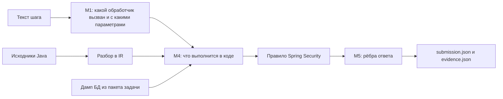

# Archonity

Статический анализатор для хакатона TechArena 2026 (бенчмарк Train Ticket). По тексту пользовательского сценария, исходникам микросервисов и графу-скелету он предсказывает, что произойдёт при исполнении сценария:

- `executes` — какие методы выполнятся;
- `calls` — какой метод вызовет какой внутри сервиса;
- `remote` — какие запросы уйдут в другие сервисы;
- `data` — к каким таблицам уйдёт SQL.

На открытых сценариях S1–S7 платформа дала 1.00000. Анализируемый проект мы не запускаем, только читаем его код. Облачных API нет: модели работают локально.

---

## Как это работает

Сценарий — это шаги на английском: «войти», «найти поезда из Шанхая в Пекин», «забронировать билет». Каждый шаг проходит четыре этапа.



1. **M1, Python.** Поиск (BM25 и векторы эмбеддера) отбирает 10 похожих REST-обработчиков. Локальная LLM выбирает из них один, для надёжности голосованием нескольких ответов, и заполняет параметры: города, дату, тип места, ссылку на заказ из прошлого шага.
2. **M4, Rust.** Исходники Java заранее разобраны в упрощённое дерево операторов и вызовов (IR). Интерпретатор проходит обработчик с параметрами шага: вычисляет `if` и `switch`, заходит в вызовы, через REST-клиенты — в другие сервисы, отмечает обращения к репозиториям. Данные берёт из дампа БД из пакета задачи. Что создал один шаг, видят следующие.
3. **Правило Spring Security.** При входе фреймворк сам вызывает `loadUserByUsername` и методы `UserDetails`. В коде проекта таких вызовов нет, поэтому правило добавляет их по контракту фреймворка.
4. **M5.** Исполнение превращается в рёбра по правилам разметки эталона ([annotation_rules.md](docs/annotation_rules.md)), например, какие конструкторы попадают в ответ. Для каждого ребра в `evidence.json` записано, откуда оно: шаг, правило, файл и строка кода.

### Почему так

- **LLM только читает текст.** Модель решает одно: какой обработчик имел в виду пользователь и с какими данными. Что выполнится дальше, считает детерминированный код по исходникам. Поэтому каждое ребро можно объяснить, а ошибка модели ограничена выбором обработчика и параметров.
- **Исполнение, а не всё достижимое.** В ответ попадает только то, что выполнилось при данных этого сценария. Лишнее ребро стоит столько же, сколько пропущенное, а «всё достижимое из обработчика» даёт много лишнего.
- **Никаких знаний о Train Ticket в коде.** Описание домена модель строит сама по README проекта, скелету и коду UI ([ADR-007](docs/adr/adr-007_project_profile.md)). Литералы проекта в коде движка запрещены, и это проверяет отдельный тест.
- **Rust основной, Python запасной.** Разбор исходников, M4 и M5 написаны на Rust ([ADR-008](docs/adr/adr-008_rust_engine_boundary.md), [ADR-009](docs/adr/adr-009_archparse_rust.md)). Та же логика есть на Python, и выдачи совпадают байт в байт. Python-движок служит эталоном для тестов и запасным путём.

Подробно — [ADR-005](docs/adr/adr-005_scenario_execution_pipeline.md) (конвейер) и [ADR-006](docs/adr/adr-006_constructor_visibility.md) (конструкторы).

---

## Запуск

### Требования

- Python 3.11+ (рекомендуем 3.13): `pip install -r requirements.txt` или `uv sync --locked`.
- Rust 1.99.1 (`rust/rust-toolchain.toml`) и компилятор C (`cc` или `gcc`, его требует tree-sitter). `scripts/run_final.sh` ставит Rust через `rustup` сам.
- Под Windows перед командами нужно задать `$env:PYTHONUTF8=1`, иначе вывод сломается на кириллице.

### У организаторов: одна команда

Linux, A100 40 ГБ:

```bash
scripts/run_final.sh                              # S0–S7
scripts/run_final.sh /path/S8.json /path/S9.json  # свои сценарии
```

Скрипт выполняет четыре шага:

1. докачивает модели по `models/manifest.json` и сверяет sha256;
2. собирает Rust;
3. запускает прогон, при этом IR строится из исходников заново;
4. печатает sha256 выдачи, итог M1 и ресурсы.

Если ответа нет в кеше, `llama-server` поднимается сам и гасится в конце. Настройки задаются переменными окружения: `OUT` (куда писать, по умолчанию `output/submission.json`), `ENGINE=python` (без Rust), `PARSE_SOURCES=0` (взять готовый IR из `data/`). Подробно — [docs/run_on_a100.md](docs/run_on_a100.md).

### Воспроизвести посылку из кеша (без GPU)

```bash
python run_eval.py -o output/submission.json                                  # Python
cd rust && cargo build --release --locked && cd ..
python run_eval.py --engine rust --parse-sources -o output/submission.json    # Rust
```

Обе команды дают один и тот же `submission.json` с sha256 `94463c41a72c244fc548cbb52d009cff7c65f44ad5e682b7176a156cb66a5a08`, как у рекорда 1.00000 ([eval/records/](eval/records/README.md)). В конце прогон сам оценивает S0 официальным `evaluate_golden.py`.

### Запуск без кеша

Чтобы получить ответы модели заново, достаточно указать пустую папку кеша:

```bash
python scripts/fetch_models.py --llama-cpp     # модели и llama.cpp, если их ещё нет
python run_eval.py --llm-cache output/llm_fresh -o output/fresh/submission.json
```

В пустой папке нет ни одного ответа, поэтому каждый вопрос уходит к модели. Сервер `llama-server` поднимается сам, новые ответы складываются в `output/llm_fresh`, а `cache/llm` из репозитория не меняется. На видеокарте 16 ГБ прогон S0–S7 занял около 21 минуты. На другом железе модель может ответить чуть иначе.

Флаг `--no-cache` тоже пересчитывает ответы, но записывает их поверх `cache/llm` в репозитории. Для проверки лучше пустая папка.

Векторы эмбеддера при этом берутся из `cache/emb`, отдельного флага для них нет. Для новых сценариев эмбеддер сам считает недостающие векторы.

### Кеш простыми словами

Локальная LLM на одном и том же вопросе с одинаковыми настройками отвечает одинаково. Мы один раз прогнали модель на S0–S7 и на своих проверочных сценариях и сохранили каждый ответ в файл `cache/llm/<ключ>.json`. Ключ — отпечаток (sha256) вопроса: имя модели, версия промпта, сам текст и схема ответа.

При следующем прогоне код строит тот же вопрос, вычисляет ключ и, если файл с таким ключом есть, берёт ответ из него, не обращаясь к модели. Поэтому посылка воспроизводится за секунды и без видеокарты. Новый сценарий даёт новые вопросы, их в кеше нет, и тогда работает модель. Любая правка промпта меняет ключи, и старые ответы перестают подходить сами.

Как проверить, что кеш честный:

- `python run_eval.py --require-cache` — прогон только из кеша. Если хоть одного ответа нет, код выхода 2.
- `python scripts/verify_llm_cache.py` — пересчитывает ключ каждой записи из сохранённых промпта и схемы и проверяет, что каждый запрос текущего кода есть в кеше. С флагом `--recheck N` и запущенным сервером заново спрашивает модель на N случайных записях и сравнивает ответы.
- Итог M1 печатается в конце каждого прогона и пишется в `m1_report.json`:

  ```text
  M1: режим full. Шагов 103: выбрано моделью 103, первым кандидатом поиска 0
      ответы LLM: из кеша 385, от сервера 0, без ответа 0, ошибок 0; промахов кеша векторов 0
  ```

Для S0–S7 нужно 385 ответов: голосование останавливается, как только исход ясен. В кеше лежат ещё полные выборки голосования и ответы на проверочные сценарии из `eval/`.

---

## Если что-то пошло не так

Прогон не падает молча. Выдача строится всегда, а сбой виден в рамке `ATTENTION.txt` рядом с выдачей и в последних строках вывода.

| Что сломалось | Что происходит | Качество |
|---|---|---|
| Rust не собрался или бинарник упал | тот же прогон на Python-движке | выдача та же байт в байт |
| нет ответа в кеше и нет сервера LLM | режим `emergency`: шаг получает первый кандидат поиска, без параметров от модели | около 0.575 против 1.0 (замер 20.10) |
| нет видеокарты | малая модель на CPU, команда ниже | 0.614, около 2 часов на 4 ядрах (замер 21.10) |
| сценарий не той формы: BOM, UTF-16, нет `id` или `action`, каталог вместо файла | сценарий читается, проблема описана в рамке | ответ строится |

Режим `emergency` теряет в основном на выборе обработчика. Верный обработчик есть среди кандидатов поиска в 99 шагах из 103, но выбрать его без модели не получается.

Режим CPU показывает, что код работает без видеокарты, но рекорд он не воспроизводит. Пример для Qwen3-4B Q4_K_M, требуется около 7 ГБ свободной памяти:

```powershell
llama-server -m Qwen3-4B-Q4_K_M.gguf -t 4 -np 2 -c 12288 -fa off --cache-ram 2048 --port 8090
$env:ARCHONITY_LLM_URL="http://127.0.0.1:8090"; $env:ARCHONITY_LLM_MODEL="Qwen3-4B-Q4_K_M"; $env:NO_PROXY="127.0.0.1,localhost"
python run_eval.py --m1-index off --m1-top-k 5 --select-votes 0 --llm-timeout 900 --llm-cache output/llm_cpu -o output/submission.json
```

---

## Флаги `run_eval.py`

Без флагов прогон даёт рекорд. Полный список с умолчаниями выводит `python run_eval.py --help`.

**Вход и выход**

| Флаг | Что делает |
|---|---|
| `--scenarios ФАЙЛЫ` | файлы сценариев, маски или каталог; по умолчанию S0–S7 из `hackaton/tt-challenge/scenarios/` |
| `-o ПУТЬ` | куда писать `submission.json`; рядом появятся `evidence.json`, `m1_report.json`, `resources.json` |
| `--skeleton`, `--targets` | граф-скелет и исходники проекта |
| `--artifacts-dir ПАПКА` | IR и каталог UI; для другого проекта задайте отдельную папку, `data/` тогда не меняется |
| `--no-eval` | не запускать `evaluate_golden.py` на S0 |

**Движок**

| Флаг | Что делает |
|---|---|
| `--engine rust\|python` | чем исполнять шаги и строить ответ (M4 и M5): `rust` — бинарник `archonity-exec`, `python` — тот же движок на Python, выдача та же байт в байт. Без флага — `python`; `scripts/run_final.sh` запускает `rust` |
| `--parse-sources` | перед прогоном заново построить IR из исходников бинарником `archonity-parse` |
| `--rust-bin`, `--parse-bin` | пути к бинарникам, если они собраны не в `rust/target/release/` |

**Модели и кеш**

| Флаг | Что делает |
|---|---|
| `--llm-cache ПАПКА` | своя папка кеша ответов LLM; пустая папка означает прогон без кеша |
| `--require-cache` | только кеш; код выхода 2, если хоть одного ответа нет |
| `--no-server` | только кеш, но без ошибки на промахе |
| `--no-cache` | пересчитать все ответы и записать поверх `cache/llm` |
| `--no-llm` | без LLM: первый кандидат поиска |
| `--no-embed` | поиск только BM25, без векторов |
| `--embed-model off` | не загружать эмбеддер на промахе кеша векторов |
| `--llm-timeout С` | таймаут одного вызова LLM, по умолчанию 300 с |
| `--select-votes N`, `--select-early-stop`, `--m1-top-k N`, `--m1-index`, `--select-reasoning` | настройки выбора обработчика: число голосов, ранняя остановка, число кандидатов, индекс в промпте, рассуждение. Нужны для режима CPU |

Сервер LLM настраивается переменными окружения:

- `ARCHONITY_LLM_URL` — адрес сервера, по умолчанию `http://127.0.0.1:8080`;
- `ARCHONITY_LLM_MODEL` — имя модели для ключа кеша;
- `ARCHONITY_LLAMA_SERVER` — путь к `llama-server`; значение `off` отключает автозапуск;
- `ARCHONITY_LLAMA_ARGS` — дополнительные аргументы сервера.

**Правила M4 и M5.** Каждое правило можно выключить, чтобы проверить его вклад. Умолчания — конфигурация рекорда, менять их для посылки не нужно.

| Флаг | Правило |
|---|---|
| `--ctors caller_only\|all\|off` | какие конструкторы попадают в ответ ([ADR-006](docs/adr/adr-006_constructor_visibility.md)) |
| `--collection-tables loaded\|all` | таблицы ленивых коллекций при чтении |
| `--element-callbacks` | `equals` сущности из `list.contains(x)` |
| `--rabbitmq-delivery` | ребро к потребителю очереди RabbitMQ |
| `--jackson-ctor` | Jackson создаёт тело запроса конструктором без аргументов |
| `--lombok-tostring` | логирование объекта вызывает его геттеры через Lombok `toString` |
| `--unbound-handlers rebind\|keep` | обработчик, который Spring вызвать не может, заменяется рабочим из того же контроллера |
| `--m4-unresolved-calls emit\|mute` | вызов метода проекта, которого нет в рёбрах скелета |
| `--m4-success-retry` | шаг ждёт успеха, а по параметрам M1 получен отказ: повтор с нормализованными значениями |
| `--ref-explicit-id`, `--ref-idless-result` | как найти сущность по ссылке на прошлый шаг |
| `--ui-optional-groups` | поля, которые UI шлёт только по условию, без значения в шаге не отправляются |

Правила `on|off`, если не указано иное. Подробнее — [annotation_rules.md](docs/annotation_rules.md).

---

## Проверка обобщения

Победителя определят закрытые сценарии, поэтому, кроме S0–S7, конвейер проверен на том, чего он не видел.

| Проверка | Что | Итог |
|---|---|---|
| Перефразированные S0–S7 | те же сценарии другими словами, эталон — рекорд | **0.994** против 1.0 на исходных текстах (замер 22.10). Потери: S4.1, выбран не тот обработчик, и S6.13, неверная ссылка на прошлый шаг |
| Свои сценарии X1–X8 | 83 шага на обработчики, которых нет в S1–S7, разметка по коду | M1 выбрал верный обработчик в 78 шагах из 83 |
| Перебор обработчиков | каждый из 262 обработчиков как сценарий из одного шага | исключений 0; Rust и Python совпадают ребро в ребро ([rust/README.md](rust/README.md)) |
| Нестандартный ввод | BOM, UTF-16, нет `id` или `action`, каталог вместо файла | ответ строится, сбой описан в `ATTENTION.txt` |

Ответы LLM на свои сценарии лежат в `cache/`, их замеры воспроизводятся без GPU. Для перефразированных после #150 (новые кандидаты поиска для S4.1) в кеше не хватает 6 ответов. Без них прогон идёт в режиме `partial` и даёт те же 0.994.

---

## Отчёт, ресурсы, архив

**Отчёт прогона.** Команда собирает один статический файл без сервера. В нём sha256 выдачи и сверка с рекордом, IoU по видам рёбер, ответы и голоса модели по каждому шагу, а также рёбра шага с правилом и ссылкой на строку кода.

```bash
python scripts/report.py output/                       # output/report.html
python scripts/report.py output/ --compare output-py/  # сверить с другим прогоном
```

**Ресурсы.** Каждый прогон печатает время по этапам, пик памяти (вместе с Rust и `llama-server`), видеопамять и счётчики LLM, и пишет их в `resources.json`. Прогон S0–S7 из кеша в Linux-контейнере без GPU:

```text
Ресурсы: всего 3.9 с (разбор исходников 0.6, сборка конвейера 0.6, M1 1.0, исполнение Rust 1.4, локальная оценка 0.1)
  память: пик 299 МиБ (процесс с дочерними: Rust, llama-server)
  LLM: из кеша 385, вызовов сервера 0 за 0.0 с, токенов 0 + 0
```

**Архив для NSUTS.** `python pack_submission.py` собирает `output/submission.zip` из прогона в `output/`. В корне архива лежат `submission.json`, `evidence.json`, `report.html` и `RUN.md` с командами. В `code/` — всё для запуска: код, `data/`, кеши, зависимости, манифест моделей, скрипты, рекорд и доки, на которые ссылается этот README (ADR и правила разметки). Модели, пакет организаторов и Java-оракул разбора в архив не входят.

---

## Тесты

```bash
cd rust && cargo test --release --locked && cd ..
```

`cargo test` сверяет Rust с закоммиченными оракулами: `archonity-parse` — с `data/ir/` и `data/entity_ir.json`, `archonity-exec` — с рекордом из `eval/records/` ([rust/README.md](rust/README.md)). Тесты Python (движок, паритет Rust и Python, сторож литералов) и наборы сценариев для проверки обобщения остаются в репозитории команды и в посылку не входят.

---

## Где что лежит

- `run_eval.py` — точка входа; `pack_submission.py` — сборка архива.
- `engine/grounding/` — M1: поиск, эмбеддер, LLM, каталог UI, профиль проекта.
- `rust/` — разбор исходников (`archonity-parse`), интерпретатор (`archonity-m4`), сборка ответа (`archonity-exec`), общие типы и ввод-вывод (`archonity-model`, `archonity-io`).
- `engine/executor/`, `engine/spring_security.py`, `engine/projection.py` — те же M4, правило Spring Security и M5 на Python.
- `data/` — IR тел методов и факты JPA (их же строит `archonity-parse` при каждом прогоне), каталог UI.
- `cache/` — ответы LLM (`llm/`) и векторы эмбеддера (`emb/`).
- `models/manifest.json` — версии и sha256 моделей и `llama.cpp`.
- `scripts/` — `run_final.sh`, `fetch_models.py`, `report.py`, `verify_llm_cache.py`, `start_llm.*`.
- `eval/records/` — рекорд, оракул `cargo test`.
- `docs/` — решения (`adr/`), правила разметки ([annotation_rules.md](docs/annotation_rules.md)), запуск на A100 ([run_on_a100.md](docs/run_on_a100.md)).
