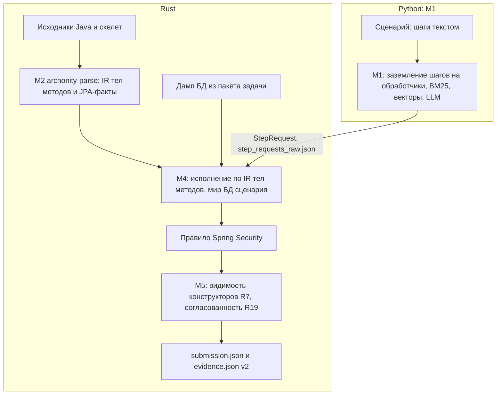

# Archonity

Статический анализатор для предсказания исполнения пользовательских сценариев в микросервисных проектах (бенчмарк Train Ticket, хакатон TechArena 2026).

По тексту сценария, исходникам сервисов и графу-скелету определяет:
- какие методы реально исполняются (`executes`),
- вызовы методов внутри сервиса (`calls`),
- межсервисные сетевые запросы (`remote`),
- SQL-обращения к таблицам базы данных (`data`).

Проект работает по принципу **Strict Local-First**:
- Только статический анализ — целевой микросервисный проект не запускается и не инструментируется в рантайме.
- Никаких внешних облачных API. Модели эмбеддингов и LLM работают локально. Их ответы на S0–S7 и наши сценарии закешированы в репозиторий: воспроизведение посылки идёт офлайн и без GPU. Новые сценарии требуют живой LLM — на A100 её поднимает `scripts/run_final.sh`.

**Анализ кода и построение ответа — на Rust** (`rust/`). Разбор исходников Java в IR тел методов и факты JPA (`archonity-parse`, tree-sitter), исполнение шагов по IR, правила фреймворка, проекция на рёбра и запись `submission.json` (`archonity-exec`) делают бинарники Rust. На Python остаётся M1: сопоставление текста шага с обработчиком через локальные модели (поиск, эмбеддер, LLM) и кеш их ответов. Граница — [ADR-008](docs/adr/adr-008_rust_engine_boundary.md) и [ADR-009](docs/adr/adr-009_archparse_rust.md). Финальный запуск `scripts/run_final.sh` идёт через Rust. Python-движок с той же выдачей байт в байт остаётся запасным: на него прогон переключается сам, если Rust не собрался или упал.

---

## Быстрый старт

### Требования
- Python 3.11+ (рекомендуется Python 3.13)
- Rust 1.99.1 (`rust/rust-toolchain.toml`) и компилятор C (`cc`/`gcc`, нужен tree-sitter). `scripts/run_final.sh` ставит Rust через `rustup` сам
- Java 17+ — только для `archparse`, Java-оракула разбора исходников; в запуске не участвует

### Установка зависимостей
```bash
pip install -r requirements.txt
```
или через `uv`:
```bash
uv sync --locked
```

Запуск на машине организаторов (Linux, A100 40 ГБ) одной командой: модели докачиваются по `models/manifest.json`, Rust собирается (`cargo build --release --locked`), `archonity-parse` строит IR из исходников, `llama-server` поднимается сам на первом промахе кеша. Подробно — [docs/run_on_a100.md](docs/run_on_a100.md).

```bash
scripts/run_final.sh <файлы сценариев>   # без аргументов — S0–S7
```

### Воспроизведение сабмишна

S0–S7 из кеша, без GPU и сервера LLM, через Rust:

```bash
cd rust && cargo build --release --locked && cd ..
python run_eval.py --engine rust --parse-sources -o output/submission.json
```

То же целиком на Python (запасной движок, выдача та же байт в байт):

```bash
python run_eval.py -o output/submission.json
```

Под Windows (PowerShell) для корректного UTF-8 вывода — `$env:PYTHONUTF8=1` перед командой.

Команда автоматически запустит официальный валидатор `evaluate_golden.py` на калибровочном сценарии S0 и выведет метрики IoU. Выдача совпадает с эталонным рекордом 1.00000 байт в байт: sha256 `94463c41a72c244fc548cbb52d009cff7c65f44ad5e682b7176a156cb66a5a08` ([eval/records/](eval/records/README.md)).

### Ресурсы прогона

Каждый прогон пишет рядом с выдачей `resources.json` и печатает итог (`engine/resources.py`):

```text
Ресурсы: всего 3.9 с (разбор исходников 0.6, сборка конвейера 0.6, M1 1.0, исполнение Rust 1.4, локальная оценка 0.1)
  память: пик 299 МиБ (процесс с дочерними: Rust, llama-server)
  видеопамять: не использовалась (нет nvidia-smi)
  LLM: из кеша 385, вызовов сервера 0 за 0.0 с, токенов 0 + 0
```

- время — по этапам `run_eval.py`;
- память — пик RSS всего дерева процессов: Python, бинарники Rust и `llama-server`. На Linux её опрашивает `/proc` раз в секунду, на других ОС — `getrusage`;
- видеопамять — опрос `nvidia-smi` раз в секунду: пик на каждой GPU, фон до старта и сумма по нашим процессам;
- LLM — сколько ответов взято из кеша, сколько вызовов сервера, их время и токены, время подъёма сервера.

`scripts/run_final.sh` дописывает в тот же файл время своих шагов (`run_final`: модели, сборка Rust, прогон) и печатает строку «Время команды». Раздел «Ресурсы» есть и в `report.html`. Пример выше — прогон S0–S7 из кеша в Linux-контейнере (amd64), без GPU.

### Проверка без кеша

Ответы LLM (`cache/llm/`) и векторы эмбеддера (`cache/emb/`) лежат в репозитории. Ключ каждого ответа — sha256 от имени модели, версии промпта, текста сообщений и JSON-схемы ответа, поэтому любая правка промпта в коде — промах кеша. В конце прогона печатается итог M1 (он же — `m1_report.json` рядом с выдачей):

```text
M1: режим full. Шагов 103: выбрано моделью 103, первым кандидатом поиска 0
    ответы LLM: из кеша 385, от сервера 0, без ответа 0, ошибок 0; промахов кеша векторов 0
```

Прогону S0–S7 нужно 385 ответов: голосование выбора останавливается, как только исход ясен, и ответ от этого не меняется ([ADR-005](docs/adr/adr-005_scenario_execution_pipeline.md), M1). Ещё в кеше — выборки полного голосования (`--select-early-stop off`) и ответы на наши сценарии `eval/` (раздел «Проверка обобщения»).

- `python run_eval.py --require-cache` — прогон только из кеша; код выхода 2, если хоть одного ответа LLM в кеше нет.
- `python scripts/verify_llm_cache.py` — проверка кеша без GPU: ключ каждой записи пересчитывается из записанных промпта, схемы и модели, ответ проверяется по схеме; затем прогон с `--require-cache` сверяет, что каждый запрос текущего кода к LLM найден в кеше. Итог: ответы записаны на промпты, которые строит текущий код. Что ответы дала модель, а не человек, доказывает только перепроверка с сервером LLM: `--recheck N` спрашивает N случайных записей заново и сравнивает ответы (на другом железе часть может отличаться).
- Без кеша и без сервера LLM прогон не падает, а идёт в режиме `emergency`: шаг сценария сопоставляется с первым кандидатом поиска (BM25), без параметров и ссылок от модели, итог печатается с предупреждением. Качество в этом режиме ниже: замер 20.10 — около 0.575 против 1.0. Основная потеря — выбор обработчика: верный есть среди кандидатов поиска в 99 шагах из 103, но выбрать его без модели не удаётся ([исследование](docs/researches/gpu_dependence_and_cpu_fallback_study.md), раздел 7).
- Пересобрать кеш: сервер `llama.cpp` с `Qwen3.6-35B-A3B-UD-IQ4_XS` (`scripts/start_llm.ps1`, видеокарта 16 ГБ), затем `python run_eval.py --no-cache`. На GPU 16 ГБ ответы `m1-v8` заняли около 32 минут (сумма времени ответов в кеше — 1923 с). С ранней остановкой голосования вызовов нужно меньше — около 21 минуты (1255 с); `--no-cache` пересчитывает только их. На другом железе ответы модели могут чуть отличаться.
- Без видеокарты — режим CPU: малая модель через `llama.cpp` на процессоре. Пример (Qwen3-4B Q4_K_M, нужно ~7 ГБ свободной памяти):

  ```powershell
  llama-server -m Qwen3-4B-Q4_K_M.gguf -t 4 -np 2 -c 12288 -fa off --cache-ram 2048 --port 8090
  $env:ARCHONITY_LLM_URL="http://127.0.0.1:8090"; $env:ARCHONITY_LLM_MODEL="Qwen3-4B-Q4_K_M"; $env:NO_PROXY="127.0.0.1,localhost"
  python run_eval.py --m1-index off --m1-top-k 5 --select-votes 0 --llm-timeout 900 --llm-cache output/llm_cpu -o output/submission.json
  ```

  Замер 21.10 на Ryzen 3 4300U (4 ядра): 2 часа, итог 0.614 против 1.0 из кеша и 0.575 без модели — малая модель выбирает обработчик хуже большой. Режим показывает, что код работает без GPU, но рекорд не воспроизводит ([исследование](docs/researches/gpu_dependence_and_cpu_fallback_study.md), разделы 7.5–7.6). `-fa off` на CPU вдвое ускоряет ответ модели; `NO_PROXY` нужен, если в системе задан прокси.

### Отчёт прогона

```bash
python scripts/report.py output/                         # output/report.html
python scripts/report.py output/ --compare output-py/    # и сверка файлов с другим прогоном (Rust и Python)
```

Один статический `report.html` без сервера: sha256 выдачи и совпадение с рекордом, режим M1, ответы и время LLM, сбои; IoU по видам рёбер против эталона S0 и рекорда платформы 1.0 на S1–S7 (формула `evaluate_golden.py`); точность выбора обработчика на своих сценариях по разметке `eval/own/steps.json`; по каждому шагу — текст, обработчик, голоса и объяснение модели, параметры и рёбра шага с правилом из `decisions.json` и ссылкой на строку кода. Выдачу не меняет.

### Проверка обобщения

Победителя определят закрытые сценарии, поэтому, кроме S0–S7, конвейер проверен на том, чего он не видел:

| Проверка | Что | Итог |
|---|---|---|
| [Перефразированные S0–S7](eval/paraphrase/README.md) | те же сценарии другими словами, эталон — рекорд | **0.899** против 1.0 на исходных текстах; полнота рёбер 1.00, потери только в точности. M1 top-1 — 92/103 |
| [Свои сценарии X1–X8](eval/own/README.md) | 83 шага на обработчики, которых нет в S1–S7, разметка по коду | M1 top-1 — 78/83; исход шага M4 совпал с разметкой в 68 из 83 |
| Перебор обработчиков | каждый из 262 обработчиков как одношаговый сценарий | исключений 0; Rust = Python ребро в ребро ([rust/README.md](rust/README.md)) |
| Нестандартный ввод | файл сценария не той формы: BOM, UTF-16, нет `id` или `action`, каталог вместо файлов | ответ строится; сбои — в рамке `ATTENTION.txt` ([run_on_a100.md](docs/run_on_a100.md)) |

Ответы LLM на перефразированные и свои сценарии лежат в `cache/`, их замеры воспроизводятся без GPU.

### Сборка архива для тестирующей системы (NSUTS)

```bash
python pack_submission.py
```

Скрипт соберёт `output/submission.zip`. В корне — `submission.json`, `evidence.json`, `RUN.md` с командами воспроизведения и `report.html` — отчёт прогона `output/` (ссылки на код ведут в `code/hackaton/`). В `code/` — всё для запуска из этого каталога: код (`run_eval.py`, `engine/`, исходники `rust/` без `target/` и `archparse/`), артефакты M2 (`data/`), кеши M1 (`cache/`), зависимости (`pyproject.toml`, `uv.lock`, `requirements.txt`), манифест моделей (`models/manifest.json`), скрипты запуска и отчёта (`scripts/run_final.sh`, `scripts/fetch_models.py`, `scripts/report.py`), рекорд `eval/records/` (оракул `cargo test`) и `docs/run_on_a100.md`. Модели и пакет организаторов в архив не входят. Текст — с LF, скрипты `.sh` — исполняемые.

---

## Архитектура решения

Пайплайн состоит из нескольких независимых модулей (подробнее см. [ADR-005](docs/adr/adr-005_scenario_execution_pipeline.md)):



- **M1 (Заземление шагов, Python, `engine/grounding/`):** сопоставляет шаги сценария на естественном языке с методами контроллеров через комбинацию BM25, эмбеддингов (`Qwen3-Embedding-4B`) и локальной MoE-LLM (`Qwen3.6-35B-A3B`, 3 млрд активных параметров). Промпт не содержит слов предметной области: описание домена и правила сервисов-близнецов строит сама модель по README, `context` скелета и коду UI (профиль проекта), виды сущностей для ссылок берутся из `@Entity` скелета ([ADR-007](docs/adr/adr-007_project_profile.md)). Все предсказания сохранены в `cache/` для мгновенного детерминированного воспроизведения. Шаги до правила R20 M1 пишет в `step_requests_raw.json` — вход `archonity-exec`.
- **M2 (Разбор исходников, Rust, `rust/crates/archonity-parse/`):** tree-sitter-java. Строит дерево операторов и вызовов методов в `ir/<module>.json` и факты о JPA-сущностях, связях и вызовах репозиториев в `entity_ir.json`. Результат байт в байт совпадает с Java-оракулом `archparse/` (JavaParser), по которому построены закоммиченные `data/ir/` и `data/entity_ir.json`.
- **M4 (Интерпретатор исполнения, Rust, `rust/crates/archonity-m4/`):** пошагово исполняет сценарий по IR. Вычисляет условия ветвлений (`if/else`, `switch`) по данным сценария, отслеживает вызовы и межсервисные переходы. Мир БД сценария — форк дампа из пакета задачи: записи, созданные шагом, видны следующим шагам.
- **Правило Spring Security (Rust, `archonity-exec`):** вход через `AuthenticationManager` достраивает по контракту фреймворка `loadUserByUsername`, фильтр запроса и методы `UserDetails` — их нет в коде проекта как вызовов.
- **M5 (Правила разметки и атрибуция, Rust, `archonity-exec`):** правило R20 (обработчик, который Spring вызвать не может), правила эталона ([annotation_rules.md](docs/annotation_rules.md)): видимость конструкторов ([ADR-006](docs/adr/adr-006_constructor_visibility.md)) и согласованность `executes` с рёбрами (R19); запись `submission.json`, `evidence.json`, `decisions.json`.

Python-движок (`engine/executor/`, `engine/spring_security.py`, `engine/projection.py`) — та же логика, запасной путь и оракул: выдача Rust совпадает с ним байт в байт на S0–S7, своих сценариях X1–X8 и на каждом из 262 обработчиков проекта как одношаговом сценарии ([rust/README.md](rust/README.md)).

---

## Навигация по репозиторию

- `run_eval.py` — главная точка входа пайплайна анализа.
- `pack_submission.py` — утилита сборки архива сдачи в NSUTS.
- `rust/` — анализ кода и построение ответа на Rust ([rust/README.md](rust/README.md)):
  - `archonity-parse` — разбор исходников Java (tree-sitter) в IR тел методов и `entity_ir.json`.
  - `archonity-m4` — интерпретатор IR, модель JDK и Spring, шаг сценария.
  - `archonity-exec` — бинарник: сценарии, R20, Spring Security, R19, M5, запись выдачи.
  - `archonity-io`, `archonity-model` — скелет, дамп БД, мир БД, форматы выдачи и `evidence.json`.
- `engine/` — M1 на Python и запасной Python-движок:
  - `engine/pipeline.py` — конвейер сценария: M1 → M4 → правило Spring Security → M5, пассажир сценария.
  - `engine/grounding/` — модуль заземления шагов M1 (`grounder.py`, `llm.py`, `embedder.py`).
  - `engine/executor/` — интерпретатор тел методов M4 на Python (`world.py`, `interpreter.py`, `step.py`).
  - `engine/spring_security.py` — правило фреймворка Spring Security.
  - `engine/projection.py` — проекция исполнения на рёбра эталона (M5, ADR-006).
  - `engine/adapters/` — адаптеры графа-скелета, снимка базы данных и формата выдачи.
  - `engine/entities.py` — JPA-сущности, таблицы и вызовы репозиториев из `data/entity_ir.json`.
  - `engine/rules.py` — режимы правил M4 и M5 (`RuntimeRules`); умолчания — конфигурация рекорда.
  - `engine/decisions.py`, `engine/evidence.py` — журнал решений и `evidence.json` v2.
  - `engine/scenario.py` — чтение файла сценария; `engine/attention.py` — рамка сбоев `ATTENTION.txt`; `engine/resources.py` — замер ресурсов.
- `archparse/` — Java-оракул разбора исходников (JavaParser): по нему построены `data/ir/` и `data/entity_ir.json`, `archonity-parse` воспроизводит их байт в байт:
  - `MethodIrWriter.java` — генерация структурного IR тел методов.
  - `EntityScanner.java` — сканер сущностей, таблиц и вызовов Spring Data.
  - `EnumResolver.java` — динамический резолвер констант перечислений.
  - `SkeletonGraph.java` — зависимости модулей из рёбер `depends_on` скелета.
- `data/` — артефакты M2 (`data/ir/`, `data/entity_ir.json`) и каталог UI (`data/ui_catalog.json`).
- `cache/` — кеши ответов LLM (`cache/llm/`) и векторов эмбеддера (`cache/emb/`).
- `models/manifest.json` — версии и sha256 LLM, эмбеддера и сборки `llama.cpp`; сами модели качает `scripts/fetch_models.py`.
- `scripts/run_final.sh` — финальный запуск на A100; `scripts/start_llm.*` — ручной запуск `llama-server`; `scripts/report.py` — отчёт прогона `report.html`.
- `eval/` — проверки качества: рекорд (`records/`), перефразированные S0–S7 (`paraphrase/`), свои сценарии с разметкой (`own/`), эталон выбора M1 (`m1_steps.json`).
- `facts/configs_topology.json` — топология развёртывания: имя шлюза для `evidence.json`.
- `docs/` — документация проекта:
  - `docs/roadmap.md` — текущий статус, прогресс и таблица посылок.
  - `docs/annotation_rules.md` — правила разметки графа и сопоставления рёбер.
  - `docs/environment_guide.md` — тонкости запуска и окружения (Windows/Linux).
  - `docs/adr/` — архитектурные решения (ADR-005 — ADR-009).
  - `docs/researches/` — исследовательские отчеты и логи гипотез.
- `tests/` — модульные, контрактные и регрессионные тесты движка.

---

## Тестирование

Запуск тестов движка:
```bash
pytest tests/
```

Тесты Rust. `cargo test` сам проверяет паритет с закоммиченными оракулами: `archonity-parse` = `data/ir/` и `data/entity_ir.json`, `archonity-exec` по шагам M1 S0–S7 = рекорд `eval/records/` байт в байт ([rust/README.md](rust/README.md), «Тесты Rust»). Паритет с Python — в pytest: `tests/test_rust_engine.py` (выдача `--engine rust` = Python на S0–S7) и `tests/test_rust_parse.py`, без собранных бинарников они пропускаются:
```bash
cd rust && cargo test --release --locked && cargo build --release --locked && cd ..
pytest tests/test_rust_engine.py tests/test_rust_parse.py
```

Запуск тестов Java-парсера `archparse`:
```bash
cd archparse
./gradlew test        # Linux/macOS
cmd /c gradlew.bat test  # Windows
```
