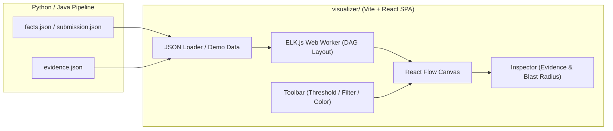

# ADR-002: Архитектура интерактивного визуализатора графа на React Flow

## Статус
Принято (по результатам командного обсуждения и grill-me).

## Контекст
В рамках проекта [Archonity](AGENTS.md) для бенчмарка Train Ticket (40+ микросервисов) требуется инструмент визуализации восстановленного графа зависимостей.
Визуализатор решает две ключевые задачи:
1. Внутренняя отладка и поиск аномалий (изолированные вершины, ложные кластеры, калибровка порога уверенности ML).
2. Демонстрация жюри (Killer Feature): интерактивное доказательство статического анализа через Evidence Log и наглядный расчет Blast Radius.

Сравнение альтернатив проведено в [graph_visualization_options.md](graph_visualization_options.md). Выбран стек на базе **React Flow (xyflow)**.

---

## Принятые решения

### 1. Архитектура и среда исполнения
- **Тип приложения:** автономный Single Page Application (SPA) на базе Vite + React + TypeScript.
- **Расположение в репозитории:** директория `visualizer/` в корне проекта.
- **Local-First интеграция:** клиент не требует отдельного бэкенд-сервера. Данные (`submission.json`, `evidence.json`, `facts.json`) загружаются через интерфейс drag-and-drop или открываются локально.
- **Демо-режим:** при первом открытии в приложение сразу зашит демонстрационный срез графа Train Ticket для мгновенного показа без предварительной генерации файлов.

### 2. Движок раскладки (Layout)
- **Библиотека:** `elkjs` (Eclipse Layout Kernel для JavaScript).
- **Исполнение:** вычисления производятся в фоновом Web Worker на стороне клиента.
- **Обоснование:** нативная поддержка иерархических DAG-структур и compound-узлов (вложенные группы). Фоновый поток исключает фризы UI при пересчете координат для сотен вершин.

### 3. Гранулярность узлов
- **Двухуровневая модель:**
  - *Макро-уровень (по умолчанию):* отображаются только сервисы, очереди сообщений и хранилища БД.
  - *Микро-уровень (раскрытие по клику):* узел сервиса разворачивается в compound-контейнер, содержащий список эндпоинтов (`inbound_endpoints`), DTO-моделей и прямых обращений к БД.

### 4. Компоновка интерфейса
- **Плавающий тулбар:**
  - Слайдер порога уверенности ML-модели ($p_{\text{threshold}}$) с отсечением ребер в реальном времени.
  - Фильтры по типам источников (`AST_EXACT`, `CONFIG`, `ML_PREDICTED`, `TRANSITIVE`).
  - Переключатель цветовых схем («По источникам данных» vs «По протоколам связи»).
  - Поиск по имени сервиса, эндпоинта или таблицы.
- **Правый сайдбар (Инспектор):**
  - При клике на ребро: показ записи из `evidence.json` (тип источника, файл, строка, сниппет кода или признаки модели).
  - При клике на узел: панель **Blast Radius** с метриками и подсветкой всех прямо и косвенно зависимых сервисов.

### 5. Стилизация
- Чистый CSS / CSS Modules (Vanilla CSS).
- Без тяжелых утилитных библиотек для сохранения полного контроля над анимациями ребер и стилями кастомных узлов.

---

## Архитектурная схема взаимодействия

---

## Последствия

### Положительные
- Нулевая связанность фронтенда с runtime-средой Python или Java.
- Высокая интерактивность и эстетика для защиты перед жюри.
- Возможность запустить визуализатор простым `npm run dev` или открыть статический билд.

### Риски и ограничения
- Необходимость реализовать мост между сырыми ребрами и форматом графа ELK.js (решается отдельным модулем трансформации `graphAdapter.ts`).
- Потребуется аккуратная настройка отступов и размеров compound-узлов в ELK.js, чтобы исключить наложение ребер при разворачивании сервисов.
