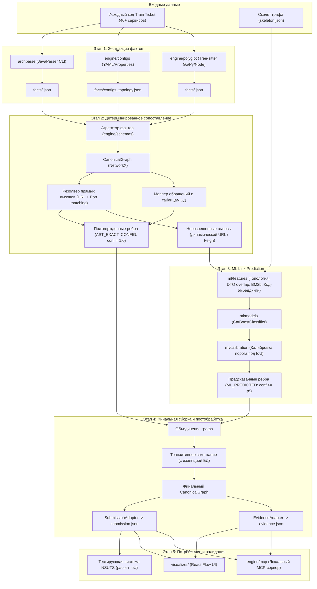
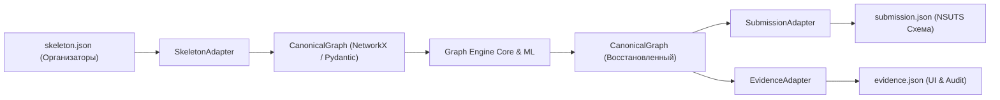

# ADR-001: Архитектура системы Archonity и межмодульные контракты данных

> **Устарело.** Заменено [ADR-005](adr-005_scenario_execution_pipeline.md) 16.10: задача — исполнение сценария, а не глобальный граф сервисов. Хранится для истории.

## Статус
Заменено [ADR-005](adr-005_scenario_execution_pipeline.md) 16.10.2026.

Живо: Local-First, запрет рантайма, слой адаптеров к форматам организаторов, `evidence.json` по ключу ребра (формат обновлён в ADR-005). Контракт `facts.json` и граф уровня сервисов не используются.

## Контекст
В рамках проекта [Archonity](../../AGENTS.md) для участия в TechArena 2026 (бенчмарк Train Ticket, 40+ микросервисов) требуется восстановить ориентированный типизированный граф runtime-зависимостей с достижением максимальной метрики **IoU (Intersection over Union)**:

$$\text{IoU} = \frac{|E_{\text{pred}} \cap E_{\text{gold}}|}{|E_{\text{pred}} \cup E_{\text{gold}}|} = \frac{TP}{TP + FP + FN}$$

### Ограничения и инженерные вызовы
1. **Строгий Local-First:** все вычисления, модели и парсеры работают локально без обращения к внешним облачным API.
2. **Многоязычность и гетерогенность:** основное ядро сервисов написано на Java 21 / Spring Boot, вспомогательные микросервисы — на Go, Python и Node.js, инфраструктура — в Docker Compose и Spring Cloud.
3. **Параллельная разработка в команде из трёх инженеров:**
   - Паша (@Pavelgrr7): детерминированный синтаксический анализ Java/Spring.
   - Миша (@vocisyy): ML-модели Link Prediction и калибровка порога IoU.
   - Денис (@ischademadda): архитектура, конфиги, полиглот-сервисы, графовое ядро и фронтенд-визуализатор.
4. **Неопределенность схемы организаторов:** официальная JSON-схема скелета и итоговой отправки публикуется позже, поэтому ядро системы не должно зависеть от формата тестирующей системы (NSUTS).
5. **Фильтрация мертвого кода и правила БД:** в эталон Golden Set входят только связи, достижимые из публичных точек входа; обращения разных микросервисов к одной таблице БД образуют независимые ребра от сервисов к таблице.
6. **Обязательная трассируемость (Evidence Log):** каждое ребро обязано сопровождаться проверяемой записью источника (`AST_EXACT`, `CONFIG`, `ML_PREDICTED`, `TRANSITIVE`) с указанием файла и номера строки.

Для предотвращения хаоса интеграции и дублирования работы утверждается архитектура монорепозитория и типизированные межмодульные контракты данных.

---

## Принятые решения

### 1. Архитектура монорепозитория и границы модулей
Проект организуется как монорепозиторий со строгим разделением зон ответственности и языковых стеков:

```text
archonity/
├── archparse/              # Детерминированный парсер Spring (Java 21, Gradle, JavaParser)
│   ├── src/main/java/      # Экстракция Inbound/Outbound/DB, Call Graph, отсев мертвого кода
│   └── build.gradle
├── engine/                 # Ядро сборки графа и оркестрации (Python 3.11+, менеджер uv)
│   ├── configs/            # Парсинг application.yml, docker-compose.yml, env vars
│   ├── polyglot/           # Tree-sitter парсеры для сервисов на Go, Python, Node.js
│   ├── graph/              # NetworkX ядро: матчинг эндпоинтов, reachability, транзитивность
│   ├── evidence/           # Валидация и генерация evidence.json
│   ├── adapters/           # Адаптеры входного skeleton.json и выходного submission.json
│   ├── mcp/                # Локальный MCP-сервер для ИИ-агентов (blast radius, explain)
│   ├── schemas/            # Pydantic v2 модели контрактов facts, evidence, canonical graph
│   ├── cli.py              # Единый CLI-раннер пайплайна (archonity run, build-graph)
│   └── pyproject.toml
├── ml/                     # Модуль предсказания связей (Python, CatBoost, Transformers)
│   ├── features/           # Извлечение признаков (эмбеддинги UniXcoder, DTO overlap, BM25)
│   ├── models/             # Обучение и инференс CatBoostClassifier
│   └── calibration/        # Калибровка вероятностного порога под максимум IoU (Optuna)
├── visualizer/             # Автономный SPA-визуализатор (Vite, React Flow, TypeScript, elkjs)
├── docs/                   # Документация, RFC, ADR, паспорта задач
│   ├── rfc/                # Проектные предложения
│   ├── adr/                # Принятые архитектурные решения (ADR-001, ADR-002, ADR-003, ADR-004)
│   └── open-questions.md   # Открытые вопросы и альтернативы
└── data/                   # Данные и бенчмарк Train Ticket
```

---

### 2. Сквозной поток данных (Data Flow)

Пайплайн делится на 5 последовательных этапов:



---

### 3. Контракт синтаксических фактов (`facts/<service_name>.json`)

#### 3.1. Принцип изоляции файлов фактов
Каждый анализатор сервиса генерирует результат в изолированный JSON-файл: `facts/<service_name>.json`. Это обеспечивает:
- Независимый параллельный запуск экстракции.
- Устойчивость к сбоям: синтаксическая ошибка в одном сервисе не блокирует сборку остальных.
- Кеширование результатов при повторных запусках.

#### 3.2. Типизированная схема сервисных фактов
Спецификация описывается моделями Pydantic v2 в `engine/schemas/facts.py`:

```json
{
  "$schema": "https://json-schema.org/draft/2020-12/schema",
  "service_name": "ts-travel-service",
  "language": "java",
  "framework": "spring-boot",
  "repo_path": "data/train-ticket/ts-travel-service",
  "service_metadata": {
    "server_port": 12346,
    "context_path": "/api/v1/travelservice",
    "env_vars": {
      "ORDER_SERVICE_HOST": "ts-order-service",
      "SEAT_SERVICE_PORT": "18898"
    }
  },
  "inbound_endpoints": [
    {
      "id": "ts-travel-service:GET:/api/v1/travelservice/routes",
      "path": "/api/v1/travelservice/routes",
      "http_method": "GET",
      "handler_class": "travel.controller.TravelController",
      "handler_method": "getRoutes",
      "file_path": "src/main/java/travel/controller/TravelController.java",
      "line_number": 42,
      "request_dto": {
        "class_name": "travel.entity.TripInfo",
        "fields": [
          {"name": "startPlace", "type": "String"},
          {"name": "endPlace", "type": "String"},
          {"name": "departureTime", "type": "Date"}
        ]
      },
      "response_dto": {
        "class_name": "travel.entity.TravelResult",
        "fields": [
          {"name": "status", "type": "boolean"},
          {"name": "message", "type": "String"},
          {"name": "routes", "type": "List<Route>"}
        ]
      }
    }
  ],
  "outbound_calls": [
    {
      "id": "ts-travel-service:CALL:ts-seat-service:querySeat",
      "client_type": "REST_TEMPLATE",
      "target_service_hint": "ts-seat-service",
      "target_url_template": "http://ts-seat-service:18898/api/v1/seatservice/seat",
      "raw_expression": "getServiceUrl(\"ts-seat-service\") + \"/api/v1/seatservice/seat\"",
      "http_method": "POST",
      "caller_class": "travel.service.TravelServiceImpl",
      "caller_method": "querySeat",
      "file_path": "src/main/java/travel/service/TravelServiceImpl.java",
      "line_number": 115,
      "is_reachable": true,
      "call_chain": [
        "travel.controller.TravelController.getRoutes",
        "travel.service.TravelServiceImpl.querySeat"
      ],
      "request_dto": {
        "class_name": "travel.entity.SeatQuery",
        "fields": [
          {"name": "tripId", "type": "String"},
          {"name": "seatType", "type": "int"}
        ]
      },
      "response_dto": {
        "class_name": "travel.entity.SeatResult",
        "fields": [
          {"name": "available", "type": "boolean"}
        ]
      },
      "code_snippet": "restTemplate.postForObject(seatServiceUrl + \"/seat\", query, SeatResult.class)"
    }
  ],
  "db_access": [
    {
      "id": "ts-travel-service:DB:trip",
      "table_name": "trip",
      "db_type": "MYSQL",
      "operation": "READ_WRITE",
      "entity_class": "travel.entity.Trip",
      "caller_class": "travel.repository.TripRepository",
      "caller_method": "findByTripId",
      "file_path": "src/main/java/travel/repository/TripRepository.java",
      "line_number": 28,
      "is_reachable": true,
      "call_chain": [
        "travel.controller.TravelController.getRoutes",
        "travel.service.TravelServiceImpl.getRoutes",
        "travel.repository.TripRepository.findByTripId"
      ]
    }
  ],
  "messaging": [
    {
      "id": "ts-travel-service:MQ:order_queue",
      "broker": "RABBITMQ",
      "role": "PRODUCER",
      "destination": "order_queue",
      "routing_key": "order.create",
      "caller_class": "travel.service.TravelServiceImpl",
      "caller_method": "notifyOrder",
      "file_path": "src/main/java/travel/service/TravelServiceImpl.java",
      "line_number": 154,
      "is_reachable": true,
      "call_chain": [
        "travel.controller.TravelController.getRoutes",
        "travel.service.TravelServiceImpl.notifyOrder"
      ]
    }
  ]
}
```

---

### 4. Обязанности статического парсера Java (`archparse`)
1. **Внутрисервисный Call Graph:** синтаксический анализ вызовов методов внутри одного микросервиса.
2. **Анализ достижимости (Reachability):** поиск пути обходом в глубину (DFS) от публичных точек входа (`@RestController`, `@RabbitListener`, `@Scheduled`).
3. **Отсев мертвого кода:** простановка булева флага `is_reachable: true/false` и сохранение цепочки методов `call_chain`.
4. **Контекст для ML:** при невозможности детерминированного сворачивания констант парсер сохраняет сырую строковую инструкцию `raw_expression`, сниппет кода и DTO для ML-модуля.

---

### 5. Спецификация Evidence Log (`evidence.json`)

`evidence.json` обеспечивает 100% проверяемость каждого добавленного ребра для жюри и интерактивного инспектора визуализатора ([ADR-002](adr-002_react_flow_visualizer.md)).

#### 5.1. Источники связей (`source_type`)
- `AST_EXACT`: прямое соответствие из статического анализа кода (confidence = 1.0).
- `CONFIG`: связь из конфигураций топологии (`docker-compose.yml`, `application.yml`, confidence = 1.0).
- `ML_PREDICTED`: связь предсказана моделью CatBoost на основе мультимодальных признаков ($p \ge p^*$, см. [ADR-003](adr-003_multimodal_ai_architecture.md)).
- `TRANSITIVE`: связь выведена алгоритмом транзитивного замыкания ($A \to B \to C \implies A \to C$).

#### 5.2. Структура записи
Формат организован в виде словаря по `edge_id` (Вариант 1 из `open-questions.md`, обеспечивает доступ за $O(1)$ при клике в визуализаторе):

```json
{
  "ts-travel-service->ts-seat-service:REST_HTTP": {
    "edge_id": "ts-travel-service->ts-seat-service:REST_HTTP",
    "source": "ts-travel-service",
    "target": "ts-seat-service",
    "relation_type": "REST_HTTP",
    "source_type": "AST_EXACT",
    "confidence": 1.0,
    "evidence_details": {
      "file_path": "src/main/java/travel/service/TravelServiceImpl.java",
      "line_number": 115,
      "caller": "travel.service.TravelServiceImpl.querySeat",
      "matched_endpoint": "POST /api/v1/seatservice/seat",
      "call_chain": [
        "travel.controller.TravelController.getRoutes",
        "travel.service.TravelServiceImpl.querySeat"
      ],
      "code_snippet": "restTemplate.postForObject(seatServiceUrl + \"/seat\", query, SeatResult.class)"
    }
  },
  "ts-order-service->ts-inside-payment-service:REST_HTTP": {
    "edge_id": "ts-order-service->ts-inside-payment-service:REST_HTTP",
    "source": "ts-order-service",
    "target": "ts-inside-payment-service",
    "relation_type": "REST_HTTP",
    "source_type": "ML_PREDICTED",
    "confidence": 0.874,
    "evidence_details": {
      "model_name": "CatBoost_LinkPredictor_v1",
      "threshold": 0.730,
      "top_features": {
        "jina_code_similarity": 0.892,
        "dto_field_overlap_jaccard": 0.750,
        "bm25_token_similarity": 0.814,
        "hits_product": 0.420
      }
    }
  }
}
```

---

### 6. Каноническая модель графа (`CanonicalGraph`) и изоляция через адаптеры

Для защиты пайплайна от изменений формата тестирующей системы организаторов вводится каноническая внутренняя модель:



- Любые изменения внешней схемы организаторов локализуются в файлах адаптеров (`SkeletonAdapter.py`, `SubmissionAdapter.py`) и не затрагивают аналитическое ядро.
- `CanonicalGraph` основан на `networkx.DiGraph` с типизированными атрибутами вершин и рёбер.

---

### 7. Матрица обязанностей и этапы реализации

| Этап | Задача | Ответственный | Модуль | Результат |
|:---|:---|:---|:---|:---|
| 1 | Экстракция `facts/<service>.json` с Call Graph | Паша (@Pavelgrr7) | `archparse/` | Валидные JSON-факты по сервисам Train Ticket |
| 2 | Pydantic v2 схемы контрактов и агрегатор фактов | Денис (@ischademadda) | `engine/schemas/` | Типизированные структуры данных, автотесты схем |
| 3 | Парсинг `docker-compose.yml`, `application.yml` | Денис (@ischademadda) | `engine/configs/` | `facts/configs_topology.json` |
| 4 | Извлечение мультимодальных признаков пар | Миша (@vocisyy) | `ml/features/` | Векторы признаков пар (эмбеддинги, DTO, BM25, HITS) |
| 5 | NetworkX Graph Engine (детерминированный матчинг) | Денис (@ischademadda) | `engine/graph/` | Базовый граф `confirmed_edges` (conf = 1.0) |
| 6 | Обучение CatBoost и калибровка порога под $\text{IoU}$ | Миша (@vocisyy) | `ml/models/` | `predicted_edges.json`, калибровка порога $p^*$ |
| 7 | Сборка графа, транзитивное замыкание, экспорт | Денис (@ischademadda) | `engine/` | `submission.json`, `evidence.json` |
| 8 | Интеграция с React Flow Visualizer | Денис (@ischademadda) | `visualizer/` | Интерактивный UI с инспектором доказательств |

---

## Последствия

### Положительные
1. **Нулевые интеграционные блокировки:** участники команды работают параллельно в независимых модулях (`archparse/`, `engine/`, `ml/`), соблюдая зафиксированные Pydantic-контракты.
2. **Изоляция от внешних изменений:** схема организаторов изолирована слоем адаптеров.
3. **Строгая трассируемость:** Evidence Log формируется программно на всех этапах конвейера.
4. **Защита от мертвого кода:** фильтрация недостижимых вызовов на уровне парсера снижает объем шума для ML-модуля и максимизирует целевой IoU.

### Риски и митигации
1. **Риск рассинхронизации схем Java и Python:**
   * *Митигация:* фиксация JSON Schema (`facts.schema.json`) и юнит-тесты валидации вывода JavaParser через Pydantic v2 в CI.
2. **Риск ошибок в динамических URL на полиглот-сервисах:**
   * *Митигация:* направление неразрешенных полиглот-вызовов в общий пул кандидатов для мультимодального бустинга и точечной LLM.
