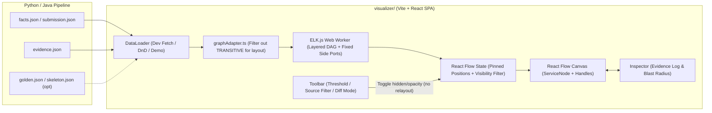

# ADR-002: Архитектура интерактивного визуализатора графа на React Flow

## Статус
Принято (по результатам командного обсуждения и grill-me).

## Контекст
В рамках проекта [Archonity](AGENTS.md) для бенчмарка Train Ticket (40+ микросервисов) требуется инструмент визуализации восстановленного графа зависимостей.
Визуализатор решает две задачи:
1. **Инженерная отладка пайплайна:** поиск аномалий (изолированные вершины, мертвые кластеры), сверка с эталоном ($TP / FP / FN$) и калибровка порога уверенности ML-модели ($p_{\text{threshold}}$).
2. **Демонстрация жюри (Killer Feature):** интерактивное доказательство легитимности каждого найденного ребра через `evidence.json` и наглядный расчет радиуса поражения (**Blast Radius**).

Сравнение альтернатив проведено в [graph_visualization_options.md](graph_visualization_options.md). Выбран стек на базе **React Flow (`@xyflow/react`)**.

---

## Принятые решения

### 1. Архитектура, среда исполнения и загрузка данных
- **Тип приложения:** автономный Single Page Application (SPA) на базе Vite + React + TypeScript в директории `visualizer/`.
- **Local-First (без бэкенда):** приложение работает полностью на клиенте и не зависит от runtime-окружения Python или Java.
- **Трехрежимный загрузчик данных (`DataLoader`):**
  1. *Dev-режим:* автоматический `fetch` свежих артефактов (`submission.json`, `evidence.json`, `facts.json`) из локальной выходной папки пайплайна по кнопке `Reload` (исключает рутинный переброс файлов при частых итерациях).
  2. *Drag-and-Drop:* загрузка произвольных JSON-срезов через UI, включая опциональный слот для `skeleton.json` / `golden.json`.
  3. *Демо-режим:* в сборку вшит предрассчитанный срез графа Train Ticket, который открывается мгновенно при первом запуске без внешних файлов.

### 2. Движок раскладки (Layout) и стабильность геометрии
- **Библиотека:** `elkjs` (алгоритм `layered`), вынесенный в фоновый Web Worker для предотвращения блокировки UI-потока.
- **Фиксация координат (Layout Pinning):** расчет геометрии в `ELK.js` жестко отделен от фильтрации. Пересчет позиций узлов запускается только при смене датасета или раскрытии карточки сервиса. Движение слайдера $p_{\text{threshold}}$ и переключение чекбоксов фильтров меняют только свойства видимости (`hidden` / `opacity`) ребер в стейте React Flow, чтобы граф не «прыгал» по экрану во время анализа.
- **Исключение транзитивных ребер из раскладки:** ребра типа `TRANSITIVE` не передаются в `ELK.js` при построении слоев DAG, чтобы не ломать иерархию прямых вызовов. Они рендерятся поверх готовой сетки только при выборе узла в режиме **Blast Radius** или при явном включении фильтра.

### 3. Гранулярность узлов и реализация Микро-уровня
- **Макро-уровень (по умолчанию):** на канве отображаются микросервисы, брокеры сообщений и таблицы/коллекции БД.
- **Микро-уровень (раскрытие по клику без sub-flows):** вместо создания вложенных дочерних React Flow-узлов (требующих тяжелого двухпроходного замера DOM-габаритов), сервис реализован как единый кастомный узел (`ServiceNode`). При раскрытии внутри карточки рендерится компактная таблица эндпоинтов (`inbound_endpoints`), DTO и обращений к БД, а ребра привязываются к конкретным строкам через боковые порты `<Handle id={endpointId} />` с настройкой `elk.portConstraints: 'FIXED_SIDE'`.

### 4. Компоновка интерфейса и сценарии анализа
- **Верхняя панель инструментов (Toolbar):**
  - Слайдер порога уверенности ML ($p_{\text{threshold}}$) с отсечением ребер в реальном времени и пересчетом счетчика активных связей (и метрики IoU при загруженном эталоне).
  - Фильтры по источникам происхождения: `AST_EXACT`, `CONFIG`, `ML_PREDICTED`, `TRANSITIVE`.
  - Переключатель режимов раскраски:
    - *By Source:* цвета по источнику ребра (`AST` / `Config` / `ML`).
    - *By Protocol:* цвета по типу взаимодействия (`HTTP` / `DB` / `MQ`).
    - *Diff Mode:* визуальное сравнение со скелетом или обучающим Golden Set (`True Positive` — сплошной зеленый, `False Positive` — красный пунктир, `False Negative` — фиолетовый пунктир).
  - Поиск по имени сервиса, URL эндпоинта или таблице БД с автоматическим наведением камеры (`fitView`).
- **Правый сайдбар (Inspector):**
  - *При выборе ребра (Evidence View):* вывод карточки доказательства из `evidence.json` (правило экстрактора, точный путь к файлу и номер строки, сниппет кода, вероятность модели $p$ и вектор топ-признаков).
  - *При выборе узла (Blast Radius View):* подсветка цепочки прямых и косвенных зависимостей ($A \to B \to C$), которые будут затронуты при изменении или отказе выбранного узла, со списком задетых сервисов.

### 5. Стилизация
- Чистый CSS / CSS Modules (Vanilla CSS) без тяжелых UI-комбайнов.
- Строгое соответствие спецификации `DESIGN.md`: светлая инженерная тема, табличная верстка инспектора, моноширинные шрифты для путей и метрик (`tabular-nums`), сплошные рамки `1px`, отсутствие размытий (`backdrop-filter: none`) и нулевые скругления (`border-radius: 0px`)[cite: 1].

---

## Архитектурная схема взаимодействия

---

## Последствия

### Положительные
- Нулевая связность фронтенда с бэкенд-пайплайном, мгновенный старт из коробки за счет вшитого демо-среза.
- Отсутствие визуальных скачков графа при настройке порога $p_{\text{threshold}}$ и фильтрации источников.
- Избавление от багов с расчетом размеров вложенных графов за счет замены compound-узлов на карточки с фиксированными боковыми портами (`FIXED_SIDE`).
- Прямая поддержка цикла Error Analysis через режим визуального Diff ($TP/FP/FN$).

### Риски и ограничения
- Необходимость аккуратной реализации маппера `graphAdapter.ts`, который конвертирует сырые JSON-артефакты в формат портов `ELK.js` и обратно в координаты узлов React Flow.
- При одновременном раскрытии более 15–20 карточек сервисов с десятками эндпоинтов плотность портов может перегрузить экран — решается кнопкой быстрого сворачивания всех узлов (`Collapse All`) в тулбаре.