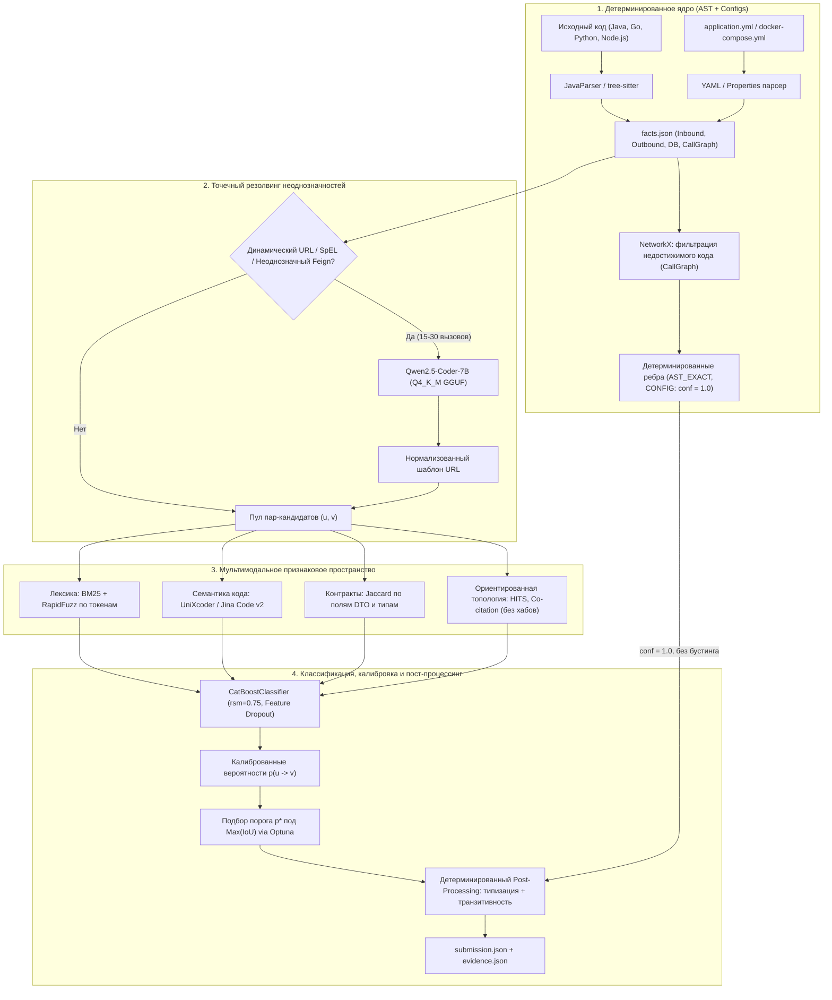

# ADR-003: Архитектура мультимодального ML-пайплайна восстановления графа (Compound AI Pipeline)

> **Устарело.** Заменено [ADR-005](adr-005_scenario_execution_pipeline.md) 16.10: задача — исполнение сценария, а не глобальный граф сервисов. Хранится для истории.

## Статус
Заменено [ADR-005](adr-005_scenario_execution_pipeline.md) 16.10.2026.

Живо: детерминированное ядро как основной источник рёбер, LLM только для неоднозначностей, вывод LLM по JSON-схеме. CatBoost, эмбеддинги, HITS и транзитивное замыкание не используются.

## Контекст
В рамках проекта [Archonity](../../AGENTS.md) для бенчмарка Train Ticket (40+ микросервисов) требуется восстановить семантический граф runtime-зависимостей по исходному коду и конфигурациям. 
Целевая метрика соревнования — **IoU (Intersection over Union)** по направленным типизированным рёбрам:

$$\text{IoU} = \frac{|E_{\text{pred}} \cap E_{\text{gold}}|}{|E_{\text{pred}} \cup E_{\text{gold}}|} = \frac{TP}{TP + FP + FN}$$

### Ограничения задачи
1. **Strict Local-First:** запрещены любые внешние облачные API. Все модели и алгоритмы обязаны работать локально.
2. **Асимметрия штрафов IoU:** любой False Positive ($FP$) увеличивает знаменатель дроби и резко снижает финальный балл.
3. **Объяснимость (Evidence Log):** каждое ребро графа обязано сопровождаться записью в `evidence.json` со ссылкой на исходный файл, строку и источник (`AST_EXACT`, `CONFIG`, `ML_PREDICTED`, `TRANSITIVE`).
4. **Фильтрация мертвого кода (Dead Code Elimination):** в Golden Set входят только связи, достижимые из публичных точек входа (контроллеры, слушатели очередей, cron-задачи).
5. **Правило баз данных:** обращения разных сервисов к одной таблице БД формируют независимые ребра от сервисов к таблице. Таблицы являются терминальными узлами.

### Почему монолитная LLM отклонена
Использование единой большой LLM (7B–14B) в качестве ядра пайплайна отклонено по следующим причинам:
- Склонность к предметным галлюцинациям ($FP$), которые невозможно откалибровать скалярным порогом.
- Неспособность детерминированно выдавать точные номера строк в распределенной кодовой базе из сотен файлов.
- Невозможность надежного межпроцедурного анализа достижимости (Call Graph reachability) в контекстном окне.
- Высокие ресурсные затраты: прогон декартова произведения пар сервисов ($40 \times 40 = 1600$) занимает десятки минут инференса на GPU.

Вместо монолитной модели принята архитектура **Compound AI**: ансамбль специализированных компактных моделей и детерминированных алгоритмов.

---

## Принятые решения

### 1. Архитектура Compound AI и разделение ответственности
Пайплайн делится на 5 специализированных слоев:
1. **Детерминированное ядро (AST + Configs):** извлечение фактов из Java/Spring (`JavaParser`), полиглот-сервисов (`tree-sitter`) и конфигураций (`application.yml`, `docker-compose.yml`) в единый формат `facts.json`.
2. **Графовая достижимость (Dead Code Elimination):** обход внутрисервисного графа вызовов через `NetworkX` от публичных точек входа. Вызовы из мертвого кода отсекаются до этапа ML.
3. **Точечный резолвинг динамических путей (Local LLM):** вызов компактной кодовой LLM строго для сложных неразрешенных выражений (SpEL, тернарные операторы, динамическая сборка URL).
4. **Мультимодальное признаковое пространство:** параллельное извлечение лексических признаков (BM25, RapidFuzz), семантики кода (кодовые эмбеддинги), структуры контрактов (Jaccard DTO) и ориентированной топологии скелета.
5. **Табличный классификатор и калибровка порога:** градиентный бустинг (`CatBoostClassifier`) с регуляризацией через Feature Dropout и прямым подбором порога $p^*$ под максимум IoU.
6. **Детерминированный пост-процессинг:** типизация ребер по AST-клиентам, безопасное транзитивное замыкание и изоляция узлов БД.

---

### 2. Слой эмбеддингов кода (Code Embeddings)
Для сопоставления вызывающих методов и контроллеров-кандидатов утвержден двухэтапный подход:
- **Базовый энкодер:** `microsoft/unixcoder-base` (125M параметров, контекст 512 токенов, лицензия MIT). Обеспечивает ультрабыстрый инференс (5–10 мс/батч на CPU) и стабильное кодирование сигнатур методов.
- **Энкодер расширенного контекста:** `jinaai/jina-embeddings-v2-base-code` (161M параметров, контекст 8192 токена, лицензия Apache 2.0). Применяется для классов контроллеров с разветвленной структурой DTO, не помещающихся в стандартное окно 512 токенов.

---

### 3. Точечный резолвинг динамических выражений (Компактная LLM)
- **Модель:** `Qwen2.5-Coder-7B-Instruct` в 4-битном квантовании `Q4_K_M` GGUF.
- **Среда инференса:** `llama-cpp-python` / `ollama` локально на GPU.
- **Условия вызова:** привлекается строго точечно (не более 15–30 вызовов на весь Train Ticket) исключительно при невозможности статического Constant Propagation в AST.
- **Ограничение выхода:** режим Grammar-based JSON sampling (Structured Outputs) со строгой схемой:
  ```json
  {
    "resolved_url_pattern": "/api/v1/travelservice/trips/{tripId}",
    "http_method": "GET",
    "confidence": 0.95
  }
  ```

---

### 4. Лексическое сопоставление и контракты DTO
- **Декомпозиция токенов:** разделение CamelCase и kebab-case с фильтрацией системных стоп-слов (`get`, `by`, `for`, `service`, `controller`).
- **BM25 (`rank_bm25`):** вычисление лексической релевантности между токенами исходящего вызова и реестром эндпоинтов.
- **RapidFuzz (Jaro-Winkler):** нечеткое выравнивание путей URL, устойчивое к вариациям версионирования (`/v1/` vs `/v2/`).
- **Сравнение схем DTO:** коэффициент Жаккара по нормализованным именам полей входных и выходных структур данных.

---

### 5. Ориентированные топологические признаки (Graph Topology)
Тяжелые графовые нейросети (GNN: R-GCN, GAT) **отклонены** из-за неизбежного переобучения на графе малого масштаба (~40–50 узлов, ~100–200 ребер скелета).
Вместо GNN топология ориентированного графа (`nx.DiGraph`) кодируется через детерминированные метрики `NetworkX`:

1. **Изоляция инфраструктурных хабов:** узлы Service Discovery (`ts-eureka-service`), конфигураций (`ts-config-service`), брокера сообщений (`rabbitmq`) и трейсинга (`zipkin`) временно исключаются из скелета при расчете метрик окрестности во избежание ложных коротких замыканий.
2. **Метрики HITS (`nx.hits`):**
   - `hits_hub_u`: склонность вызывающего сервиса $u$ быть оркестратором.
   - `hits_auth_v`: авторитетность вызываемого сервиса $v$ как поставщика доменных данных.
   - `hits_product`: $h(u) \times a(v)$ — совместная вероятность связи клиент–сервер.
3. **Направленные окрестности:**
   - Co-citation (общие исходящие цели / shared callees):
     $$\text{Jaccard}_{\text{succ}}(u, v) = \frac{|\text{Succ}(u) \cap \text{Succ}(v)|}{|\text{Succ}(u) \cup \text{Succ}(v)|}$$
   - Co-usage (общие клиенты / shared callers):
     $$\text{Jaccard}_{\text{pred}}(u, v) = \frac{|\text{Pred}(u) \cap \text{Pred}(v)|}{|\text{Pred}(u) \cup \text{Pred}(v)|}$$
   - Двухшаговая ориентированная достижимость ($u \to w \to v$).
   - Длина ориентированного кратчайшего пути с флагом недостижимости.

---

### 6. Классификатор, регуляризация и калибровка под IoU
- **Модель:** `CatBoostClassifier`. Обеспечивает нативную обработку категориальных признаков, устойчивость к малым выборкам и расчет Tree SHAP для `evidence.json`.
- **Регуляризация (Feature Dropout):**
  - *Feature Masking:* при генерации обучающих пар признаки DTO и лексики маскируются с вероятностью $p_{\text{drop}} = 0.2$ (замена на `NaN`), что предотвращает оверфиттинг на тривиальные DTO-совпадения и заставляет модель опираться на код и топологию.
  - *Random Subspace Method:* параметр `rsm = 0.75` при сплитах деревьев CatBoost.
- **Калибровка порога под IoU:** порог отсечки $p^*$ оптимизируется напрямую под метрику IoU на кросс-валидации через Optuna:
  $$p^* = \arg\max_{p \in [0.1, 0.9]} \text{IoU}\left( E_{\text{pred}}(p), E_{\text{gold}} \right)$$
  Детерминированные ребра из AST получают фиксированный вес уверенности `1.0`. Ребра бустинга включаются в граф только при $P(u \to v) \ge p^*$.

---

### 7. Детерминированный Post-Processing и правила графа
1. **Типизация ребер (Edge Typing):** тип ребра назначается строго по вызывающему клиенту из AST:
   - `RestTemplate`, `WebClient`, `@FeignClient` $\implies$ `CALLS_HTTP`
   - `RabbitTemplate`, `@RabbitListener`, Kafka $\implies$ `PRODUCES_MESSAGE` / `CONSUMES_MESSAGE`
   - `@Entity`, `@Table`, Spring Data $\implies$ `READS_DB` / `WRITES_DB`
2. **Безопасное транзитивное замыкание (Transitive Closure):** раскрутка косвенных цепочек ($A \to B \to C \implies A \to C$) выполняется **строго после** фильтрации по порогу $p^*$ (только для надежных ребер), чтобы исключить каскадное лавинообразное размножение ложных ребер ($FP$).
3. **Изоляция баз данных:** узлы таблиц БД являются терминальными стоками (`sinks`) и исключаются из алгоритма транзитивного замыкания.

---

## Архитектурная схема пайплайна



---

## Аппаратный профиль и системные требования

Архитектура верифицирована под рабочую станцию ML-инженера (Миша: **RTX 5070 Ti 16 GB VRAM, 32 GB RAM**):

| Компонент | Требуемая память | Среда исполнения | Время работы на Train Ticket |
|:---|:---|:---|:---|
| `UniXcoder` / `Jina Code v2` | ~350 MB VRAM | PyTorch (CUDA / MPS / CPU) | ~5–10 сек |
| `Qwen2.5-Coder-7B (Q4_K_M)` | ~4.7 GB VRAM | `llama-cpp-python` (CUDA) | ~10–15 сек (на 20 вызовов) |
| `CatBoost` + `NetworkX` | ~500 MB RAM | CPU | ~3–5 сек |
| **Весь пайплайн суммарно** | **~5.1 GB VRAM / ~4 GB RAM** | **Локально** | **20–40 секунд** |

Свободный запас видеопамяти превышает 10 GB VRAM, что гарантирует защиту от Out-Of-Memory (OOM).

---

## Последствия

### Положительные
1. **Защита от деградации IoU:** отсутствие галлюцинаций связей за счет жесткого скалярного порога $p^*$ и фильтрации недостижимого мертвого кода.
2. **Строгая объяснимость:** детерминированные ребра получают точные ссылки на строки кода, а ML-ребра сопровождаются весами Tree SHAP в `evidence.json`.
3. **Высокая скорость итераций:** полный прогон пайплайна за 20–40 секунд позволяет быстро проводить эксперименты и ablation study.
4. **Независимость от облака:** нулевые сетевые вызовы и полное соблюдение регламента Local-First.

### Риски и митигации
1. **Риск дефицита обучающих ребер скелета для CatBoost:**
   * *Митигация:* генерация псевдо-разметки на основе очевидных AST-совпадений контроллер-клиент и использование Feature Masking ($p_{\text{drop}}=0.2$).
2. **Риск каскадных False Positives при транзитивном замыкании:**
   * *Митигация:* транзитивное замыкание выполняется строго после фильтрации по высокому порогу $p^*$ и не затрагивает узлы баз данных.
3. **Риск расхождения контрактов URL при точечной генерации LLM:**
   * *Митигация:* применение грамматик Structured Outputs со строгим форматом URL-шаблона.
