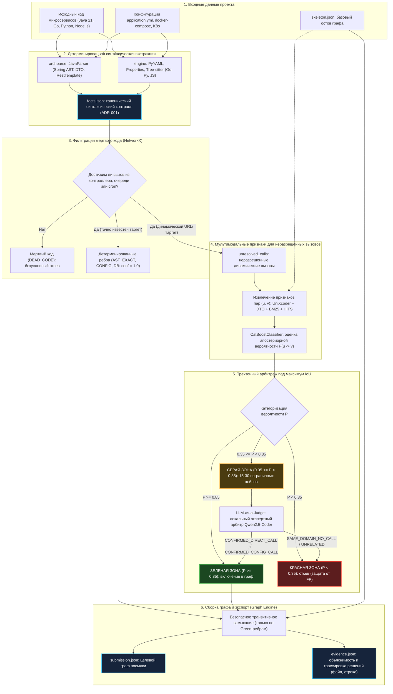

# ADR-004: Гибридный пайплайн реконструкции графа и трехзонный арбитраж

## Статус
Принято (на основе утвержденного RFC-05 с дополнениями по анализу бенчмарка Train Ticket).

---

## TL;DR
Сквозной Local-First пайплайн реконструкции графа Train Ticket под метрику IoU:
1. **Экстракция фактов (`facts.json`):** детерминированный разбор Spring AST (`JavaParser`), вызовов `RestTemplate`, семантики `getServiceUrl(...)`, схем JPA/MongoDB и брокера RabbitMQ по каноническому контракту [ADR-001](adr-001_data_contracts_and_system_architecture.md).
2. **Фильтрация мертвого кода (`Reachability`):** ориентированный обход внутрисервисного графа вызовов (`NetworkX`) от корней контроллеров, очередей и cron для отсева неиспользуемых вызовов и административных сателлитов (`DEAD_CODE`).
3. **Мультимодальный ML для `unresolved_calls`:** извлечение эмбеддингов кода (`UniXcoder-base`), лексики (BM25, RapidFuzz), контрактов DTO (Jaccard) и топологии скелета (HITS, co-citation) с расчетом вероятности $P(u \to v)$ в `CatBoostClassifier` ([ADR-003](adr-003_multimodal_ai_architecture.md)).
4. **Трехзонный арбитраж под IoU:** безусловное включение Зеленой зоны ($P \ge 0.85$), жесткий отсев Красной зоны ($P < 0.35$ для защиты знаменателя IoU от $FP$) и точечный арбитраж Серой зоны ($0.35 \le P < 0.85$, 15–30 пограничных кейсов) через локального кодового судью **LLM-as-a-Judge** (`Qwen2.5-Coder-7B Q4_K_M` с грамматикой Structured Outputs, категориальным вердиктом `CONFIRMED_DIRECT_CALL` / `SAME_DOMAIN_NO_CALL` и Chain-of-Thought заземлением на строки кода).
5. **Сборка графа и трассировка:** транзитивное замыкание строго по ребрам Зеленой зоны (с изоляцией таблиц БД) и генерация артефактов `submission.json` и `evidence.json`.

---

## Контекст
В рамках проекта [Archonity](AGENTS.md) для участия в соревновании TechArena 2026 решается задача реконструкции ориентированного типизированного графа runtime-зависимостей микросервисной архитектуры Train Ticket (~40 сервисов Spring Boot, с вспомогательными сервисами на Go, Python и Node.js) с восстановлением вырезанных связей.

Целевая метрика соревнования — **IoU (Intersection over Union)** по направленным типизированным рёбрам:

$$\text{IoU} = \frac{|E_{\text{pred}} \cap E_{\text{gold}}|}{|E_{\text{pred}} \cup E_{\text{gold}}|} = \frac{TP}{TP + FP + FN}$$

### Ограничения и инженерные вызовы
1. **Strict Local-First:** категорически запрещены любые внешние облачные API (OpenAI, Anthropic и др.). Все синтаксические парсеры, векторные модели, табличные классификаторы и языковые модели обязаны выполняться строго локально на вычислительных мощностях команды.
2. **Асимметрия штрафов IoU:** в формуле IoU каждый ложноположительный вызов ($FP$) одновременно увеличивает знаменатель дроби и не добавляет очков в числитель. Одно ошибочное ребро штрафует метрику сильнее, чем пропущенное неочевидное ребро ($FN$).
3. **Неразрешимые динамические URL:** статический AST-анализатор JavaParser не способен детерминированно восстановить целевой сервис и эндпоинт при динамической конкатенации строк (например, `getServiceUrl(...) + "/api/v1/orderservice/order/" + orderId`), вычислении адресов через хелперы или внедрении значений через `@Value` / `UriComponentsBuilder`.
4. **Проблема мертвого кода (Dead Code Elimination):** в репозитории Train Ticket присутствуют административные модули (`ts-admin-*-service`), мок-контроллеры и дублирующие канареечные сервисы (`ts-travel2-service`), которые содержат синтаксические вызовы других сервисов, но никогда не вызываются в штатных runtime-сценариях нагрузочных тестов. Их включение в граф ведет к лавинообразным $FP$.
5. **Специфика баз данных и брокеров сообщений:** 
   - Обращения разных сервисов к одной таблице реляционной БД (MySQL) или коллекции документов (MongoDB) образуют независимые ребра от сервисов к терминальному узлу хранилища (антипаттерн *Shared Persistency*).
   - Асинхронные вызовы через RabbitMQ связывают сервисы-продюсеры (`RabbitTemplate.convertAndSend`) с сервисами-консьюмерами (`@RabbitListener`) через именованные очереди (`email`).
6. **Обязательная трассируемость (`evidence.json`):** любое ребро графа обязано сопровождаться проверяемой записью источника (`AST_EXACT`, `CONFIG`, `ML_HIGH_CONFIDENCE`, `LLM_JUDGE_VERIFIED`, `TRANSITIVE`) с указанием файла, номера строки и веса уверенности.

### Предыстория и предпосылки объединения
Ранее в команде были предложены два дополняющих проектных решения:
- **[RFC-01](../rfc/rfc-01_graph_recovery_pipeline_architecture.md):** заложил макро-структуру системы — детерминированный сбор фактов, фильтрацию недостижимого мертвого кода через внутрисервисный Call Graph на `NetworkX`, независимый учет БД и брокеров сообщений, сквозной журнал доказательств. Однако сопряжение AST и ML было описано верхнеуровнево («детерминированное = 1.0, остальное в бустинг»).
- **[RFC-04](../rfc/rfc-04_dual_parse_pipeline_architecture.md):** сформулировал практическую проблему динамических URL, предложил контракт `unresolved_calls` и концепцию трехзонного арбитража вероятностей под асимметрию штрафов IoU.
- **[RFC-05](../rfc/rfc-05_hybrid_recovery_pipeline_and_arbitration.md):** выполнил синтез подходов, добавив концепцию локального кодового арбитра LLM-as-a-Judge со структурированным категориальным вердиктом.

Настоящий ADR утверждает архитектуру сквозного гибридного пайплайна и механизмы трехзонного арбитража в качестве официального командного стандарта.

---

## Принятые решения

### 1. Архитектура сквозного потока данных (Pipeline Data Flow)

Пайплайн реконструкции зависимостей состоит из 5 последовательных фаз:



---

### 2. Этап 1: Детерминированная синтаксическая экстракция

Детерминированный модуль `archparse` (Java 21, `JavaParser`) и вспомогательные модули ядра `engine` (`PyYAML`, `tree-sitter`) извлекают синтаксические факты без запуска и компиляции проекта:

1. **Входные точки доступа (`inbound_endpoints`):**
   - Сканируются классы с `@RestController`, `@Controller` и методы с `@RequestMapping`, `@GetMapping`, `@PostMapping`, `@PutMapping`, `@DeleteMapping`.
   - Иерархические префиксы канонизируются: $\text{Path} = \text{normalize}(\text{Class.path}) + \text{normalize}(\text{Method.path})$.
   - Шаблоны переменных пути в аннотациях (вида `{orderId}`) транслируются в регулярные выражения (`([^/]+)`).
   - Сохраняются нормализованные HTTP-методы, пути и схемы DTO параметров/ответа.

2. **Исходящие вызовы (`outbound_calls`):**
   - Анализируются клиенты `RestTemplate`: методы `exchange`, `postForObject`, `postForEntity`, `getForObject`, `getForEntity`.
   - Для вызовов `exchange` с анонимным классом `new ParameterizedTypeReference<Response<T>>() {}` извлекается generic-тип возвращаемого ответа `T` для сопоставления схемы данных.
   - **Семантика хелпера `getServiceUrl(serviceName)`:** при обнаружении вызова метода `getServiceUrl("ts-seat-service")` имя аргумента литерала извлекается как целевой сервис (`callee_service_hint`).
   - Если URL константен или однозначно восстановим через строковые литералы — вызов фиксируется как детерминированный.
   - Если URL строится через динамические переменные, тернарные операторы или сложные выражения — вызов регистрируется в секции `unresolved_calls` с сохранением AST-фрагмента, аргументов, DTO и HTTP-метода.

3. **Базы данных и брокеры (`db_access`, `broker_access`):**
   - *Реляционные БД (MySQL):* аннотации `@Entity`, `@Table(name = "...")`, классы Spring Data JPA `JpaRepository`.
   - *Документные БД (MongoDB):* аннотации `@Document(collection = "...")`, классы `MongoRepository` и нативный драйвер Node.js `mongodb`.
   - *RabbitMQ:* вызовы `rabbitTemplate.convertAndSend(queue, payload)` связываются с аннотациями `@RabbitListener(queues = "...")`.

4. **Внутрисервисный граф вызовов (`internal_call_graph`):**
   - Строится ориентированный граф прямых вызовов методов внутри каждого микросервиса с учетом разрешения интерфейсов (`Service` $\to$ `ServiceImpl`).

Все синтаксические факты сохраняются строго по контракту [ADR-001](adr-001_data_contracts_and_system_architecture.md) в единый `facts.json`.

---

### 3. Этап 2: Фильтрация мертвого кода (Reachability Analysis)

В соответствии с регламентом [AGENTS.md](../../AGENTS.md), в итоговый граф разрешено включать только зависимости, активные в runtime. Для предотвращения размножения ложных связей ($FP$) от неиспользуемого кода применяется алгоритм графовой достижимости на `NetworkX`:

1. Для каждого сервиса строится ориентированный граф методов $G_s = (V_s, E_s)$.
2. Определяется множество публичных корней исполнения (Entry Points):
   $$\text{Roots} = \{ m \in V_s \mid m \text{ аннотирован } @RequestMapping \lor @RabbitListener \lor @Scheduled \}$$
3. Для каждого исходящего вызова $c \in \text{outbound\_calls}$, расположенного внутри метода $m_{\text{call}}$, проверяется достижимость:
   $$\exists r \in \text{Roots} : r \rightsquigarrow m_{\text{call}} \quad (\text{в графе } G_s)$$
4. Если путь не существует — вызов помечается как `DEAD_CODE` и **безусловно отсекается**. Он не попадает ни в граф, ни в признаки ML.
5. Изолируются административные сателлиты (`ts-admin-*-service`) и неактивные тестовые дубликаты (`ts-travel2-service`), не участвующие в стандартных маршрутах шлюза.

---

### 4. Этап 3: ML-пайплайн для неразрешенных вызовов (`unresolved_calls`)

Для каждого вызова, прошедшего фильтрацию достижимости, но содержащего динамический URL, формируются пары-кандидаты $(u, v)$ со всеми публичными эндпоинтами сторонних микросервисов:

1. **Мультимодальное признаковое пространство (согласно [ADR-003](adr-003_multimodal_ai_architecture.md)):**
   - **Лексическое сходство:** BM25 (`rank_bm25`) и нечеткое сравнение путей RapidFuzz (Jaro-Winkler) по токенам сервисов, методов и URL-сегментов.
   - **Семантика кода:** косинусное сходство векторных представлений сигнатур и тел методов через `microsoft/unixcoder-base` (контекст 512 токенов) и `jinaai/jina-embeddings-v2-base-code` (расширенные контроллеры).
   - **Контракты DTO:** коэффициент Жаккара по нормализованным именам полей классов запроса/ответа.
   - **Топология скелета (`skeleton.json`):** направленные метрики графа в `NetworkX` — авторитетность и хабовость HITS ($h(u) \times a(v)$), коэффициенты совместного цитирования $\text{Jaccard}_{\text{succ}}(u, v)$ и $\text{Jaccard}_{\text{pred}}(u, v)$, двухшаговая достижимость без хабовых узлов (Eureka, Zipkin, RabbitMQ).

2. **Классификация:**
   - Модель `CatBoostClassifier` с параметром `rsm = 0.75` и регуляризацией Feature Masking ($p_{\text{drop}} = 0.2$).
   - На выходе формируется оценка апостериорной вероятности связи $P(u \to v)$.

---

### 5. Этап 4: Механика трехзонного арбитража и локальный арбитр LLM-as-a-Judge

Оптимизация под метрику IoU диктует строгое разделение пространства решений на три зоны:

```text
  0.0 ---------------- 0.35 ----------------------- 0.85 ---------------- 1.0
  [   КРАСНАЯ ЗОНА     ) [       СЕРАЯ ЗОНА        ) [   ЗЕЛЕНАЯ ЗОНА    ]
  Безусловный отсев        Локальный кодовый судья   Безусловное включение
  (Защита от FP)           LLM-as-a-Judge (Qwen)     (Высокая уверенность)
```

1. **Зеленая зона ($P \ge 0.85$ либо факт AST/Config):**
   - Связи высокой надежности.
   - *Действие:* ребро безусловно включается в граф с меткой `AST_EXACT`, `CONFIG` или `ML_HIGH_CONFIDENCE`.

2. **Красная зона ($P < 0.35$):**
   - Слабые, зашумленные гипотезы.
   - *Действие:* ребро безусловно отбрасывается.

3. **Серая зона ($0.35 \le P < 0.85$):**
   - Узкая полоса пограничных и спорных вызовов (не более 15–30 случаев на кодовую базу Train Ticket).
   - *Действие:* точечная передача на разрешение **локальному арбитру LLM-as-a-Judge** (с математическим фолбэком по оптимальному порогу Optuna $p^*$).

#### Архитектура локального кодового арбитра LLM-as-a-Judge

Арбитр построен на локальной модели **`Qwen2.5-Coder-7B-Instruct`** в 4-битном квантовании `Q4_K_M` GGUF (инференс через `llama-cpp-python` / `ollama`):

1. **Досье кандидата (Case Dossier):**
   Каждому пограничному случаю формируется структурированное досье:
   - *Вызывающая сторона:* имя сервиса, метод, AST-сниппет, HTTP-метод, DTO-поля, сырое выражение URL (`raw_url_expr`).
   - *Целевая сторона-кандидат:* контроллер, шаблон `@RequestMapping`, сигнатура метода, входные DTO.
   - *Сигналы первого уровня:* вероятность CatBoost $P$, косинусное сходство UniXcoder, лексический BM25, пересечение DTO по Жаккару.
   - *Топологический контекст:* наличие ориентированного пути в `skeleton.json`.

2. **Структурированный категориальный вердикт (Grammar-Based Structured Output):**
   Исключается генерация произвольного текста или нестабильного числового скора. Инференс управляется GBNF-грамматикой / строгой JSON Schema Pydantic:

   ```json
   {
     "http_call_line_in_source": "restTemplate.exchange(url + \"/order\", HttpMethod.POST, ...)",
     "matching_dto_fields": ["orderId", "accountId", "tripId"],
     "reasoning": "Метод sendOrder выполняет явный POST-запрос с объектом OrderInfo, поля которого совпадают с входным @RequestBody целевого контроллера OrderController.",
     "verdict": "CONFIRMED_DIRECT_CALL"
   }
   ```

3. **Категории вердикта (`VerdictEnum`):**
   - `CONFIRMED_DIRECT_CALL`: обнаружен прямой сетевой HTTP/REST вызов в исходном коде, контракты DTO и эндпоинт согласованы $\implies$ **Зеленая зона** (включение в граф со статусом `LLM_JUDGE_VERIFIED`).
   - `CONFIRMED_CONFIG_CALL`: зависимость подтверждена через конфигурации, Eureka VIP или Feign $\implies$ **Зеленая зона**.
   - `SAME_DOMAIN_NO_CALL`: сервисы работают с похожими доменными сущностями и DTO (False Positive Trap), но реального вызова в активном коде нет $\implies$ **Красная зона** (отсев, критическая защита от деградации IoU).
   - `UNRELATED`: разные домены, несопоставимые контракты $\implies$ **Красная зона** (отсев).

4. **Заземление логики (Chain-of-Thought Grounding):**
   Последовательность генерации полей JSON требует от модели сначала процитировать строку кода вызова и пересечение полей DTO, сформулировать обоснование (`reasoning`), и только затем выбрать категорию вердикта. Для предотвращения галлюцинаций системный промпт снабжается few-shot контрпримерами похожих сущностей без фактического вызова (`SAME_DOMAIN_NO_CALL`).

5. **Интеграция с журналом доказательств (`evidence.json`):**
   При принятии ребра поля `reasoning` и `http_call_line_in_source` автоматически ложатся в `evidence.json`, обеспечивая полную прозрачность решения для визуализатора ([ADR-002](adr-002_react_flow_visualizer.md)) и жюри.

6. **Ограничения (Local-First Guardrails):**
   - Жесткий лимит: не более 30 вызовов LLM-судьи на весь прогон.
   - Время инференса: 1.5–2.5 секунды на кейс, суммарно $< 1$ минуты на весь пайплайн.
   - Математический фолбэк: при отсутствии GPU или сбое локального раннера решение в серой зоне принимается по скалярному порогу $p^*$, откалиброванному Optuna.

---

### 6. Этап 5: Сборка графа и генерация артефактов

1. **Безопасное транзитивное замыкание:**
   - Косвенные вызовы ($A \to B \to C \implies A \to C$) генерируются **только по ребрам Зеленой зоны** (с уверенностью $\ge 0.85$ или статусом `LLM_JUDGE_VERIFIED`). Это исключает каскадное лавинообразное распространение $FP$-ошибок.
   - Узлы баз данных и очередей являются терминальными стоками (`sinks`) и исключаются из алгоритма транзитивного замыкания.

2. **Формирование `submission.json`:**
   - Выходной граф сериализуется в каноническую структуру организаторов с валидацией Pydantic-схемой.

3. **Формирование `evidence.json`:**
   - Согласно [ADR-001](adr-001_data_contracts_and_system_architecture.md), формируется словарь по составному ключу `edge_id` (`source->target:relation_type`) с объектом `primary_evidence`, точным путем к файлу, номером строки, сниппетом и статусом подтверждения.

---

### 7. Сопоставление с предшествующими подходами

| Характеристика | RFC-01 (Базовый) | RFC-04 (Dual-Source) | **ADR-004 (Принятый стандарт)** |
|:---|:---|:---|:---|
| **Экстракция фактов** | Единый `facts.json` | Раздельный дублирующий парсинг Java и Python | **Единый типизированный контракт `facts.json` ([ADR-001](adr-001_data_contracts_and_system_architecture.md))** |
| **Неразрешенные URL** | Концептуальное упоминание | Выделение `unresolved_calls` со сниппетами | **Структурированный экспорт `unresolved_calls` в ML** |
| **Мертвый код** | Reachability через Call Graph | Не учитывался | **Детерминированный NetworkX reachability от корней до передачи в ML** |
| **Базы данных и очереди** | Детально специфицированы | Проигнорированы | **Полный учет БД и очередей (правило независимых ребер к таблицам)** |
| **Принятие решений** | Единый порог классификатора | Трехзонный арбитраж (Green / Red / Gray) | **Трехзонная модель под IoU + локальный LLM-as-a-Judge (Qwen2.5-Coder) для серой зоны** |
| **Формат вердикта арбитра** | Отсутствовал | Числовой скор | **Категориальный Enum (`CONFIRMED_DIRECT_CALL` / `SAME_DOMAIN_NO_CALL`) с CoT-заземлением** |
| **Транзитивность** | Глобальная | Не формализована | **Транзитивное замыкание строго по ребрам Зеленой зоны, изоляция БД** |

---

## Аппаратный профиль и ресурсные ограничения

Пайплайн спроектирован с учетом ресурсов локальной рабочей станции ML-инженера команды (**16 GB VRAM GPU, 32 GB RAM**):

| Компонент пайплайна | Требуемая память | Среда исполнения | Время на Train Ticket |
|:---|:---|:---|:---|
| Детерминированная экстракция (`archparse` + `engine`) | ~500 MB RAM | OpenJDK 21 + Python 3.11 | ~5–8 сек |
| Графовая достижимость (`NetworkX`) | ~200 MB RAM | Python 3.11 | ~1–2 сек |
| Эмбеддинги кода (`UniXcoder-base`) | ~350 MB VRAM | PyTorch (CUDA / MPS) | ~3–5 сек |
| Классификатор `CatBoost` | ~400 MB RAM | CPU | ~2–4 сек |
| Арбитр `Qwen2.5-Coder-7B (Q4_K_M)` (до 30 вызовов) | ~4.7 GB VRAM | `llama-cpp-python` (CUDA) | ~20–35 сек |
| Сборка графа и экспорт артефактов | ~200 MB RAM | Python 3.11 | ~1–2 сек |
| **Суммарный прогон пайплайна** | **~5.1 GB VRAM / ~4 GB RAM** | **Локально** | **35–60 секунд** |

---

## Последствия

### Положительные
1. **Максимизация метрики IoU:** трехзонное разделение в сочетании с категоризацией вердиктов локального арбитра устраняет предметные галлюцинации и эффективно защищает знаменатель дроби от False Positives ($FP$).
2. **Устранение шума мертвого кода:** фильтрация недостижимого кода через внутрисервисный Call Graph гарантирует, что неиспользуемые административные классы и моки не загрязняют итоговый граф.
3. **100% локальность и соответствие регламенту:** полное отсутствие внешних сетевых вызовов гарантирует воспроизводимость и независимость от внешних API.
4. **Прозрачная трассируемость:** каждое ребро, включая пограничные решения арбитра, снабжается верифицируемым доказательством в `evidence.json`, готовым для демонстрации в визуализаторе ([ADR-002](adr-002_react_flow_visualizer.md)) и жюри.

### Риски и митигации
1. **Риск деградации скорости инференса LLM на CPU:**
   - *Митигация:* жесткий лимит серой зоны (до 30 вызовов); при отсутствии ускорения GPU подключается математический фолбэк на базе откалиброванного Optuna порога $p^*$.
2. **Риск ложных срабатываний из-за одинаковых DTO в разных микросервисах:**
   - *Митигация:* категория вердикта `SAME_DOMAIN_NO_CALL`, принудительное цитирование фактической строки вызова в коде и few-shot контрпримеры в системном промпте.
3. **Риск разрывов в Call Graph при сложной динамической диспетчеризации Spring:**
   - *Митигация:* вызовы, оторванные от корней, но имеющие явные сетевые URL, анализируются в секции `unresolved_calls` с пониженным базовым весом.
