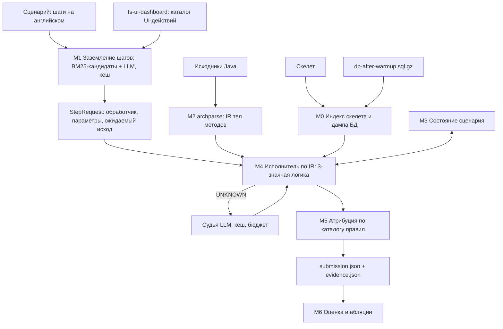

# ADR-005: Пайплайн предсказания исполнения сценария

## Статус

Принято 16.10.2026. Заменяет [ADR-001](adr-001_data_contracts_and_system_architecture.md), [ADR-003](adr-003_multimodal_ai_architecture.md), [ADR-004](adr-004_hybrid_recovery_pipeline_and_arbitration.md).

## Контекст

Ранние ADR исходили из того, что мы восстанавливаем один глобальный граф зависимостей сервисов. Пакет участника показал другую задачу ([case_description.md](../case_description.md)):

- для каждого сценария S0–S7 нужно предсказать, какие методы проекта выполнятся (`executes`), кто кого вызвал (`calls`), какие запросы ушли в другие сервисы (`remote`) и к каким таблицам ушёл SQL (`data`);
- гранулярность — методы и таблицы скелета, а не сервисы;
- метрика — среднее IoU по четырём видам на скрытых S1–S7; лишнее ребро стоит столько же, сколько пропущенное.

Скелет уже содержит то, что ADR-001 собирался извлекать сам: обработчики, call graph, `runtime_dispatch`, `remote_call`, `data_access`. Он описывает возможные связи. Неизвестно другое — какие ветки выполнятся при данных шага и состоянии БД. Организаторы сообщают, что обход скелета даже от правильных входов даёт 0.52–0.76. Значит, баллы лежат в трёх местах: правильные входы шагов, ветвления, правила разметки эталона ([annotation_rules.md](../annotation_rules.md)).

## Решения

1. **Языки.** Основная кодовая база — Python. Разбор тел методов — Java на JavaParser (`archparse/`). Rust и надбавку за него не берём.
2. **Ветвления.** Исполнитель идёт по структурированному телу метода и считает условия в трёхзначной логике: TRUE, FALSE, UNKNOWN.
3. **LLM.** Локальная модель в NVFP4 используется в двух местах: заземление шагов и судья для условий UNKNOWN. `temperature = 0`, ответы кешируются в репозиторий, прогон из кеша не требует GPU.
4. **Правила разметки** живут отдельным каталогом, каждое правило — под флагом для абляций.
5. **Local-First и запрет рантайма** — без изменений: Train Ticket не запускаем, облачные API не вызываем.

Отклонено: CatBoost, Optuna, кодовые эмбеддинги, HITS и транзитивное замыкание из ADR-003/004 — обучающих данных нет (один эталон), а задача не link prediction. Полная эмуляция Java и БД — слишком дорого и спорно с правилом «не запускать проект».

## Пайплайн



### M0. Индекс

Python. Загружает скелет и строит индексы: узлы по `kind`, рёбра по источнику, call_site по `file:line:col` (колонка 1-based, начало имени вызываемого метода), обработчики с шаблонами путей, реализации по `overrides`. Загружает дамп БД в таблицы в памяти (25 баз, сотни строк). Читает `context` скелета.

### M1. Заземление шагов

Python + LLM. Превращает шаг сценария в запрос.

1. Детерминированный каталог UI из `ts-ui-dashboard/`: JS-функция → URL, HTTP-метод, поля тела, надпись кнопки, страница. Пути сопоставляются с шаблонами `@RequestMapping` (идея из `baseline_nlp.py`).
2. Кандидаты обработчиков для шага — BM25 по каталогу и коду.
3. LLM выбирает обработчик среди кандидатов и извлекает параметры по JSON-схеме.

Без LLM (нет GPU и нет кеша) модуль работает на BM25 — хуже, но работает.

### M2. IR тел методов

Java, JavaParser. Для каждого метода проекта — дерево операторов, связанное с узлами скелета. Пишет `ir/<module>.json`.

### M3. Состояние сценария

Python. Начальное состояние — дамп и контекст (пассажир `fdse_microservice`, баланс 10 000, дата поездки 01.10.2026, системная дата 15.09.2026). Шаги меняют состояние: новый заказ и его статус, баланс, контакты, новый пользователь, админские сущности (S6). Сценарии друг от друга изолированы.

### M4. Исполнитель

Python. От обработчика шага идёт по IR:

- условие считается по параметрам шага, состоянию и результатам вызовов; результат TRUE, FALSE или UNKNOWN;
- вызов проектного метода — рекурсивный вход; вызов RestTemplate — переход в обработчик другого сервиса с выбором цели (R3); вызов репозитория — событие SQL и чтение или запись состояния;
- для UNKNOWN сначала правила по умолчанию, затем судья.

Правила по умолчанию:

- успешный путь: ответы других сервисов `status == 1`, объекты не `null`, валидация проходит — если шаг не ожидает отказа;
- цикл по коллекции исполняется, если коллекция непуста в состоянии;
- лямбда исполняется, только когда её вызывают (R16);
- исключение или ранний `return` обрывает путь, выполненное до него остаётся (R15).

Исполнитель пишет события: `execute(method)`, `call(caller, callee, via)`, `remote(src, dst)`, `sql(method, table)`, каждое со ссылкой на шаг и причину.

### M5. Атрибуция

Python. Превращает события в рёбра по [annotation_rules.md](../annotation_rules.md): схлопывание call_site, реализации вместо интерфейсов, исключение Lombok и Jackson, методы, вызванные библиотекой, приписывание SQL. Пишет `submission.json` и `evidence.json`.

### M6. Оценка

Python. Обёртка над `platform/evaluate_golden.py`: балл на S0, проверка формата S1–S7, diff с эталоном по видам рёбер, запуск с выключенными правилами. Сдачи на платформу используются для абляций целых правил, не для перебора отдельных рёбер.

## Контракты

### StepRequest (выход M1)

```json
{
  "scenario": "S1",
  "step": 6,
  "action": "Book one first-class seat on the trip for this contact, with food ...",
  "handler": "method:ts-preserve-service:preserve.controller.PreserveController#preserve(edu.fudan.common.entity.OrderTicketsInfo,org.springframework.http.HttpHeaders)",
  "http": {"method": "POST", "path": "/api/v1/preserveservice/preserve"},
  "ui_source": {"file": "ts-ui-dashboard/static/assets/js/client_ticket_book.js", "line": 511},
  "params": {"seatType": "SeatClass.FIRSTCLASS", "assurance": 1, "foodType": 2, "consigneeWeight": 2.0},
  "expected_outcome": "success",
  "refs": {"trip": "first_of_step_2", "contact": "first_of_step_5"},
  "grounding": {"source": "LLM", "candidates": ["..."], "cache_key": "sha256:..."}
}
```

`handler` — ID узла скелета, всегда. `params` — только то, что влияет на ветки; имена полей берутся из DTO обработчика (здесь `OrderTicketsInfo`), значения в примере условные. `expected_outcome`: `success` или `refused` (S7). `refs` ссылаются на результаты предыдущих шагов.

### IR (выход M2)

Файл на модуль: `ir/<module>.json` — словарь `method_id → тело`.

```json
{
  "method:ts-order-service:order.service.OrderServiceImpl#queryOrders(...)": {
    "file": "ts-order-service/src/main/java/order/service/OrderServiceImpl.java",
    "params": ["qi", "accountId", "headers"],
    "body": [
      {"op": "assign", "target": "list", "expr": {"call": "call:method:...#queryOrders(...)@128:49"}},
      {"op": "if", "line": 131,
       "cond": {"or": [{"call": "call:...@131:16"}, {"call": "call:...@131:43"}, {"call": "call:...@131:75"}]},
       "then": [{"op": "foreach", "var": "tempOrder", "iter": {"name": "list"}, "body": ["..."]}],
       "else": [{"op": "return", "expr": {"new": "edu.fudan.common.util.Response"}}]}
    ]
  }
}
```

Операторы: `assign`, `expr`, `if`, `switch`, `while`, `for`, `foreach`, `try` (с `catches`, `finally`), `return`, `throw`. Выражения: литерал, имя, доступ к полю, `call` (ID call_site скелета или собственный ID вида `ircall:<method>@строка:колонка`, если в скелете его нет), бинарные и унарные операции, `instanceof`, тернарный оператор, `new`, `lambda` (отложенный блок), `method_ref`.

Требования к парсеру:

- каждый вызов связан с call_site скелета по `file + line + col`;
- вызовы, которых нет в скелете (через enum-константы, `this`-вызовы, конструкторы), получают свой ID и, если удалось, разрешённую цель;
- константы (`static final`, enum) вычислены, если это литералы.

Точные поля фиксируются в `archparse/README.md` до начала реализации M4 и согласуются с исполнителем.

### Вердикт судьи

```json
{
  "cited_line": "if (order.getStatus() == OrderStatus.COLLECTED.getCode()) {",
  "reasoning": "Шаг 7 выдал билет, статус заказа COLLECTED, проверка срабатывает",
  "verdict": "TRUE"
}
```

`verdict`: `TRUE`, `FALSE`, `UNKNOWN`. Вход судьи: текст метода, условие, известные факты состояния, текст шага. Выход ограничен JSON-схемой. На `UNKNOWN` остаётся правило по умолчанию.

### evidence.json v2

Словарь по ключу ребра `relation|source|target`:

```json
{
  "data|method:...TokenServiceImpl#getToken(...)|res:table:ts-auth-service.user_roles": {
    "steps": [1],
    "source_type": "FRAMEWORK_RULE",
    "rule": "R10",
    "confidence": 0.9,
    "file": "ts-auth-service/src/main/java/auth/service/impl/TokenServiceImpl.java",
    "line": 90,
    "call_site": "call:method:...#getToken(...)@90:36",
    "path": ["UserController#getToken", "TokenServiceImpl#getToken"]
  }
}
```

`source_type`: `SKELETON` (связь из скелета, ветка достигнута), `IR_BRANCH` (решено условием), `STATE` (решено состоянием БД), `DEFAULT_RULE`, `LLM_JUDGE`, `FRAMEWORK_RULE` (правило каталога). `confidence` — для ранжирования при абляциях; в `submission.json` не попадает.

### Кеш LLM

- Ключ — `sha256` от модели, версии промпта и входа.
- Кеш лежит в репозитории (`cache/llm/*.json`) и входит в zip сдачи.
- По умолчанию прогон читает кеш; при промахе зовёт модель, если она доступна, иначе берёт правило по умолчанию.
- `--no-cache` пересчитывает всё.

## Модель и железо

Требования к модели судьи и заземления: локальный инференс, NVFP4, влезает в 16 GB VRAM (RTX 5070 Ti, Blackwell) вместе с контекстом под метод и каталог UI, поддержка вывода по JSON-схеме. Конкретная модель и рантайм (vLLM или TensorRT-LLM; NVFP4 на практике требует Linux или WSL2) выбираются спайком и дописываются сюда.

## Последствия

Плюсы:

- каждое ребро объяснимо: шаг, путь, правило или вердикт;
- прогон воспроизводим без GPU за счёт кеша;
- правила разметки проверяются абляцией по одному.

Минусы и риски:

- эталон содержит причуды, которые видны только на скрытых сценариях (R6, R9 в каталоге) — держим их под флагами;
- IR — критический путь: если `archparse` не готов к 19.10, запасной вариант — Python tree-sitter-java с тем же контрактом;
- переобучение под 8 сценариев — правила формулируются через семантику Spring, JPA и Java, а не через имена сценариев.
