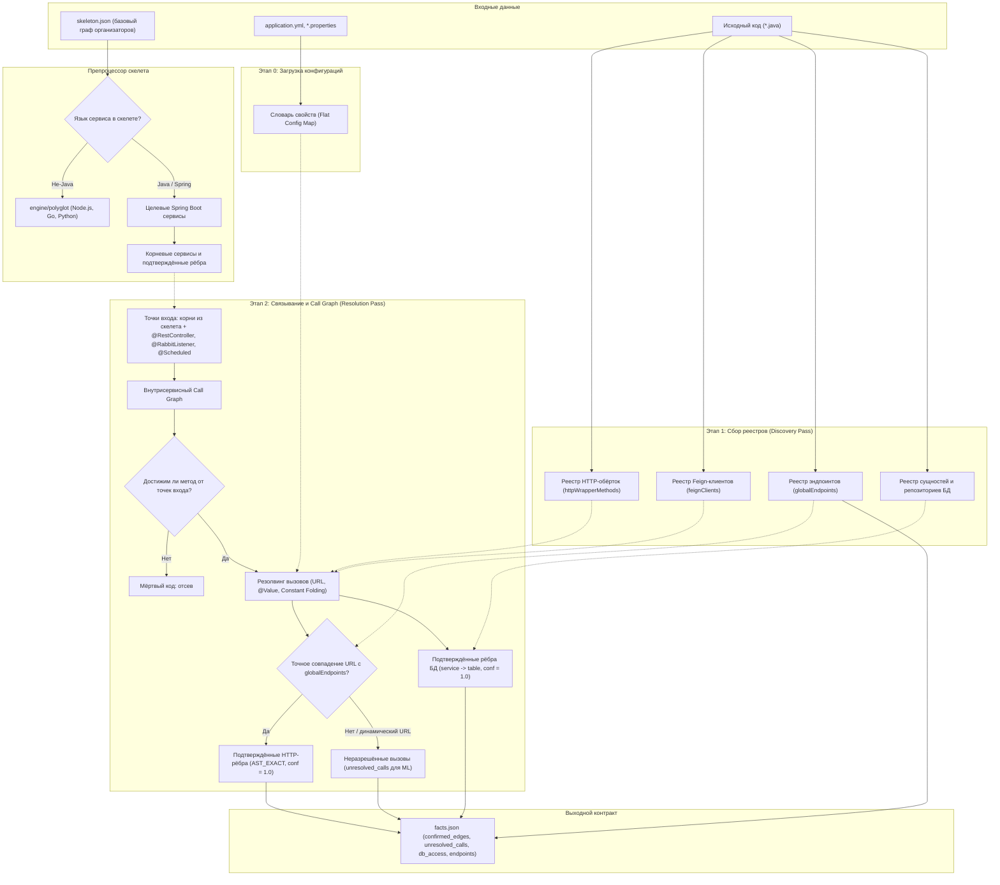

# Пайплайн детерминированного парсера бэкенда (archparse)

Модуль статического анализа `archparse` (Java 21, JavaParser). (Набросок)

Цель — детерминированное извлечение 100% достоверных фактов и связей из кода Spring Boot сервисов Train Ticket, отсев мёртвого кода и генерация контракта `facts.json` для графового ядра и ML-модуля.

---

## Архитектурная схема пайплайна



---

## Этап 0: Загрузка окружения (Config Loader)

Парсер читает конфигурации всех сервисов (`application.yml`, `application.properties`, `bootstrap.yml`) до обхода AST.

### Шаги:
1. Сбор всех файлов конфигурации из `src/main/resources/`.
2. Разворачивание дерева YAML в плоский словарь `key -> value`.
3. Подстановка значений по умолчанию вида `${PROPERTY_NAME:default_value}`.

### Пример результата (Flat Config Map):
- `server.port` $\to$ `12345`
- `spring.datasource.url` $\to$ `jdbc:mysql://ts-station-mysql:3306/ts`
- `ts.station.service.url` $\to$ `http://ts-station-service:12345`

Словарь сохраняется в `AnalysisContext.configurations` и используется на Этапе 2 для раскрытия `@Value` и константных параметров клиентов.

---

## Этап 1: Сбор реестров (Discovery Pass)

Первый проход по всем Java-файлам собирает декларации без вычисления связей.

### 1. Реестр серверов (`globalEndpoints`)
Поиск классов `@RestController`, `@Controller` и методов `@RequestMapping`, `@GetMapping`, `@PostMapping`, `@PutMapping`, `@DeleteMapping`.
Фиксируются:
- Сервис-владелец (по директории модуля).
- Полный HTTP-путь (базовый путь контроллера + путь метода).
- HTTP-глагол (`GET`, `POST`, `PUT`, `DELETE`).
- Параметры и типы DTO запроса/ответа.
- Файл и номер строки.

### 2. Реестр HTTP-обёрток (`httpWrapperMethods`)
Поиск сервисных методов, инкапсулирующих HTTP-вызовы:
```java
public Response myCustomPost(String url, Object body) {
    return restTemplate.postForObject(url, body, Response.class);
}
```
Критерии включения:
- Принимает строковый параметр (`url` / `uri` / `path`).
- Передаёт его в вызов `restTemplate.*` (глубина 1–2 уровня).

Методы добавляются в `httpWrapperMethods` и обрабатываются на Этапе 2 наравне со стандартными методами `RestTemplate`.

### 3. Реестр Feign-клиентов (`feignClients`)
Интерфейсы с аннотацией `@FeignClient`:
- Имя целевого сервиса (`name` / `value`).
- Базовый URL (`url`), если задан явно.
- Сигнатуры методов и их HTTP-маппинги.

### 4. Реестр сущностей и репозиториев БД (`dbEntities`, `dbRepositories`)
- **Сущности:** связывание `@Entity` + `@Table(name = "...")` (JPA) и `@Document(collection = "...")` (Mongo) с именами таблиц и коллекций.
- **Репозитории:** интерфейсы, наследующие `JpaRepository`, `CrudRepository` или `MongoRepository`, сопоставляются с соответствующей таблицей.

Итог этапа: `AnalysisContext` содержит реестры эндпоинтов, клиентов, обёрток и структур БД.

---

## Этап 2: Связывание и Call Graph (Resolution Pass)

Второй проход выполняет детерминированное связывание, анализ достижимости и фильтрацию неиспользуемого кода.

### 1. Предобработка скелета и точки входа (Entry Points)
На входе доступен `skeleton.json` — неполный граф от организаторов с сохранёнными узлами и базовыми рёбрами.

Перед построением Call Graph запускается фильтр:
1. **Изоляция не-Java сервисов:** узлы на Go, Python, Node.js (`ts-ui-dashboard`, `ts-ticket-office-service` и др.) отсекаются и направляются в парсер `engine/polyglot`. `archparse` обрабатывает только Spring Boot.
2. **Первичные корни из скелета:** узлы и подтверждённые входящие рёбра из `skeleton.json` служат опорными точками первого приоритета.
3. **Внутрисервисные точки входа:** публичные методы контроллеров, слушатели очередей (`@RabbitListener`, `@KafkaListener`) и задачи планировщика (`@Scheduled`).
4. **Reachability Analysis:** внутри каждого сервиса строится ориентированный граф вызовов от точек входа. Методы, недостижимые по цепочке вызовов, отсекаются как мёртвый код и не участвуют в анализе исходящих связей.

### 2. Резолвинг исходящих HTTP-вызовов
Внутри достижимых методов ищутся обращения к:
- Методам `RestTemplate` (`getForObject`, `postForObject`, `exchange` и др.).
- Пользовательским обёрткам из `httpWrapperMethods`.
- Методам зарегистрированных интерфейсов `@FeignClient`.

#### Алгоритм разрешения URL:
1. **Constant Folding:** свёртка строковых констант и конкатенаций (`"http://" + host + "/api/v1"`).
2. **Подстановка конфигураций:** раскрытие выражений `@Value("${ts.service.url}")` через `AnalysisContext.configurations`.
3. **Сопоставление:** URL нормализуется (с приведением path-параметров вида `{id}` к шаблону) и сверяется с `globalEndpoints`.

#### Ветвление:
- **Точное совпадение:** генерируется ребро в `confirmed_edges` (`REST_HTTP`, `confidence: 1.0`, `source_type: AST_EXACT`, файл, строка, цепочка вызова `call_chain`).
- **Динамический URL / частичный шаблон:** вызов пакуется в `unresolved_calls` (имя сервиса, вызывающий метод, сырое выражение URL, поля DTO, сниппет кода) для ML-классификатора.

### 3. Резолвинг обращений к базам данных
При вызове методов репозиториев (например, `orderRepository.save(...)`):
1. По типу переменной определяется связанная таблица из `dbRepositories`.
2. Создаётся независимое ребро `service -> table` (`DATABASE`, `confidence: 1.0`, `source_type: AST_EXACT`).
3. Каждый сервис, обращающийся к таблице, получает собственное изолированное ребро (согласно регламенту).

---

## Выходной контракт данных (`facts.json`)

`archparse` генерирует файл `facts.json`:

```json
{
  "service_nodes": [
    { "id": "ts-order-service", "language": "java", "framework": "spring-boot" }
  ],
  "confirmed_edges": [
    {
      "source": "ts-order-service",
      "target": "ts-station-service",
      "relation_type": "REST_HTTP",
      "evidence": {
        "source_type": "AST_EXACT",
        "confidence": 1.0,
        "file_path": "ts-order-service/src/main/java/order/service/OrderServiceImpl.java",
        "line_number": 84,
        "call_chain": [
          "order.controller.OrderController.createOrder",
          "order.service.OrderServiceImpl.getStationName"
        ],
        "matched_endpoint": "GET /api/v1/stationservice/stations/{stationId}"
      }
    },
    {
      "source": "ts-order-service",
      "target": "orders",
      "relation_type": "DATABASE",
      "evidence": {
        "source_type": "AST_EXACT",
        "confidence": 1.0,
        "file_path": "ts-order-service/src/main/java/order/service/OrderServiceImpl.java",
        "line_number": 120,
        "table_name": "orders",
        "repository_interface": "order.repository.OrderRepository"
      }
    }
  ],
  "unresolved_calls": [
    {
      "call_id": "call_order_01",
      "caller_service": "ts-order-service",
      "caller_method": "order.service.OrderServiceImpl.notifyUser",
      "raw_url_expr": "notificationServiceUrl + \"/send\"",
      "http_verb": "POST",
      "payload_dto_fields": ["userId", "orderId", "status"],
      "file_path": "ts-order-service/src/main/java/order/service/OrderServiceImpl.java",
      "line_number": 156,
      "code_snippet": "restTemplate.postForObject(notificationServiceUrl + \"/send\", req, Void.class)"
    }
  ],
  "endpoints": [
    {
      "service": "ts-order-service",
      "path": "/api/v1/orderservice/order",
      "http_verb": "POST",
      "controller_class": "order.controller.OrderController",
      "handler_method": "createOrder"
    }
  ]
}
```

---

## Граничные случаи

1. **Мёртвый код:** Методы, недостижимые от точек входа, отсекаются при построении Call Graph и не попадают ни в `confirmed_edges`, ни в `unresolved_calls`.
2. **Параметризованные пути:** Пути эндпоинтов `/api/v1/stations/{id}` нормализуются в regex-шаблоны для сопоставления со строками вида `url + "/" + stationId`.
3. **Изоляция БД:** Транзитивность через базы данных исключена: связи с таблицами являются строго прямыми и изолированными для каждого сервиса.