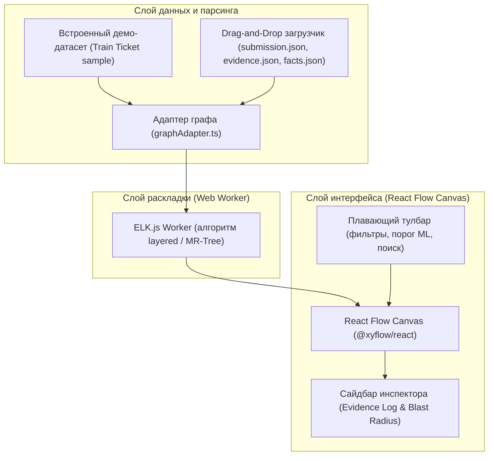

# Дорожная карта разработки визуализатора архитектурного графа (visualizer/)

Документ фиксирует этапы, архитектурные слои и критерии готовности фронтенд-приложения визуализации графа зависимостей Archonity.

Основано на решениях [ADR-001](adr/adr-001_data_contracts_and_system_architecture.md), [ADR-002](adr/adr-002_react_flow_visualizer.md), требованиях [case_description.md](case_description.md) и [RFC-05](rfc/rfc-05_hybrid_recovery_pipeline_and_arbitration.md).

---

## 1. Цели и назначение визуализатора

1. **Внутренняя отладка пайплайна:** оперативный визуальный поиск разорванных цепочек, ложных кластеров, изолированных узлов и калибровка порога уверенности ML ($p_{\text{threshold}}$).
2. **Демонстрация жюри (Killer Feature):** интерактивная защита результатов статического анализа без динамического запуска через Evidence Log и наглядный расчет Blast Radius (радиуса поражения при изменениях).
3. **Строгий Local-First:** автономная работа в браузере без внешних API, серверов и CDN.

---

## 2. Архитектура и стек технологий

- **Среда:** SPA на базе Vite, React 19, TypeScript.
- **Директория в репозитории:** `visualizer/`.
- **Графовый холст:** `@xyflow/react` (React Flow v12).
- **Движок раскладки:** `elkjs` в фоновом Web Worker (для исключения блокировки UI).
- **Иконки:** `lucide-react`.
- **Стилизация:** Vanilla CSS / CSS Modules (без Tailwind и внешних CSS-фреймворков для максимального контроля над производительностью DOM).

---

## 3. Этапы разработки (Roadmap)

### Этап 1. Базовая инфраструктура и каркас проекта
**Цель:** создать рабочий проект в `visualizer/`, настроить TypeScript, зависимости, типизированные контракты и минимальный тестовый запуск.

* **Задачи:**
  1. Инициализация Vite + React + TypeScript приложения в директории `visualizer/`.
  2. Установка зависимостей: `@xyflow/react`, `elkjs`, `lucide-react`.
  3. Настройка `vite.config.ts` с поддержкой Web Worker и корректной сборкой локальных статических файлов.
  4. Описание TypeScript-типов на основе схем [ADR-001](adr/adr-001_data_contracts_and_system_architecture.md):
     - `CanonicalGraph`, `GraphNode`, `GraphEdge`.
     - `EvidenceRecord`, `EvidenceDetails`, `MLFeatures`.
     - `ServiceFacts`, `InboundEndpoint`, `OutboundCall`, `DbAccess`.
  5. Подготовка эталонного встроенного демо-набора данных (`demoData.ts`): срез 6–8 связанных микросервисов Train Ticket (`ts-travel-service`, `ts-seat-service`, `ts-order-service`, `ts-station-service` и др.), базы MySQL/MongoDB и очередей с реальными записями evidence (`AST_EXACT`, `CONFIG`, `ML_PREDICTED`, `LLM_JUDGE_VERIFIED`).
* **Результат этапа:** проект собирается командой `npm run build`, запускается `npm run dev`, на экране отображается базовая оболочка с подключенными типами.

---

### Этап 2. Графовый адаптер и фоновая раскладка (ELK.js Web Worker)
**Цель:** преобразование канонического графа в узлы и ребра React Flow с автоматической DAG-раскладкой.

* **Задачи:**
  1. Реализация `graphAdapter.ts`:
     - Трансформация сырых узлов (сервисы, БД, очереди) и ребер в структуры `Node` и `Edge` для React Flow.
     - Добавление метаданных к ребрам (источник доказательства, тип протокола, confidence, статус LLM-арбитра).
  2. Создание Web Worker для `elkjs`:
     - Вынесение вычислений координат в отдельный поток `layout.worker.ts`.
     - Настройка параметров ELK: `elk.algorithm: layered`, `elk.direction: RIGHT` (или `DOWN`), расчет отступов между слоями и узлами.
  3. Кастомные React-компоненты узлов (Macro-level):
     - `ServiceNode`: карточка сервиса с бейджем языка/фреймворка, портом и счетчиком эндпоинтов.
     - `DatabaseNode`: стилизованный узел хранилища (MySQL, MongoDB) с указанием таблиц.
     - `QueueNode`: узел очереди сообщений (RabbitMQ).
* **Результат этапа:** демо-граф автоматически красиво раскладывается в иерархический DAG без зависания вкладки браузера.

---

### Этап 3. Кастомные ребра и интерактивная панель управления (Toolbar)
**Цель:** наглядная дифференциация типов связей и управление отображением графа в реальном времени.

* **Задачи:**
  1. Кастомные ребра (`CustomEdge.tsx`):
     - Стилизация линий по типу источника: сплошная (`AST_EXACT`), пунктирная (`CONFIG`), штриховая с бейджем вероятности (`ML_PREDICTED`), подсвеченная (`LLM_JUDGE_VERIFIED`), точечная (`TRANSITIVE`).
     - Цветовые схемы: режим «По источникам данных» и режим «По протоколам связи» (`REST_HTTP`, `DATABASE`, `MESSAGE_QUEUE`).
     - Анимация потока данных для активных ребер.
  2. Плавающий верхний тулбар (`Toolbar.tsx`):
     - Слайдер порога уверенности ML ($p_{\text{threshold}} \in [0.0, 1.0]$) с мгновенным отсечением слабых гипотез.
     - Фильтры-чекбоксы источников данных (`AST_EXACT`, `CONFIG`, `ML_PREDICTED`, `TRANSITIVE`, `LLM_JUDGE`).
     - Фильтры по типам узлов (скрыть/показать БД или очереди).
     - Поисковая строка с автокомплитом по сервисам, эндпоинтам и таблицам, с автоматическим зумом и центрированием на найденном узле (`fitView({ nodes: [...] })`).
* **Результат этапа:** пользователь может фильтровать связи на лету, отсекать шумный ML и быстро находить интересующий сервис.

---

### Этап 4. Сайдбар инспектора: Evidence Log и расчет Blast Radius
**Цель:** детальная доказательная база связей и анализ архитектурного влияния узлов.

* **Задачи:**
  1. Инспектор ребер (Evidence View):
     - Отображение типа доказательства (`AST_EXACT`, `CONFIG`, `ML_PREDICTED`, `LLM_JUDGE_VERIFIED`).
     - Путь к исходному файлу и номер строки с удобным копированием.
     - Цепочка вызовов (`call_chain`) от корня контроллера до вызова.
     - Превью фрагмента кода (`code_snippet`).
     - Для ML-ребер: радар/список топ-признаков (сходство DTO, BM25, эмбеддинги).
     - Для арбитражных ребер: вывод вердикта и аргументации LLM-as-a-Judge.
  2. Инспектор узлов и калькулятор Blast Radius:
     - Определение прямых зависимостей (входящих upstream и исходящих downstream).
     - Алгоритм обхода графа (BFS/DFS) для вычисления полного радиуса поражения (транзитивно зависимые сервисы).
     - Подсветка графа на канвасе: затемнение неаффектированных узлов и яркая подсветка зависимой подсистемы.
     - Метрики надежности: критичность сервиса (степень входящих связей, количество зависимых компонентов).
* **Результат этапа:** по клику на любое ребро видна полная доказательная база; по клику на узел мгновенно виден весь радиус влияния на систему.

---

### Этап 5. Локальный загрузчик данных (Local-First Drag & Drop)
**Цель:** загрузка реальных выходных файлов пайплайна без сервера.

* **Задачи:**
  1. Модальное окно / панель загрузки локальных JSON-файлов (`FileDropZone.tsx`):
     - Поддержка `submission.json` (ребра организаторов).
     - Поддержка `evidence.json` (детали доказательств).
     - Поддержка `facts.json` (агрегированные синтаксические факты).
  2. Валидация входных данных на клиенте с информативными сообщениями об ошибках (несовпадение формата, битый JSON).
  3. Переключатель наборов данных (Демо-граф / Загруженный граф).
  4. Экспорт текущего представления в SVG/PNG или фильтрованного графа в JSON.
* **Результат этапа:** возможность перетащить файл прямо из директории `output/` и мгновенно увидеть граф всего Train Ticket.

---

### Этап 6. Детализация узлов (Micro-level Compound Nodes)
**Цель:** возможность заглянуть внутрь микросервиса.

* **Задачи:**
  1. Разворачивание карточки сервиса по двойному клику или кнопке «Раскрыть».
  2. Показ внутренних элементов: список публичных эндпоинтов с HTTP-глаголами, DTO, используемые репозитории БД.
  3. Пересчет раскладки ELK с учетом изменившихся габаритов compound-узла без наложения соседних блоков.
* **Результат этапа:** двухуровневая модель детализации согласно ADR-002.

---

### Этап 7. Визуализатор рантайм-достижимости и мертвого кода (Reachability & Dead Code Visualizer) [Выполнено]
**Цель:** визуальное подтверждение жесткого правила регламента («в итоговый граф попадают только связи, достижимые из публичных точек входа: контроллеров, слушателей очередей, cron-задач»).

* **Задачи:**
  1. Анализ достижимости (`graphAdapter.ts`):
     - Определение статуса `isReachable` для каждого ребра по цепочке вызовов (`callChain`) от корней контроллеров/листенеров.
     - Определение статуса достижимости узлов сервисов, БД и очередей (сервисы без эндпоинтов/активных вызовов и БД без активных связей).
  2. Режимы отображения в тулбаре (`Toolbar.tsx`):
     - Тумблер `[РАНТАЙМ]` / `[ВЕСЬ КОД]`.
     - Суб-тумблер недостижимого кода: `[ЗАТУХАНИЕ]` (прозрачность 0.35, пунктирные границы, сохранение структуры) vs `[СКРЫТО]` (полное исключение из графа).
     - Счетчик обнаруженных мертвых элементов `DEAD: N`.
  3. Оформление узлов и связей:
     - Бейджи `DEAD` на недостижимых методах и сервисах в стиле CAD / Swiss Grid.
     - Информационные предупреждения в паспорте ребра в инспекторе.
* **Результат этапа:** наглядная демонстрация жюри фильтрации мертвого кода и отсечения невалидных путей вызова.

---

### Этап 8. Сквозная трассировка вызовов между сервисами (Cross-Service Call Path Tracing) [Выполнено]
**Цель:** интерактивное раскрытие полного пути выполнения запроса от выбранного эндпоинта контроллера сквозь сервисы до целевых таблиц БД и очередей сообщений.

* **Задачи:**
  1. Алгоритм трассировки (`traceCallPath` в `graphAdapter.ts`):
     - Поиск исходящих вызовов сервиса-источника, привязанных к конкретному методу эндпоинта.
     - Многошаговый поиск целевых сервисов по сопоставлению URL-путей (`matchedEndpoint`).
     - Продвижение по цепочке до узлов данных (`DATABASE`, `MESSAGE_QUEUE`).
     - Расчет метрик пути (количество узлов в цепочке, затронутые таблицы БД).
  2. Визуализация цепочки на канвасе:
     - Подсветка узлов цепочки с ролевыми бейджами шагов: `[1] START`, `[HOP]`, `[SINK/DB]`.
     - Анимированные активные ребра пути (контрастный синий цвет `#0969DA`, увеличенная толщина).
     - Затемнение не участвующих в цепочке сервисов (прозрачность 0.15).
  3. Карточка трассировки в сайдбаре (`Inspector.tsx`):
     - Кнопка `[ТРЕЙС]` у каждого метода сервиса в инспекторе.
     - Детальный таймлайн со списком всех шагов, протоколов вызовов (`REST_HTTP`, `DATABASE`, `MESSAGE_QUEUE`) и затронутых таблиц БД.
     - Плашка активного трейса в тулбаре с кнопкой быстрого сброса `[СБРОС ТРЕЙСА]`.
* **Результат этапа:** по одному клику на эндпоинт жюри и разработчики видят полную транзитивную цепочку вызовов вглубь системы.

---

## 4. Матрица рисков и решений

| Риск | Влияние | Стратегия решения |
|:---|:---|:---|
| Зависание интерфейса при раскладке 40+ сервисов и 200+ ребер | Высокое | Все вычисления ELK.js производятся строго в Web Worker с передачей координат через `postMessage`. |
| Расхождение схемы данных организаторов с нашим форматом | Среднее | Изоляция в адаптере `graphAdapter.ts`. Канвас работает только с внутренним каноническим представлением. |
| Слишком плотный клубок связей (hairball effect) | Среднее | Иерархический алгоритм `elk.algorithm: layered` + фильтрация по порогу вероятности и изоляция узлов БД на отдельном нижнем уровне. |
| Высокая нагрузка на DOM при раскрытии всех сервисов | Низкое | По умолчанию отображается только макро-уровень; микро-уровень раскрывается точечно по требованию пользователя. |

---

## 5. План приемки и проверки

1. **Сборка и линтинг:**
   - `cd visualizer && npm run build` выполняется без ошибок TypeScript и сборщика.
2. **Проверка сценария демо-режима:**
   - При открытии приложения сразу виден красивый граф связей нескольких сервисов Train Ticket.
   - Слайдер ML-порога скрывает и показывает предсказанные связи.
   - Клик по ребру открывает сайдбар с файлом, строкой и сниппетом.
   - Клик по сервису активирует режим Blast Radius и подсвечивает транзитивных соседей.
3. **Проверка сценария Drag-and-Drop:**
   - Загрузка `confirmed_edges.json` / `evidence.json` корректно отрисовывает полный граф.
