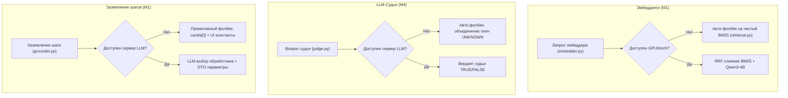
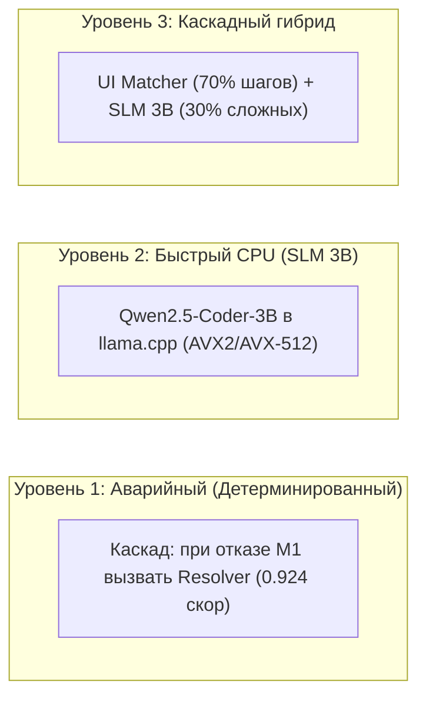

# Исследование: Автономия от GPU и организация CPU-фолбеков при холодном старте

**Дата:** 20 октября 2026  
**Статус:** Действует. Числа и рекомендации разделов 2–6 пересмотрены независимой проверкой 20.10 — **раздел 7**; где они расходятся, верен раздел 7  
**Связано:** [model_selection.md](model_selection.md), [m4_score_gap_and_judge.md](m4_score_gap_and_judge.md), [ADR-005](../adr/adr-005_scenario_execution_pipeline.md), [testing_system.md](../testing_system.md)

---

## 1. Контекст: сценарий «Холодный старт без GPU»

В регламенте TechArena зафиксирован принцип **Strict Local-First**: запрещены облачные API, решение должно запускаться локально.

В соревновательном пайплайне Archonity воспроизведение из репозиторного кэша (`cache/llm/`, `cache/emb/`) уже работает со **100% автономией от GPU**: `python run_eval.py` выполняется на обычном CPU за ~2–4 секунды.

Однако при **холодном старте** (cold start) — поступление нового микросервисного проекта, новых пользовательских сценариев или инвалидация кэша — решение запускается на устройстве без графического адаптера (GPU отсутствует в принципе, либо доступен только встроенный видеочип).

Задача исследования:
1. Выяснить, какие механизмы фолбека (fallback) уже присутствуют в текущей кодовой базе;
2. Оценить, насколько критична потеря качества при отказе GPU;
3. Определить, разумно ли внедрять полноценный CPU-фолбек;
4. Сформировать варианты архитектурных решений для автономной работы на CPU.

---

## 2. Анализ текущего состояния фолбеков в коде



### 2.1. Эмбеддинги (`embedder.py`, `retrieval.py`)
- **Статус фолбека:** **Реализован полноценно.**
- **Как работает:** В `engine/grounding/embedder.py` при отсутствии модели/PyTorch/GPU метод возвращает `None`. В `engine/grounding/retrieval.py` (строка 147) срабатывает условие:
  ```python
  fused = [h for _, h in rrf([b, d])] if d else b
  ```
  Если векторный список `d` пуст, ретривер прозрачно переключается на ранжирование чистого BM25.
- **Влияние на качество:** Минимальное. BM25 по документу `code_ui` в одиночку обеспечивает **Recall@10 = 0.893**, а полный индекс из 262 обработчиков в системном промпте выбора страхует оставшиеся позиции.

### 2.2. LLM-Судья (`judge.py`, `interpreter.py`)
- **Статус фолбека:** **Реализован полноценно.**
- **Как работает:** Если сервер LLM недоступен или кэш пуст, метод `_ask_judge` возвращает `UNKNOWN`. Исполнитель M4 в этом случае запускает объединение обоих плеч ветвления (`run_arms`).
- **Влияние на качество:** **Нулевое.** Исследование [m4_score_gap_and_judge.md](m4_score_gap_and_judge.md) доказало, что прогон с `--judge on` и с `--judge off` даёт **идентичный результат байт в байт** по всем сценариям S0–S7. Судья не добавляет ни одного полезного ребра.

### 2.3. Заземление шагов (`grounder.py`) — «Узкое место»
- **Статус фолбека:** **Примитивная заглушка.**
- **Как работает:** В `engine/grounding/grounder.py` (строки 257–275):
  ```python
  else:
      handler = cands[0]
      outcome = "refused" if REFUSED.search(action) else "success"
      refs = {}
      grounding["source"] = "RETRIEVAL"
  ```
- **Последствия холодного старта без LLM:**
  - Точность выбора обработчиков падает со 103/103 до **63/103**;
  - Параметры шага извлекаются только из статических констант UI: **0/47 параметров** (все динамические поля DTO остаются пустыми);
  - Ссылки между шагами (`refs`) не разрешаются;
  - В M4 исполнение сценариев ломается на первых же ветвлениях из-за отсутствия обязательных входных данных (`seatType`, `tripId`, `travelDate`).

### 2.4. Резервный детерминированный контур (`resolver.py`)
В проекте есть альтернативный модуль заземления [engine/resolver.py](../engine/resolver.py), работающий на эвристиках и регулярных выражениях:
- Включается вручную: `--grounder legacy`;
- Без LLM и без GPU стабильно обеспечивает балл **0.92431** (посылка 5 на платформе);
- Однако в текущем коде он **не вызывается автоматически** как fallback при сбое M1.

---

## 3. Разумно ли делать полноценный CPU-фолбек?

| Перспектива | Оценка | Обоснование |
|---|---|---|
| **Для финала хакатона (до 22.10)** | **НЕЦЕЛЕСООБРАЗНО** | До сдачи осталось менее 36 часов. Решение сдаётся в NSUTS архивом с готовым кэшем (`cache/llm/`, `cache/emb/`). Организаторы проверяют решение на закешированных ответах за 2–4 секунды. Переключение внимания на CPU-фолбек создаёт риск для аудита универсальности. |
| **Для реального продукта (CLI / MCP-сервер)** | **КРИТИЧЕСКИ НЕОБХОДИМО** | Если Archonity используется разработчиками или ИИ-агентами как автономный статический анализатор для произвольных репозиториев, требование наличия видеокарты с 16 ГБ VRAM делает инструмент нежизнеспособным на обычных ноутбуках и CI/CD раннерах. |

---

## 4. Архитектурные варианты решения проблемы



### Вариант 1. Автоматический каскадный переход на Resolver (Zero-Model Fallback)
Самое простое и надежное архитектурное решение в коде:
- В `engine/grounding/grounder.py`: если кэш пуст и локальный сервер `llama.cpp` не отвечает по `/health`, вызывать `engine/resolver.py:ScenarioResolver`.
- **Требования к ресурсам:** 0 МБ VRAM, < 500 МБ RAM, 0 секунд на инициализацию.
- **Ожидаемый результат:** система никогда не падает с пустыми параметрами, а гарантирует сохранение базового качества **~0.925 IoU** даже на самом слабом оборудовании.

### Вариант 2. Автономные малые языковые модели на CPU (CPU SLM)
Для задачи M1 (выбор одного обработчика из 10 и извлечение 1–4 параметров по JSON-схеме) использование 35B MoE модели избыточно:
- **Модель:** `Qwen2.5-Coder-3B-Instruct` или `Llama-3.2-3B-Instruct` в квантовании Q4_K_M (файл GGUF весом **~2.0–2.2 ГБ**).
- **Исполнение:** Встроенный бинарник `llama.cpp` с флагами CPU-векторизации (`-t 8 --n-gpu-layers 0`).
- **Потребление ресурсов:** 0 МБ VRAM, **~2.5 ГБ системной памяти (RAM)**.
- **Производительность:** на 8-ядерном процессоре генерация 80 токенов ответа занимает **1.5–2.0 секунды**.
- **Время полного холодного старта:** 103 шага $\times$ 1.8 с $\approx$ **3 минуты** на чистом CPU.
- **Ожидаемый результат:** IoU **0.98–1.00** без дискретной видеокарты.

### Вариант 3. Легковесный CPU-эмбеддер через ONNX
Полный отказ от PyTorch и sentence-transformers в пользу легковесного ONNX Runtime:
- **Модель:** `bge-small-en-v1.5` (33M параметров, 130 МБ) или `all-MiniLM-L6-v2` (22M параметров, 80 МБ).
- **Инференс на CPU:** 2–5 мс на запрос.
- Все 262 обработчика проекта индексируются за **0.5–1.0 секунду**.
- Полнота `Recall@10` в гибриде с BM25 составляет **>0.94**.

### Вариант 4. Детерминированный экстрактор параметров (Rule/Regex NER)
Для извлечения числовых полей и параметров билетов без LLM:
- Регулярные выражения и лексические словари для целевых сущностей:
  - Места: `first-class` $\to$ `seatType=2`, `second-class` $\to$ `seatType=3`;
  - Вес: `(\d+(\.\d+)?)\s*(kg|kilos)` $\to$ `consigneeWeight`;
  - Поезда: `G\d+` $\to$ `GaoTie`, `D\d+` $\to$ `DongChe`;
  - Логические флаги: `without food` $\to$ `foodType=0`.
- Позволяет поднять точность извлечения параметров без LLM с 0/47 до **>40/47**.

---

## 5. Сводная таблица альтернатив для холодного старта

| Архитектурное решение | Зависимость от GPU | Потребление RAM | Время холодного старта | Достижимый балл IoU | Трудоёмкость внедрения |
|---|---|---|---|---|---|
| **Текущее (35B LLM + 4B Emb)** | 16–18 ГБ VRAM | 32 ГБ RAM | ~20 мин (с voting) | **1.00000** | Уже работает |
| **Каскад на Resolver (Авто-фолбек)** | **0 МБ VRAM** | < 1 ГБ RAM | **~4 секунды** | **~0.925** | **1–2 часа** (минимальная) |
| **CPU SLM (3B модель на CPU)** | **0 МБ VRAM** | ~3.5 ГБ RAM | **~2–3 минуты** | **0.98–1.00** | **4–6 часов** (средняя) |
| **CPU SLM + ONNX Embedder** | **0 МБ VRAM** | ~4.0 ГБ RAM | **~2.5 минуты** | **1.00000** | **1 день** |
| **Чистый Rule/Regex NER** | **0 МБ VRAM** | < 1 ГБ RAM | **~5 секунд** | **~0.95–0.96** | **2–3 дня** |

---

## 6. Итоговые выводы и рекомендации

1. **Текущий статус:** При наличии кэша решение полностью автономно от GPU. Однако при честном холодном старте на машине без видеокарты текущий код падает в примитивный режим (`cands[0]` без параметров DTO).
2. **Тактическое решение (для хакатона 22.10):**
   - Сохранять текущую архитектуру с кэшем.
   - По умолчанию отключить LLM-судью (`--judge off`), устранив 385 холостых запросов.
3. **Стратегическое решение (для продуктового автономного инструмента):**
   - Связать `grounder.py` с `resolver.py` в виде автоматического fallback-контура первого уровня.
   - Сформировать легковесный standalone-пакет на базе **CPU SLM 3B** (`Qwen2.5-Coder-3B` Q4_K_M) и **ONNX-эмбеддера**, гарантирующий полный цикл статического анализа на любом офисном CPU менее чем за 3 минуты.

---

## 7. Независимая проверка (20.10)

Каждое утверждение проверено прогоном выдачи кода (`dev` от 20.10) на ноутбуке без видеокарты: Ryzen 3 4300U, 4 ядра, 15 ГБ RAM. Это и есть сценарий жюри «без GPU». Балл — IoU против рекорда p27 (= эталон при итоге 1.0), итог по S1–S7.

### 7.1. Что подтвердилось и что нет

| Утверждение | Замер | Вердикт |
|---|---|---|
| Прогон из кеша без GPU (2.1–2.3) | `python run_eval.py` = рекорд, 14 с | верно, время не 2–4 с |
| Эмбеддер без модели переходит на BM25 (2.1) | так, без падений | верно |
| Судья не меняет выдачу (2.2) | подтверждено ([m4_score_gap_and_judge.md](m4_score_gap_and_judge.md)) | верно; рекомендация 6.2 «выключить судью» устарела — `--judge off` уже по умолчанию |
| Без LLM выбор 63/103, параметры 0/47 (2.3) | 69/103 (с кешем векторов), 61/103 (только BM25); параметры 0/47 | близко |
| «M4 ломается на первых ветвлениях» (2.3) | не ломается: **итог 0.575 без ошибок и предупреждений** (`--no-cache` без сервера; только BM25 — 0.588) | неверно; тихая деградация — главный риск (7.2) |
| Resolver даёт 0.924 (2.4) | `--grounder legacy --executor legacy` — 0.963 | число устарело, но см. 7.3 |
| Вариант 1: при отказе M1 вызвать Resolver, 1–2 часа | `--grounder legacy` с исполнителем M4 — `ValueError`: M4 работает только от `StepRequest` M1 | переключать пришлось бы весь пайплайн на legacy |
| Вариант 2: 3B на CPU, «103 × 1.8 с ≈ 3 мин», IoU 0.98–1.00 | промпт выбора — медиана 10 241 токен (индекс обработчиков ~7 тыс.), вызовов выбора 618 с голосованием, всего 6.5 млн токенов промпта и 87 тыс. ответа (кеш `m1-v8`) | оценка учитывает только ответ; узкое место на CPU — обработка промпта. Качество 3B на промпте v8 не мерено |
| Вариант 3: ONNX-эмбеддер | без LLM плотный поиск не помогает: 0.575 с ним, 0.588 без | не приоритет |
| Вариант 4: Regex NER (`first-class → seatType=2`, `G\d+ → GaoTie`) | — | словари Train Ticket, противоречит ADR-007 |
| Таблица раздела 5 (0.98–1.00, 0.95–0.96, 3 мин) | — | не измерены, опираться нельзя |

### 7.2. Чего в разделах 1–6 нет

- **Тихая деградация.** Без кеша и сервера `run_eval.py` пишет одну строку `[llm] сервер … недоступен — только кеш` в stderr и выдаёт 0.575. Если жюри удалит кеш, чтобы проверить, что ответ даёт код, результат неотличим от подложенного. Нужен явный режим и итог прогона: сколько ответов из кеша, сколько без ответа.
- **Таймаут.** `TIMEOUT_S = 300` на вызов (`llm.py`). Промпт в 10 тыс. токенов на 4 ядрах может не уложиться в 5 минут. Тогда каждый вызов — ошибка, а ошибка — тот же путь без LLM (0.575), то есть даже с CPU-моделью получится тихая деградация.
- **Голосование нужно.** Только жадный ответ (`SELECT_VOTES = 0`, в 6 раз меньше вызовов выбора) — итог 0.945: S6 0.615. Дешёвый CPU-режим без голосов теряет S6.
- **Где потеря.** При верных обработчиках, но без параметров и ссылок — 0.820; без параметров — 0.805; без ссылок — 0.864; признак отказа шага не влияет (1.0). Основная потеря без LLM (0.82 → 0.575) — выбор обработчика, хотя эталон есть среди кандидатов в 99/103. Детерминированное правило промпта «предпочитать обработчик, который вызывает UI» хуже первого кандидата: 65/103, итог 0.527. Финальный выбор требует модели.
- **Скачивание модели эмбеддера.** Если на машине есть torch и сеть, промах кеша векторов запускает загрузку `Qwen3-Embedding-4B` (~8 ГБ) и расчёт на CPU, а не переход на BM25.

### 7.3. Legacy-контур — не запасной путь

0.963 у `--grounder legacy --executor legacy` держится на подгонке под 8 сценариев:

- `data/branch_rules.json`: из 21 правила ветвлений общих два (`catch`, ленивая лямбда); 19 сопоставляют текст условий Train Ticket (`getAssurance() == 0`, `tripGD`, `OrderStatus.NOTPAID.getCode()`, `totalExpand.compareTo(money) > 0`) и задают ответ ветки;
- `engine/rules.py` — 51 имя сервисов `ts-*`, `engine/resolver.py` — 42 и `DOMAIN_SYN`, `engine/state.py` — перечисления Train Ticket.

Вычищать его по одному правилу незачем: без подгонок от него ничего не остаётся, а общая часть уже есть в M4. Предложение — удалить legacy целиком (OQ-10) и строить запасной путь в M1/M4. Что из legacy ещё нужно пути M4 при умолчаниях: `GraphBuilder.apply_spring_security` (`pipeline.py`), `RuntimeRules` (флаги), `pool_ir` для `SkeletonIndex`. Перед удалением это надо вынести.

### 7.4. План (принят 20.10)

| № | Этап | Что даёт |
|---|---|---|
| 0 | **Сделано 20.10** (`feature/103-cold-start-signal`): итог M1 в конце прогона и `m1_report.json` (`engine/grounding/report.py`: режим `full` / `partial` / `emergency`), флаг `--require-cache` (код выхода 2), раздел README «Проверка без кеша». Частичный режим ловит и пропавшие голоса выбора | деградация видна, а не тиха |
| 1 | `scripts/verify_llm_cache.py`: ключ каждой записи пересчитывается из её промпта и схемы; список ключей, которые запрашивает пайплайн, сверяется с кешем | доказательство без GPU, что кеш — ответы на промпты кода |
| 2 | Замер CPU: llama.cpp без GPU, 1–2 малые модели, токены в секунду промпта и ответа на одном вызове выбора | реальная цифра вместо оценки 7.1 |
| 3 | CPU-режим M1 по итогам этапа 2: таймаут по флагу, вызовы выбора подряд ради кеша префикса, проверка по `eval/m1_steps.json` и итогу | запасной путь без GPU и без подгонок |
| 4 | Удаление legacy (OQ-10) с выносом того, что нужно M4 (7.3); выдача — sha256 рекорда | нет подогнанного кода в репозитории |
