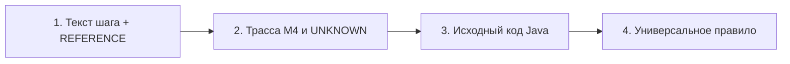

# Рекомендации по поиску гипотез и построчному разбору сценариев S1–S7

**Дата:** 18 октября 2026 г.  
**Контекст:** Пайплайн M4 IR-Executor (текущий скор **0.93625**, посылка `02-m4-unresolved-emit`)  
**Ориентиры:** [REFERENCE.md](../../hackaton/tt-challenge/REFERENCE.md), [annotation_rules.md](../annotation_rules.md), [m4_executor.md](m4_executor.md)

---

## 1. Оценка идеи пошагового разбора по сценариям

Идея разделить поиск гипотез по конкретным сценариям ($S_1 \dots S_7$) — **абсолютно правильная и самая эффективная на текущем этапе**.

### Почему это работает:
1. **Ортогональность бизнес-механизмов:** Сценарии практически не пересекаются по сложной бизнес-логике:
   * $S_2$ — отмена, возврат 80%, перебронирование на более дешевый регулярный поезд;
   * $S_3$ — добавление контакта, опции страховки/багажа, запрос тарифов;
   * $S_4$ — новый пользователь, пустой баланс $\to$ внешний платеж;
   * $S_5$ — сложные алгоритмы поиска маршрута (cheapest, quickest, minStation, transfer);
   * $S_6$ — административное создание сущностей и чтение админ-оркестраторами;
   * $S_7$ — отказы системы после сбора билета, смена получателя багажа без изменения веса.
2. **Структура REFERENCE:** Организаторы в [REFERENCE.md](../../hackaton/tt-challenge/REFERENCE.md) (раздел «В-третьих, специфичные сценарии») дали прямые подсказки именно в разрезе $S_1 \dots S_7$.
3. **Равный вес в метрике:** Итоговый балл — строго среднее арифметическое по 7 сценариям:
   $$\text{Score} = \frac{1}{7} \sum_{i=1}^{7} \text{IoU}(S_i)$$
   Прирост на $+0.035$ в слабом сценарии (например, в $S_2$) дает сразу $+0.005$ к общему лидерборду.

---

## 2. Очередь разбора сценариев (потенциал роста / ROI)

Разбор следует вести не строго по порядку номеров, а по величине разрыва до 1.0:

| Очередь | Сценарий | Текущий балл | Ключевая специфика из REFERENCE | Главные точки потери баллов |
|:---:|:---|:---:|:---|:---|
| **1 (P0)** | **$S_2$** | ~0.919 | Обычный поезд, возврат 80%, дешевое перебронирование | Вызовы сервиса распределения мест (`SeatController#create`), расчет разницы цен, зондирующие чтения заказа |
| **2 (P1)** | **$S_3$** | ~0.913 | 2 заказа с разными опциями, 0.5 кг багаж, типы страховок | Вызовы геттеров `AssuranceType`, конструктор нового контакта, разделение опций заказа 1 и 2 |
| **3 (P1)** | **$S_7$** | ~0.951 | Отказ в отмене/перебронировании после `collect`, багаж без смены веса | Блокировка веток доплаты/возврата, отсечение пересчета цены багажа при неизменном весе |
| **4 (P2)** | **$S_4$** | ~0.942 | Регистрация, пустой баланс $\to$ `payment-service`, отмена | Ветка внешней оплаты в `InsidePaymentServiceImpl#pay`, гидрация сущностей при пустой БД |
| **5 (P2)** | **$S_5$** | ~0.950 | Advanced search (3 режима + пересадка через Suzhou) | Объемные деревья вызовов `ts-travel-plan-service` и `ts-route-plan-service`, отсечение лишних станций |
| **6 (P3)** | **$S_1$** | ~0.941 | Поездная еда, страховка, 2 кг багаж, посадка в поезд | Каскадный опрос станционной еды из `getAllFood`, жизненный цикл `collected` $\to$ `used` |
| **7 (P3)** | **$S_6$** | ~0.913 | Admin: создание станции, поезда, маршрута, цены, рейса | Видимость созданного рейса G9101 в БД пассажира, чтение обеих баз заказов через админку |

---

## 3. Протокол построчного анализа сценария (4 шага)

Для каждого сценария $S_k$ проходим по его шагам по единому алгоритму:



### Шаг 1. Контекст шага и указания организаторов
* Читаем формулировку шага в `scenarios/S<k>.json`.
* Сверяем с разделом «В-третьих, специфичные сценарии» в [REFERENCE.md](../../hackaton/tt-challenge/REFERENCE.md):
  * Какие сервисы должны отвечать?
  * Есть ли специфичные условия (например, «без доплаты», «вес не изменился», «отказ системы»)?

### Шаг 2. Анализ трассы M4 и журнал неопределенностей
* Запускаем M4 с подробным выводом решений:
  ```bash
  python run_eval.py --executor ir --m4-unresolved-calls emit -o output/submission.json
  ```
* Открываем `output/m4_unknowns.json` и фильтруем по `scenario == "S<k>"`:
  * Какие ветки условий не вычислились точно (`UNKNOWN`) и пошли по ветке `both` или `success_path`?
  * Не привел ли выбор `both` к появлению лишних вызовов (FP) в альтернативной ветке?

### Шаг 3. Построчная сверка с Java-исходником
Открываем Java-класс обработчика и его сервиса:
* **`calls` / `executes`:**
  * Доходит ли управление до приватных хелперов и сеттеров/геттеров сущностей?
  * Проверяем вызовы конструкторов: создается ли объект через `new` с аргументами или через фреймворк?
* **`remote`:**
  * Какой точный URL собирается в `restTemplate.exchange(...)` или `postForObject(...)`?
  * Подставляем реальные параметры шага: какой порт/сервис выбирается (скоростной vs обычный)?
* **`data`:**
  * Какой метод репозитория вызывается (`save`, `findById`, `@Query`)?
  * Затрагивает ли запрос таблицы ленивых коллекций (R10) или выполняется чистый SELECT к основной таблице?

### Шаг 4. Фильтр универсальности (Защита от оверфиттинга)
Любая гипотеза **запрещена** к внедрению в виде хардкода сценария (`if scenario == "S2"`).  
Она обязана быть сформулирована через один из трех системных механизмов:
1. **Семантика данных M4:** передача точного значения поля в DTO шага (например, `consignRequest.weight == originalRecord.weight`).
2. **Семантика состояния БД (World/State):** состояние сущности после предыдущего шага (`order.status == OrderStatus.COLLECTED`).
3. **Семантика фреймворка:** стандартное поведение Spring Data / RestTemplate / JPA.

---

## 4. Конкретный чек-лист проверок по видам связей

При анализе каждого шага проверять 4 изолированных аспекта:

### 1. Связи `data` (SQL обращения к таблицам)
* [ ] **Ленивые коллекции (R10):** Не читается ли лишняя таблица коллекции (например, `route_distances`, `station_food_list`, `user_roles`), если метод не обращался к ее элементам на стеке?
* [ ] **Зондирующие SELECT:** Если сервис ищет запись и возвращает 0 строк, формируется ли легитимное ребро `data` (SQL отправлен)?
* [ ] **Каскадные обновления:** При вызове `save()` обновляется ли только основная таблица или также дочерние таблицы связей?

### 2. Связи `remote` (Межсервисные вызовы)
* [ ] **Разделение близнецов:** Не уходит ли запрос одновременно в оба сервиса (`ts-order-service` и `ts-order-other-service`), если тип поезда известен из параметров?
* [ ] **Условные интеграции:** Отсечены ли вызовы `ts-payment-service` (внешний платеж), `ts-notification-service` (почта) и `ts-consign-price-service`, если условие их вызова в Java ложно?
* [ ] **RabbitMQ (R13):** Активируется ли слушатель `RabbitReceive#process`, если сообщение реально отправлено в очередь?

### 3. Связи `calls` (Внутрисервисные вызовы)
* [ ] **Неразрешенные вызовы (M4-1):** Все ли явные проектные вызовы с неразрешенным в скелете типом получателя (цепочки вроде `getTripId().toString()`) учтены флагом `emit`?
* [ ] **Геттеры перечислений (Enum):** Вызываются ли реальные проектные методы enum (`getCode()`, `getNameByCode()`) в проверяемом шаге?
* [ ] **Колбэки коллекций (R5):** Вызывается ли рукописный `Order#equals` при проверке `accountOrders.contains(order)`?

### 4. Связи `executes` (Исполненные методы)
* [ ] **Конструкторы сущностей (R7):** Включены ли только те конструкторы, в которых есть явные проектные вызовы (режим `project_calls`), без фантомных пустых конструкторов Hibernate?
* [ ] **Код после отказа:** Если шаг завершился отказом (например, отказ в отмене на шаге $S_7$), включены ли только методы, успевшие выполниться до `return / throw`?

---

## 5. План ближайших действий

1. **Фокус на $S_2$:**
   * Провести построчный разбор шагов 9, 10 (отмена/расчет возврата) и 14 (перебронирование).
   * Проверить, какие вызовы генерирует `SeatController#create` внутри `RebookServiceImpl#updateOrder`.
   * Собрать изолированный архив и оценить дельту на платформе.
2. **Фокус на $S_3$:**
   * Разобрать шаг 14 (расчет багажа 0.5 кг) и шаг 15 (`getAllAssuranceTypes`).
   * Проверить необходимость вызовов геттеров `AssuranceType` по эталону организаторов.
3. **Фокус на $S_7$:**
   * Построчно разобрать реакцию `CancelServiceImpl` и `RebookServiceImpl` на статус билета `COLLECTED`.
   * Убедиться в отсечении ветки пересчета цены багажа при неизменном весе.
