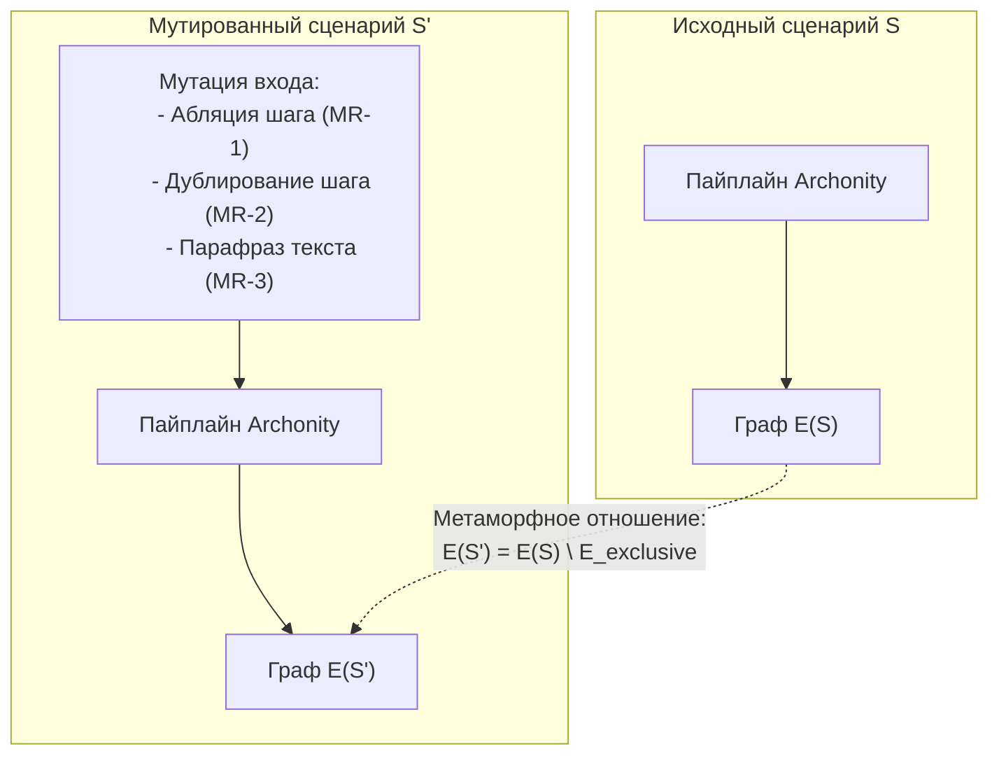

# Метаморфное тестирование конвейера Archonity

Дата: 20.10.2026  
Статус: **Действует**  
Связано: [testing_system.md](../testing_system.md), [universality_audit_after_1_0.md](universality_audit_after_1_0.md), [tests/test_metamorphic.py](../../tests/test_metamorphic.py)

---

## 1. Контекст и мотивация

Решением Archonity достигнут максимальный результат **1.00000** на всех 8 сценариях Train Ticket (посылка 27 в замере, посылка 28 и `dev` в выдаче кода). Регламент соревнований формулирует задачу шире: *«решение одно — программа, которая по тексту любого сценария строит его блок»*, а организаторы проверяют исходный код лучших решений на воспроизводимость и статический анализ.

Главная методическая сложность при подготовке к проверке на неизвестных сценариях — так называемая **проблема оракула (oracle problem)**: у новых сценариев нет размеченного эталона ($G$), поэтому традиционную метрику платформы $\text{IoU} = |P \cap G| / |P \cup G|$ невозможно посчитать напрямую.

Решение: **метаморфное тестирование (Metamorphic Testing, MT)**. Вместо сверки с отсутствующим абсолютным эталоном проверяются обязательные формальные свойства и инварианты между мутациями входного сценария и получаемыми графами исполнения.

---

## 2. Система метаморфных отношений (MR)

В Archonity выделено 5 метаморфных отношений, покрывающих ключевые узлы пайплайна (M1 Grounder, M3 State, M4 IR Executor, M5 Attribution).

---

### MR-1: Абляция изолированных шагов (Subgraph Ablation Invariance)

* **Формулировка:** Если шаг $k$ является терминальным запросом (например, просмотр информации в конце сценария без последующих зависимостей), то исключение шага $k$ из сценария обязано удалить из графа **строго** рёбра, порождённые шагом $k$, не затронув остальной конвейер и не породив случайных артефактов:
  $$E(S \setminus \{k\}) = E(S) \setminus E_{exclusive}(k)$$
  $$E(S \setminus \{k\}) \setminus E(S) = \emptyset$$
* **Реализация в тестах:**
  - Шаг 14 в $S_1$ («Look up the assurance (insurance) record of the order»): исключение шага удаляет ровно 2 метода (`AssuranceController#findAssuranceByOrderId` и `AssuranceServiceImpl#findAssuranceByOrderId`), 1 ребро `calls` и 1 обращение к таблице `ts-assurance-service.assurance`. Лишних рёбер в мутированном графе: **0**.
  - Шаги 13 и 14 в $S_1$ (багаж + страховка): удаление обоих шагов вычитает ровно 4 метода, 2 вызова и 2 таблицы. Основной бизнес-процесс (бронирование, билеты, оплата, посадка) остаётся побайтово неизменным.

---

### MR-2: Идемпотентность повторных read-only шагов (Execution Idempotence)

* **Формулировка:** Повторное выполнение одного и того же шага чтения (read-only query) из идентичного состояния не должно приводить к дублированию или мутации связей в результирующем множестве:
  $$\mathcal{G}(st_k) \cup \mathcal{G}(st_k) \equiv \mathcal{G}(st_k)$$
* **Реализация в тестах:** В исполнитель M4 передаётся StepRequest шага просмотра меню еды (`View the food menu offered on this trip`). Повторный вызов `run_step` из того же `ScenarioState` возвращает идентичные множества `methods`, `calls`, `remote`, `data`.

---

### MR-3: Устойчивость поиска точки входа к парафразам (Retrieval Robustness)

* **Формулировка:** Естественные вариации формулировки пользовательского шага (синонимы, опечатки, перестановка слов) не должны выбивать целевой обработчик контроллера из пула Top-$K$ кандидатов ($K \le 5$, при общем размере пула кандидатов $K=10$):
  $$\text{rank}_{BM25}(\text{mutate}(query)) \le 5$$
* **Реализация в тестах:** Проверка вариаций формулировок ключевых шагов:
  - *«Look up the assurance (insurance) record of the order»* $\to$ ранг 1.
  - *«Query the assurance insurance policy for this order»* $\to$ ранг 4.
  - *«Find insurance details by order id»* $\to$ ранг 4.
  - *«Get assurance of order»* $\to$ ранг 2.
  - *«Log in with username and password»* $\to$ ранг 1.
  - *«Sign in user with login credentials»* $\to$ ранг 3.
  - *«User authentication and login with password»* $\to$ ранг 3.
  - *«Look up the luggage consignment record of the order»* $\to$ ранг 1.
  - *«Search luggage consign history by order identifier»* $\to$ ранг 3.

---

### MR-4: Структурные инварианты графа и 100% Evidence Coverage

* **Формулировка:** Любой граф, выдаваемый конвейером, должен удовлетворять строгим архитектурным инвариантам:
  1. **Легитимность вершин:** Все вершины методов принадлежат `index.N` и имеют `kind in ("method", "constructor")`. Все вершины таблиц принадлежат `index.N` либо начинаются с `res:table:`.
  2. **Правило R19:** Все концы рёбер `calls`, `remote` и источники `data` строго присутствуют в `executes`.
  3. **100% аудит (Decision Ledger):** Каждое ребро из финального ответа имеет запись в `decisions.json` с непустым правилом (`rule`) и валидным источником (`SKELETON`, `IR_BRANCH`, `FRAMEWORK_RULE`, `DEFAULT_RULE`, `STATE`).

---

### MR-5: Детерминизм и калибровка

* **Формулировка:**
  - Два независимых прогона одного и того же сценария возвращают строго эквивалентные множества рёбер:
    $$\text{sha256}(submission_1) == \text{sha256}(submission_2)$$
  - Калибровочный эталон $S_0$ сохраняет $\text{IoU} = 1.0000$ по всем четырём типам рёбер.

---

## 3. Результаты прогона

Тестовый сьют реализован в [`tests/test_metamorphic.py`](../../tests/test_metamorphic.py):
- **14 тестов** выполняются за **1.6 секунды** на CPU;
- Не требуют сервера LLM и GPU, работают детерминированно в CI;
- Общий тестовый сьют проекта составляет **365 тестов** (все зелёные).
