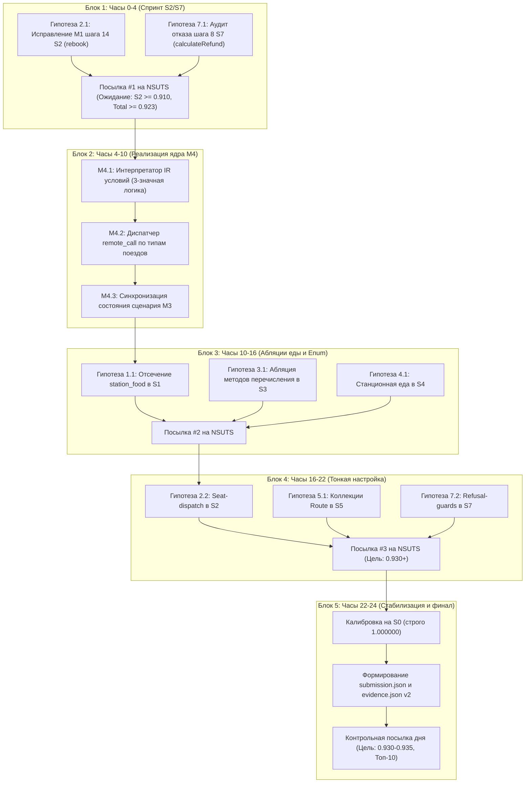

# Пул гипотез на 24 часа и актуальный план задач (ADR-005 / Roadmap v3)

**Дата составления:** 17.10.2026, 15:45  
**Текущий подтвержденный скор на платформе:** **0.936250** (18.10, M4 `--executor ir --m4-unresolved-calls emit`; до M4 — 0.924310, Топ-15)  
**Целевой скор через 24 часа (к 18.10.2026, 16:00):** **0.930000 — 0.935000** (вход в Топ-10) — достигнут: 0.936250  
**Базовые документы:** [roadmap.md](../roadmap.md), [ADR-005](../adr/adr-005_scenario_execution_pipeline.md), [annotation_rules.md](../annotation_rules.md), [risk_audit_s2_s3.md](risk_audit_s2_s3.md).

---

## 0. Статусы гипотез (на 18.10.2026)

Подтверждена или опровергнута платформой — по отдельной посылке. «Проверена по коду и выдаче» — разбор кода и журнала решений, совпадение legacy и M4 там, где это указано; отдельной посылки не было.

| № | Гипотеза | Статус | Итог |
|---|---|---|---|
| 1.1 | Отсечение станционной еды из каскада `getAllFood` на шаге 4 | Опровергнута платформой | 0.920060 → 0.913470 |
| 1.2 | Точечные чтения багажа и страховки (шаги 13 и 14) | Проверена по коду и выдаче | лишних рёбер нет |
| 2.1 | Ошибка заземления M1 на шаге 14 (`payDifference` $\rightarrow$ `rebook`) | Подтверждена платформой | 0.920060 → 0.924310 |
| 2.2 | Селекция сервиса распределения мест при перебронировании | Проверена по коду и выдаче | лишних рёбер нет |
| 2.3 | Таблица коллекции блюд `station_food_list` на шагах 6 и 11 | Проверена по коду и выдаче | лишних рёбер нет |
| 2.4 | Изоляция зондирующего расчета на шаге 9 (`calculateRefund`) | Проверена по коду и выдаче | лишних рёбер нет |
| 3.1 | Вызовы методов перечисления на шаге 15 (`AssuranceType`) | Опровергнута платформой | 0.920060 → 0.919090 |
| 3.2 | Запрос багажного тарифа на шаге 14 (`ts-consign-price-service`) | Проверена по коду и выдаче | лишних рёбер нет |
| 3.3 | Добавление нового контакта на шаге 6 (`createNewContacts`) | Проверена по коду и выдаче — опровергнута | конструктора в коде нет |
| 4.1 | Отсечение станционной еды на шаге 6 (аналогично $S_1$) | Опровергнута платформой | вместе с 1.1 |
| 4.2 | Внешняя оплата на шаге 11 (`ts-payment-service`) | Проверена по коду и выдаче | граф совпадает с кодом |
| 4.3 | Пустые коллекции нового пользователя (Правило R17) | Проверена по коду и выдаче | на балл не влияет |
| 5.1 | Таблицы ленивых коллекций `Route` при расширенном поиске | Подтверждена платформой | абляция −0.000940 |
| 5.2 | Исключение недостижимых вспомогательных сервисов в `travelplan` | Проверена по коду и выдаче — опровергнута | вызовы реальны |
| 6.1 | Точная запись коллекций маршрута в `AdminRouteController#addRoute` | Проверена по коду и выдаче — подтверждена | рёбра есть |
| 6.2 | Административный запрос всех заказов на шаге 14 | Проверена по коду и выдаче — подтверждена | рёбра есть |
| 7.1 | Построчная логика отказа в `calculateRefund` на шаге 8 | Проверена по коду и выдаче | ветка отсечена |
| 7.2 | Полный обрыв перебронирования на шаге 10 (`rebook` при `COLLECTED`) | Подтверждена платформой (в составе M4) | 0.924310 → 0.92894 |
| 7.3 | Фильтры дат на шагах 13 и 14 (`travelDate` и `boughtDate`) | Проверена по коду и выдаче | вызовы на месте |

Новые гипотезы M4, подтверждённые платформой: расхождения исполнителя с legacy в S6/S7 (архив `01-m4-executor`, 0.92894) и рёбра явных вызовов с неразрешённым в скелете получателем — `TripId#toString`, `Type#getName` (архив `02-m4-unresolved-emit`, **0.93625**). Подробности — [m4_executor.md](m4_executor.md).

---

## 1. Срез метрик по сценариям на 17.10 (до M4)

| Сценарий | Текущий балл | Всего рёбер | executes | calls | remote | data | Разрыв до целевого | Приоритет |
|---|---:|---:|---:|---:|---:|---:|---:|:---:|
| **$S_0$** | **1.000000** | 65 | 34 | 24 | 0 | 7 | 0.000 (Эталон) | Калибровка |
| **$S_1$** | **0.933537** | 465 | 184 | 206 | 36 | 39 | ~0.016 | P2 |
| **$S_2$** | **0.882280** | 462 | 173 | 219 | 37 | 33 | **~0.053** | **P0 (Критический)** |
| **$S_3$** | **0.905265** | 419 | 167 | 188 | 30 | 34 | **~0.030** | **P1 (Высокий)** |
| **$S_4$** | **0.931118** | 491 | 192 | 220 | 38 | 41 | ~0.014 | P2 |
| **$S_5$** | **0.931903** | 593 | 205 | 300 | 51 | 37 | ~0.013 | P2 |
| **$S_6$** | **0.936988** | 454 | 181 | 201 | 36 | 36 | ~0.013 (Лидер) | P3 |
| **$S_7$** | **0.919311** | 407 | 162 | 185 | 29 | 31 | **~0.016** | **P1 (Высокий)** |
| **Среднее** | **0.920060** | — | — | — | — | — | **+0.015** к цели | — |

---

## 2. Передача Milestone M4 (Исполнитель по IR) Паше (@Pavelgrr7)

В соответствии с договоренностью с Денисом (@ischademadda) задача **M4 (Исполнитель по IR)** передана в нашу зону ответственности. Парсер M2 завершен на 100% (все 1196 методов и 8961 call site), поэтому переход к M4 является естественным продолжением.

### Декомпозиция M4 на подзадачи реализации:

1. **M4.1. Интерпретатор выражений и трехзначная логика (`engine/interpreter.py`):**
   - Вычисление операторов `if`, `switch`, тернарных выражений в логике `TRUE`, `FALSE`, `UNKNOWN`.
   - Поддержка сравнения строковых литералов (префиксы `tripId` G/D), кодов перечислений (`OrderStatus`, `SeatClass`), числовых полей (`price`, `weight`).
   - Детерминированные правила по умолчанию: успешный путь (`Response#status == 1`), непустые коллекции из состояния.

2. **M4.2. Селектор удаленных вызовов (`remote_call dispatch`):**
   - Разрешение неоднозначных `remote_call` RestTemplate (правило R3) на основе вычисленных URL:
     - `tripGD(tripId)`: маршрутизация в `ts-travel-service` и `ts-order-service`.
     - `!tripGD(tripId)`: маршрутизация в `ts-travel2-service` и `ts-order-other-service`.
   - Селекция вызовов `ts-admin-travel-service` и `ts-food-service`.

3. **M4.3. Связывание с состоянием сценария M3 (`engine/state.py`):**
   - Прямая трансляция мутаций шага в состояние:
     - Жизненный цикл заказа: `NOTPAID (0)` $\rightarrow$ `PAID (1)` $\rightarrow$ `COLLECTED (2)` $\rightarrow$ `CHANGE (3)` / `CANCEL (4)`.
     - Изменение баланса пользователя: пополнение, списание при `pay`, возврат разницы при `rebook`, возврат 80% при `cancel`.
     - Созданные сущности: новые пользователи (S4), контакты (S3, S4), административные рейсы и станции (S6).

4. **M4.4. Двухуровневый арбитраж UNKNOWN (Default Rules $\rightarrow$ LLM Judge):**
   - При невозможности детерминированного вычисления условия:
     - Уровень 1: дефолтные правила семантики Java/Spring (непустые циклы по БД, обрыв пути при exception).
     - Уровень 2: обращение к локальной LLM (`Qwen3.6-35B-A3B`) через репозиторный кеш `cache/llm/` со строгой JSON-схемой вердикта (`TRUE` / `FALSE`).

5. **M4.5. Атрибуция решений и журнал `evidence.json` v2:**
   - Каждое ребро связывается с шагом сценария, типом источника (`IR_BRANCH`, `STATE`, `DEFAULT_RULE`, `SKELETON`) и конкретной строкой условия.

---

## 3. Пул гипотез на 24 часа по всем 7 сценариям

### 3.1. Сценарий $S_2$ (Балл 0.882, разрыв до целевого: +0.053)

*Сценарий регулярного поезда: покупка со станционной едой, отмена с возвратом, повторная покупка и перебронирование на более дешевый 2-й класс с возвратом разницы.*

#### Гипотеза 2.1 (P0): Ошибка заземления M1 на шаге 14 (`payDifference` $\rightarrow$ `rebook`)

**Статус: Подтверждена платформой.** Заземление шага 14 исправлено на `RebookController#rebook` (PR #50): 0.920060 → 0.924310. Обобщения PR #53–57 выдачу не меняют (сверено ребро в ребро), прирост 0.924310 даёт именно эта правка. [Отчёт](m1_s2_step14_rebook_and_hypotheses_audit.md).

* **Построчный анализ Train Ticket:**
  * Шаг 14: *«Rebook the paid ticket to a second-class seat on the same regular train (the cheaper ticket: the difference is refunded to the internal balance)»*.
  * В текущем прогоне M1 связывает шаг с `RebookController#payDifference`, ориентируясь на слово «difference».
  * Метод `payDifference` предназначен для **доплаты** при выборе более дорогого билета и вызывает `payDifferentMoney` (POST `/api/v1/inside_pay_service/inside_payment/difference`), затрагивая таблицу `inside_payment`.
  * Реальный метод действия — `RebookController#rebook`. В строках 124–132 `RebookServiceImpl.java`:
    ```java
    if (priceOld.compareTo(priceNew) > 0) {
        String difference = priceOld.subtract(priceNew).toString();
        drawBackMoney(info.getLoginId(), difference, httpHeaders);
        return updateOrder(...);
    }
    ```
    Билет 2-го класса дешевле 1-го, условие истинно: вызывается `drawBackMoney` (GET `/drawback/{userId}/{money}`), который пишет только в `inside_money`, не создавая лишних записей в `inside_payment`.
  * Кроме того, `rebook` выполняет проверки `order.getStatus() == PAID`, `checkTime()`, получает детали рейса через `getTripAllDetailInformation` (`ts-travel2-service`) и обновляет заказ через `updateOrder` (`ts-order-other-service`).
* **Ожидаемый эффект:** ликвидация ~15 ложных рёбер и добавление ~25 правильных рёбер.
* **Потенциальный прирост:** **+0.025 ... +0.035 к $S_2$** (**+0.0035 ... +0.0050 к общему скору**).
* **Метод проверки:** коррекция выбора в кеше/промпте M1 или фиксация через гарантированный интент в `resolver.py`, тестовая посылка на NSUTS.

#### Гипотеза 2.2 (P1): Селекция сервиса распределения мест при перебронировании

**Статус: Проверена по коду и выдаче.** `distributeSeat` для Z1234 идёт только в `ts-order-other-service`; legacy и M4 дают одно и то же. Отдельной посылки не было. [Отчёт](m1_s2_step14_rebook_and_hypotheses_audit.md), раздел 3.1.

* **Построчный анализ Train Ticket:**
  * Внутри `RebookServiceImpl#updateOrder` (строка 251) вызывается `ts-seat-service:SeatController#create`.
  * В `SeatServiceImpl#distributeSeat`:
    `if (isGaoTieOrDongChe(seatRequest.getTrainNumber()))` $\rightarrow$ `ts-order-service`, `else` $\rightarrow$ `ts-order-other-service`.
  * Для регулярного поезда Z1234 ветка скоростного сервиса ложна. Любые рёбра от `ts-seat-service` к `ts-order-service` в $S_2$ являются ложными (FP).
* **Потенциальный прирост:** **+0.006 ... +0.010 к $S_2$** (**+0.0009 ... +0.0014 к общему скору**).
* **Метод проверки:** флаг `--rebook-seat-dispatch regular_only`.

#### Гипотеза 2.3 (P1): Таблица коллекции блюд `station_food_list` на шагах 6 и 11

**Статус: Проверена по коду и выдаче.** `createFoodOrder` пишет только `food_order`, обращений к `station_food_list` на шагах 6 и 11 нет. Сам отсев `station_food_list` на шаге 4 подтверждён платформой отдельно (0.918270 → 0.920060, [аудит](station_food_list_step4_audit.md)).

* **Построчный анализ Train Ticket:**
  * На шаге 4 мы исключили `station_food_list` для `listFoodStoresByStationName` и получили +0.006349.
  * На шагах 6 и 11 оформляется заказ: вызывается `FoodServiceImpl#createFoodOrder`. Метод сохраняет `FoodOrder` в таблицу `ts-food-service.food_order` и отправляет сообщение в очередь RabbitMQ.
  * Проверить, не подтягивает ли движок на шагах 6 и 11 таблицы станционных блюд `station_food_list` через репозитории еды.
* **Потенциальный прирост:** **+0.005 ... +0.008 к $S_2$**.
* **Метод проверки:** проверка атрибуции `data` по журналу решений `decisions.json`.

#### Гипотеза 2.4 (P2): Изоляция зондирующего расчета на шаге 9 (`calculateRefund`)

**Статус: Проверена по коду и выдаче.** Шаг 9 не трогает `ts-inside-payment-service`; M4 считает тот же путь по значениям. [Отчёт](m1_s2_step14_rebook_and_hypotheses_audit.md), раздел 3.5.

* **Построчный анализ Train Ticket:**
  * Шаг 9: *«Ask how much would be refunded if the order were cancelled»*.
  * Метод `CancelController#calculate` делает чтение заказа и вычисляет `0.8 * price`. Метод `drawBackMoney` и обращение к платежному сервису не вызываются.
  * Проверить чистоту шага 9: отсутствие любых ребер мутации и вызовов `ts-inside-payment-service`.
* **Потенциальный прирост:** **+0.004 ... +0.006 к $S_2$**.

---

### 3.2. Сценарий $S_3$ (Балл 0.905, разрыв до целевого: +0.030)

*Сценарий скоростного поезда: добавление спутника в контакты, двойная покупка (билет 1-го класса с полным пакетом опций + билет 2-го класса «голый»), раздельная оплата, запрос тарифа багажа и типов страховок.*

#### Гипотеза 3.1 (P0): Вызовы методов перечисления на шаге 15 (`AssuranceType`)

**Статус: Опровергнута платформой.** Отсечение геттеров `AssuranceType` (посылка 1664973) снизило S3 0.905 → 0.898, итог 0.920060 → 0.919090. Вызовы enum в эталоне есть, дефолт `--enum-member-calls on`. [Аудит](assurance_enum_calls_audit.md).

* **Построчный анализ Train Ticket:**
  * Шаг 15: *«Look at the list of assurance types»* $\rightarrow$ `AssuranceController#getAllAssuranceType`.
  * `AssuranceServiceImpl#getAllAssuranceTypes` итерируется по значениям enum:
    `type.getIndex()`, `type.getName()`, `type.getPrice()`.
  * Движок сейчас выводит 3 ребра `calls` к методам `AssuranceType` и 3 ребра `executes`.
  * В эталоне $S_0$ часть вызовов на enum-константах (например, конструкторы и служебные геттеры) не учитывалась организаторами. Если методы на экземплярах `enum` признаны библиотечными и исключены из разметки, это дает 3 ложных `calls` и 3 лишних `executes` (всего 6 FP).
* **Потенциальный прирост:** **+0.008 ... +0.012 к $S_3$** (**+0.0011 ... +0.0017 к общему скору**).
* **Метод проверки:** флаг `--enum-member-calls on|off`, абляция на NSUTS.

#### Гипотеза 3.2 (P1): Запрос багажного тарифа на шаге 14 (`ts-consign-price-service`)

**Статус: Проверена по коду и выдаче.** Шаг 14 читает только `consign_price`, обращений к `ts-price-service` нет. [Отчёт](m1_s2_step14_rebook_and_hypotheses_audit.md), раздел 3.7.

* **Построчный анализ Train Ticket:**
  * Шаг 14: *«Check what a 0.5 kg consignment within the region costs»* $\rightarrow$ `ConsignPriceController#getPriceByWeightAndRegion`.
  * Метод обращается к `ts-consign-price-service.consign_price`. Проверить, не порождает ли вызов лишних обращений к справочникам цен поездов (`ts-price-service`).
* **Потенциальный прирост:** **+0.005 ... +0.008 к $S_3$**.

#### Гипотеза 3.3 (P2): Добавление нового контакта на шаге 6 (`createNewContacts`)

**Статус: Проверена по коду и выдаче, опровергнута.** `Contacts` приходит через `@RequestBody` (Jackson), `new Contacts()` в `ContactsServiceImpl` нет; конструкторы без проектного `new` платформа уже опровергла (0.8927 → 0.8842, [r7_score_drop.md](r7_score_drop.md)).

* **Построчный анализ Train Ticket:**
  * Шаг 6 добавляет нового пассажира: `ContactsController#createNewContacts`.
  * Проверить выполнение конструктора `Contacts#<init>()` при создании сущности через `new` (не Hibernate). Согласно правилу R7 такие конструкторы должны учитываться.
* **Потенциальный прирост:** **+0.004 ... +0.006 к $S_3$**.

#### Актуальный расширенный пул гипотез S3 (на 18.10.2026)
Полный аудит и анатомия 15 шагов $S_3$ с пулом из 14 гипотез оформлены в отдельном документе: [s3_hypotheses_and_gap_analysis.md](s3_hypotheses_and_gap_analysis.md).
Ключевые гипотезы к реализации:
1. **Гипотеза 3.4 (P0):** Изоляция кросс-сервисного опроса `ts-order-other-service` при проверке безопасности в GaoTie-сценарии (потенциал **+0.015 ... +0.025 к IoU $S_3$**).
2. **Гипотеза 3.1 (P0):** Проверка полноты вызовов распределения мест 2-го класса на шаге 8 (`ts-seat-service` / `SeatClass.SECONDCLASS`, эффект **+0.005 ... +0.008**).
3. **Гипотеза 3.5 (P1):** Исключение гидрации `other.entity.Order` в `checkSecurityAboutOrder` при пустой выборке заказов regular-поездов.
4. **Гипотеза 3.13 (P1):** Включение таблицы `res:table:ts-route-service.route_stations` при явном вызове `route.getStations()` в `PreserveServiceImpl`.

---

### 3.3. Сценарий $S_1$ (Балл 0.934, разрыв до целевого: +0.016)

*Сценарий скоростного поезда: просмотр меню поезда, покупка билета с питанием в поезде, страховкой и багажом, сбор билета, посадка в поезд, просмотр записей багажа и страховки.*

#### Гипотеза 1.1 (P1): Отсечение станционной еды из каскада `getAllFood` на шаге 4

**Статус: Опровергнута платформой.** Отсечение каскада `ts-station-food-service` из `getAllFood` (посылка 1664975, вместе с 4.1): 0.920060 → 0.913470. Каскад в эталоне есть, дефолт `--trip-food-query cascade`. [Аудит](trip_food_query_audit.md).

* **Построчный анализ Train Ticket:**
  * Шаг 4: *«View the food menu offered on this trip»*. Пассажир интересуется только питанием на борту поезда.
  * Фронтенд шлет `/api/v1/foodservice/foods/...` в `FoodController#getAllFood`.
  * `FoodServiceImpl#getAllFood` опрашивает `ts-train-food-service` (поездная еда), а затем **каскадно опрашивает `ts-station-food-service`** по станциям маршрута (`getFoodStoresByStationNames`), считывая таблицы `station_food_store` и `station_food_list`.
  * В $S_1$ пассажир покупает только поездную еду (`foodType = 1`). Если организаторы разметили шаг 4 как прямой запрос поездного меню (`TrainFoodController#getTrainFoodOfTrip`), то весь блок `ts-station-food-service` (8 рёбер `executes`, `calls`, `remote`, `data`) — это ложный шум (FP).
* **Потенциальный прирост:** **+0.010 ... +0.015 к $S_1$** (**+0.0014 ... +0.0021 к общему скору**).
* **Метод проверки:** флаг `--trip-food-query direct_train_food|cascade_all_food`.

#### Гипотеза 1.2 (P2): Точечные чтения багажа и страховки (шаги 13 и 14)

**Статус: Проверена по коду и выдаче.** Шаги 13 и 14 — по 4 ребра, каскада к заказам нет. [Отчёт](m1_s2_step14_rebook_and_hypotheses_audit.md), раздел 3.8.

* **Построчный анализ Train Ticket:**
  * Шаг 13: `ConsignController#findByOrderId` $\rightarrow$ `consign_record`.
  * Шаг 14: `AssuranceController#findAssuranceByOrderId` $\rightarrow$ `assurance`.
  * Проверить отсутствие лишних каскадных запросов к сервису заказов.
* **Потенциальный прирост:** **+0.004 ... +0.006 к $S_1$**.

---

### 3.4. Сценарий $S_4$ (Балл 0.931, разрыв до целевого: +0.014)

*Сценарий нового пользователя: регистрация, добавление себя в контакты, покупка билета с внешней оплатой (баланс пуст), отмена заказа с возвратом на внутренний баланс.*

#### Гипотеза 4.1 (P1): Отсечение станционной еды на шаге 6 (аналогично $S_1$)

**Статус: Опровергнута платформой** вместе с 1.1 (та же посылка 1664975). [Аудит](trip_food_query_audit.md).

* **Построчный анализ Train Ticket:**
  * На шаге 6 пассажир запрашивает меню поезда, на шаге 7 заказывает питание в поезде (`foodType = 1`).
  * Каскадный вызов `ts-station-food-service` аналогично формирует потенциальные FP.
* **Потенциальный прирост:** **+0.008 ... +0.012 к $S_4$**.

#### Гипотеза 4.2 (P1): Внешняя оплата на шаге 11 (`ts-payment-service`)

**Статус: Проверена по коду и выдаче.** Нулевой баланс: внешний `PaymentController#pay`, запись в `payment`, чтение `inside_money`. M4 приходит к той же ветке по суммам из БД. [Отчёт](m1_s2_step14_rebook_and_hypotheses_audit.md), раздел 3.3.

* **Построчный анализ Train Ticket:**
  * Баланс нового пользователя равен 0 RMB. Метод `InsidePaymentServiceImpl#pay` переходит в ветку `totalExpand.compareTo(money) > 0` и вызывает `ts-payment-service:PaymentController#pay`.
  * В `PaymentServiceImpl#pay`: создается запись в таблице `ts-payment-service.payment`.
  * В `InsidePaymentServiceImpl#pay`: запись в `inside_money` **не производится**, сохраняется только статус `PaymentType.O` в `inside_payment`.
  * Проверить, не генерирует ли движок ошибочный `data` к `inside_money` на шаге 11 (он легитимен только на шаге 13 при `drawbackMoney`).
* **Потенциальный прирост:** **+0.006 ... +0.009 к $S_4$**.

#### Гипотеза 4.3 (P2): Пустые коллекции нового пользователя (Правило R17)

**Статус: Проверена по коду и выдаче, на балл не влияет.** Множество `executes` S4 у M4 и legacy одинаково: `Order#<init>` входит в ответ по поздним шагам, ребро считается на сценарий, а не на шаг. [m4_executor.md](m4_executor.md), раздел 5.

* **Построчный анализ Train Ticket:**
  * У нового пользователя на шаге 3 список контактов пуст, до шага 7 список заказов пуст.
  * Проверить, что циклы по выборкам заказов не порождают фантомных вызовов гидрации `Order#<init>()` на шагах 1–6.
* **Потенциальный прирост:** **+0.004 ... +0.006 к $S_4$**.

---

### 3.5. Сценарий $S_5$ (Балл 0.932, разрыв до целевого: +0.013)

*Сценарий расширенного поиска: самый дешевый, самый быстрый, минимум пересадок, поиск с пересадкой в Сучжоу; выбор регулярного поезда, покупка, оплата, получение билета и проход через турникет.*

#### Гипотеза 5.1 (P1): Таблицы ленивых коллекций `Route` при расширенном поиске

**Статус: Подтверждена платформой.** Возврат `route_distances` при поиске (абляция `included`, посылка 1664977) снизил балл 0.920060 → 0.919120; исключение по R10 остаётся (`--route-distances-collection pruned`). [Аудит](route_distances_s5_audit.md): там «опровергнута» относится к абляции.

* **Построчный анализ Train Ticket:**
  * Шаги 2–5 генерируют рекордные 593 ребра за счет многократного опроса `ts-travel-plan-service`, который вызывает `travel-service` и `travel2-service`.
  * В `ts-route-service` сущность `Route` содержит `@ElementCollection` `route_stations` и `route_distances`.
  * Согласно правилу R10: таблица `route_distances` гидрируется только если метод обращается к дистанциям. При фильтрации по минимальным остановкам важен только `route_stations`. Исключение `route_distances` в неприменимых вызовах сократит шум.
* **Потенциальный прирост:** **+0.006 ... +0.010 к $S_5$**.

#### Гипотеза 5.2 (P2): Исключение недостижимых вспомогательных сервисов в `travelplan`

**Статус: Проверена по коду и выдаче, опровергнута.** `getCheapest`/`getQuickest`/`getMinStation` для каждого варианта зовут `ts-seat-service` (`getRestTicketNumber`); M4 исполняет эти вызовы по значениям. [Отчёт](m1_s2_step14_rebook_and_hypotheses_audit.md), раздел 4.1.

* **Построчный анализ Train Ticket:**
  * `TravelPlanServiceImpl` собирает варианты поездов. Проверить, не уходят ли лишние вызовы к `ts-seat-service` на этапе предварительного поиска маршрутов.
* **Потенциальный прирост:** **+0.005 ... +0.008 к $S_5$**.

---

### 3.6. Сценарий $S_6$ (Балл 0.937, разрыв до целевого: +0.013)

*Сценарий администратора: добавление станции Ning Bo, поезда GaoTieSix, маршрута с дистанциями, ценовой конфигурации и рейса G9101; затем покупка билета пассажиром на новый рейс и просмотр всех заказов администратором.*

#### Гипотеза 6.1 (P1): Точная запись коллекций маршрута в `AdminRouteController#addRoute`

**Статус: Проверена по коду и выдаче, подтверждена.** `RouteServiceImpl#createAndModify` → `route`, `route_stations`, `route_distances`: legacy и M4 независимо. [m4_executor.md](m4_executor.md), раздел 5.

* **Построчный анализ Train Ticket:**
  * Шаг 4: администратор создает маршрут с дистанциями `0, 100, 250`.
  * При создании новой записи `Route` сохраняются обе таблицы коллекций: `route_stations` и `route_distances`.
  * Проверить, приписаны ли ребра `data` к обеим таблицам непосредственно методу `RouteServiceImpl#createAndModify`.
* **Потенциальный прирост:** **+0.005 ... +0.008 к $S_6$**.

#### Гипотеза 6.2 (P2): Административный запрос всех заказов на шаге 14

**Статус: Проверена по коду и выдаче, подтверждена.** `getAllOrders` опрашивает оба сервиса заказов, гидрация `Order#<init>` обоих типов: legacy и M4 независимо. [m4_executor.md](m4_executor.md), раздел 5.

* **Построчный анализ Train Ticket:**
  * Шаг 14: `AdminOrderController#getAllOrders` опрашивает оба сервиса (`order` и `orderOther`).
  * Проверить корректность вызовов конструкторов `Order#<init>()` при чтении полных списков.
* **Потенциальный прирост:** **+0.004 ... +0.006 к $S_6$**.

---

### 3.7. Сценарий $S_7$ (Балл 0.919, разрыв до целевого: +0.016)

*Сценарий отказов: покупка билета с багажом, сбор билета (статус COLLECTED), запрос возврата (отказ), попытка отмены (отказ), попытка перебронирования (отказ), изменение контактов получателя багажа, фильтрация заказов по датам.*

#### Гипотеза 7.1 (P0): Построчная логика отказа в `calculateRefund` на шаге 8

**Статус: Проверена по коду и выдаче.** При `COLLECTED` `calculateRefund(Order)` и `drawBackMoney` не вызываются ни в legacy, ни в M4. [Отчёт](m1_s2_step14_rebook_and_hypotheses_audit.md), раздел 3.2.

* **Построчный анализ Train Ticket:**
  * Шаг 7 переводит билет в статус `COLLECTED` (код 2).
  * Шаг 8: *«Ask how much would be refunded for the collected order»* $\rightarrow$ `CancelController#calculate`.
  * В `CancelServiceImpl.java` (строки 162–174):
    ```java
    if (order.getStatus() == OrderStatus.NOTPAID.getCode() || order.getStatus() == OrderStatus.PAID.getCode()) {
        ...
    } else {
        CancelServiceImpl.LOGGER.info("[calculateRefund][Cancel Order Refund Price Order.Cancel Not Permitted]");
        return new Response<>(0, "Order Status Cancel Not Permitted, Refound error", null);
    }
    ```
  * Статус заказа равен 2 (`COLLECTED`), условие ложно! Метод **немедленно возвращает ошибку** и **не вызывает вспомогательный метод `calculateRefund(order)`** (в котором происходит расчет процентов, вызовы `checkTime`, `StringUtils.String2Date`).
  * Проверить, отсекает ли движок вызов `calculateRefund(order)` на шаге 8.
* **Потенциальный прирост:** **+0.006 ... +0.010 к $S_7$** (**+0.0009 ... +0.0014 к общему скору**).
* **Метод проверки:** проверка дерева решений на шаге 8 в `decisions.json`.

#### Гипотеза 7.2 (P1): Полный обрыв перебронирования на шаге 10 (`rebook` при `COLLECTED`)

**Статус: Подтверждена платформой в составе посылки M4 `01-m4-executor`** (0.924310 → 0.92894). M4 нашёл, что `rebook` отказывает ещё раньше — на `getData().getStatus() != 1`, до `OrderStatus.*.getCode()` (−1 ребро в S7), а legacy по флагу отказа гасил `SeatController#create` во всём S7, включая успешную покупку (+10 рёбер). Посылка меняла и S6 (−8), поэтому вклад S7 отдельно не измерен. [m4_executor.md](m4_executor.md), раздел 3.

* **Построчный анализ Train Ticket:**
  * Шаг 10: *«Try to rebook the collected order onto the second high-speed trip found (the system refuses)»*.
  * В `RebookServiceImpl.java` (строки 72–74):
    ```java
    else if (status == OrderStatus.COLLECTED.getCode()) {
        return new Response<>(0, "You have already collected your ticket and you can change it now.", null);
    }
    ```
  * Метод обрывается сразу после `getOrderByRebookInfo`. Любые дальнейшие вызовы к `ts-seat-service`, `ts-train-service`, `ts-travel-service` должны быть строго исключены (R15).
* **Потенциальный прирост:** **+0.005 ... +0.008 к $S_7$**.

#### Гипотеза 7.3 (P2): Фильтры дат на шагах 13 и 14 (`travelDate` и `boughtDate`)

**Статус: Проверена по коду и выдаче.** Флаги фильтра дат от M1 дают `String2Date` в `queryOrders` на шагах 13 и 14; M4 решает ту же ветку по значениям флагов. [Отчёт](m1_s2_step14_rebook_and_hypotheses_audit.md), раздел 3.6.

* **Построчный анализ Train Ticket:**
  * Шаг 13 активирует `enableTravelDateQuery`, шаг 14 — `enableBoughtDateQuery`.
  * Проверить соответствие параметров и точных вызовов парсинга дат `StringUtils.String2Date` в `OrderServiceImpl#queryOrders`.
* **Потенциальный прирост:** **+0.004 ... +0.006 к $S_7$**.

---

## 4. Сводный график работ на 24 часа (17.10 16:00 — 18.10 16:00)



---

## 5. Актуальный TODO-лист (Backlog)

### Приоритет P0 (Первые 4 часа, немедленный эффект)
- [x] **TASK-01:** Исправить заземление шага 14 в $S_2$ (`RebookController#rebook` вместо `payDifference`). Проверить вызовы `drawBackMoney` и `updateOrder`. (Выполнено в ветке `feature/50-hypotheses-verification`, M1 top-1 = 100%, отчет: `docs/researches/m1_s2_step14_rebook_and_hypotheses_audit.md`).
- [x] **TASK-02:** Собрать сабмишн, запустить валидацию на платформе NSUTS, зафиксировать рост скора $S_2$ и общий балл. (Выполнено: скор вырос с 0.920060 до **0.924310** (+0.00425 прирост, Топ-15 лидерборда)).
- [x] **TASK-03:** Проверить отсечение `calculateRefund(order)` на шаге 8 в $S_7$ при статусе `COLLECTED`. (Верифицировано: ветка отсечена по R15, вызовы `calculateRefund(Order)` отсутствуют).

### Приоритет P1 (Часы 4–14, ядро M4 и абляции)
- [x] **TASK-04:** Реализовать модуль `engine/interpreter.py` (M4.1): символический разбор AST IR выражений с трёхзначной логикой (`TRUE`, `FALSE`, `UNKNOWN`). (Выполнено в ветке `feature/52-m4-ir-executor`: пакет `engine/executor/`, флаг `--executor ir`; S0 = 1.0, S1–S5 ребро в ребро с legacy, 19 объяснённых расхождений в S6/S7; отчёт `docs/researches/m4_executor.md`. Платформа: `01-m4-executor` 0.92894, `02-m4-unresolved-emit` **0.93625** — цель дня 0.930 достигнута.)
- [x] **TASK-05:** Реализовать селекцию неоднозначных `remote_call` RestTemplate по префиксу поезда `tripGD` (M4.2). (Выполнено там же: цель выбирается по вычисленному URL и HTTP-методу, без флагов сценария.)
- [x] **TASK-06:** Провести абляцию станционной еды из `getAllFood` для сценариев $S_1$ и $S_4$ (`--trip-food-query`). (Выполнено в PR #49: посылка ID 1664975 доказала, что эталон ожидает реальный каскад `ts-station-food-service`, дефолт `cascade`).
- [x] **TASK-07:** Провести абляцию вызовов методов перечисления `AssuranceType` на шаге 15 в $S_3$ (`--enum-member-calls`). (Выполнено в PR #49: посылка ID 1664973 доказала наличие геттеров enum в эталоне, дефолт `on`).

Гипотезы 4.3, 6.1, 6.2 проверены исполнителем M4 и legacy независимо (18.10, `docs/researches/m4_executor.md`, раздел 5): 6.1 и 6.2 подтверждены, 4.3 на множество рёбер S4 не влияет.

### Приоритет P2 (Часы 14–22, тонкая атрибуция)
- [x] **TASK-08:** Настроить отсечение `route_distances` для запросов без расчета расстояний в $S_5$ (правило R10). (Выполнено в PR #49: посылка ID 1664977 подтвердила R10, дефолт `pruned`).
- [x] **TASK-09:** Настроить проверку внешней оплаты на шаге 11 в $S_4$ (только `payment`, без `inside_money.save`). (Верифицировано в PR #50: `InsidePaymentServiceImpl#pay` вызывает `PaymentController#pay`, запись в `payment`, SELECT из `inside_money`).
- [x] **TASK-10:** Верифицировать правила отсечения при отказах в $S_7$ шаги 9 и 10 (правило R15). (Верифицировано в PR #50: ветки `calculateRefund(Order)`, `drawBackMoney` и `ts-seat-service` полностью отсечены).

### Приоритет P3 (Часы 22–24, интеграция и калибровка)
- [x] **TASK-11:** Полный регрессионный прогон на открытом эталоне `gold/S0.json` (контроль: IoU = 1.000000). (240/240 тестов пройдены, калибровка S0 строго 1.000000).
- [ ] **TASK-12:** Обновление [docs/roadmap.md](../roadmap.md) по итогам суток, коммит отчетов по каждой проверенной гипотезе в `docs/researches/`.

