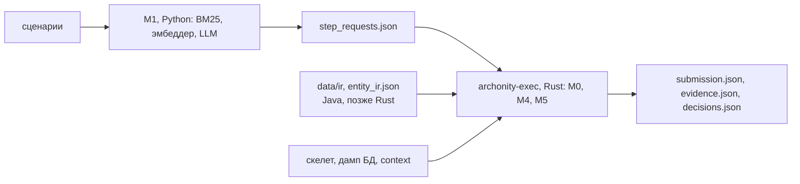

# План переноса на Rust (черновик)

Черновик от 21.10.2026. Решение Р1 из [roadmap](../roadmap.md) не принято: Паша обсуждает его с командой. Документ нужен для обсуждения, работу по нему не начинаем.

## Зачем

README организаторов: решения, в которых «анализ кода и построение ответа» реализованы на Rust, получают **×1.10 к итоговому баллу** (не выше 1.0). Надбавку начисляют после проверки кода. Тонкая обёртка на Rust вокруг кода на другом языке её не получает.

С 21.10 победителей определяют закрытые сценарии ([testing_system.md](../testing_system.md), раздел 1). Если там у нас выйдет 0.90, с надбавкой будет 0.99. За сутки никакая правка качества столько не даст.

Скорость здесь ни при чём. Движок считает 8 сценариев за 5 с из примерно 30 минут прогона, остальное время — LLM.

## Что переносить: engine или archparse

Сначала engine, потом archparse.

| | engine (M4 и M5) | archparse (M2) |
|---|---|---|
| Нужен для надбавки | Да: ответ строит он, без него «построение ответа» остаётся на Python | Желательно: разбор Java — «анализ кода». Засчитают ли без него — вопрос 2 организаторам |
| Объём | около 6.4 тыс. строк Python (список ниже) | 3.4 тыс. строк Java |
| Что сложного | Интерпретатор с динамическими значениями (`UNKNOWN`, `Obj`, `ListV`), мир БД с копированием на каждый сценарий, много правил R1–R20 | Перевод узлов синтаксического дерева в IR |
| Оракул | Рёбра на S0–S7 = рекорд; ответ по каждому из 262 обработчиков = Python (`scripts/handler_sweep.py`) | `data/ir/*.json` и `data/entity_ir.json` совпадают с выдачей Java |
| Зависимость от библиотеки | нет | JavaParser — только синтаксис, см. ниже |

### Почему archparse проще, чем кажется

JavaParser в archparse используется только как синтаксический разборщик:

- Вызовов `resolve()` и `SymbolSolver` нет: типы ищет свой `TypeIndex`.
- Из API нужны узлы `CompilationUnit`, объявления типов, методов и enum, операторы `if`/`for`/`foreach`/`try` и выражения.
- В Rust то же даёт `tree-sitter-java`: полная грамматика Java, обход дерева такой же.

Словарь IR маленький. В 1196 методах 42 модулей встречаются 12 видов операторов: `expr`, `assign`, `return`, `if`, `foreach`, `try`, `for`, `while`, `throw`, `break`, `continue`, `switch`. Ключей около 40.

Расхождение одно: поля `text` и `method_ref` Java печатает через `toString()` JavaParser, то есть заново отформатированным текстом. `tree-sitter` отдаёт исходный текст как есть, поэтому IR сравниваем без этих полей. Что они значат для движка, надо проверить: если только для показа, расхождение безопасно.

## Граница Python и Rust

M1 от M4 не зависит: выбор обработчика и параметры шага M1 строит по тексту сценария и истории шагов, результаты исполнения он не читает. Судья M4 при умолчаниях выключен. Поэтому разрез чистый:

- На Python остаётся только сопоставление текста шага с обработчиком через модели. Это работа с естественным языком, а не анализ кода. Так ли считают организаторы — вопрос 2.
- R20 (`engine/grounding/binding.py`, замена обработчика, который Spring вызвать не может) — анализ кода. Сейчас он стоит в M1 до записи `step_requests.json`. В Rust переносим вместе с M4: на вход Rust тогда идут шаги до замены.
- `run_eval.py --engine python|rust`, по умолчанию `python`, пока Rust не прошёл контрольную точку.

## Что переносить из engine

Только путь выдачи кода. Legacy-контур Миша удаляет, переносить его не нужно.

| Модуль | Строк Python |
|---|---|
| `engine/executor/` без `judge.py`: `interpreter`, `library`, `step`, `world`, `values`, `envelope`, `schema` | 3960 |
| `engine/adapters/`: `skeleton`, `db` (разбор дампа MySQL), `submission` | 1072 |
| `engine/entities.py`, `manifest.py`, `projection.py` | 516 |
| `engine/decisions.py`, `evidence.py` | 378 |
| `engine/pipeline.py` (путь M4), `apply_spring_security` из `graph/builder.py`, `binding.py` | около 500 |
| Итого | около 6.4 тыс. |

Доменные литералы Train Ticket, найденные 21.10 в коде, который работает при умолчаниях, в Rust не переносим. Их список — в roadmap, раздел П2.

## Этапы

Каждый этап заканчивается сверкой с оракулом. Python не трогаем.

| Этап | Что | Готово, когда |
|---|---|---|
| 0 | `rust/` — workspace, crate `archonity-core` и бинарник `archonity-exec`. Загрузка скелета (`.json.gz`), IR, `entity_ir.json`, дампа БД, `step_requests.json`; запись `submission.json` в порядке Python | на пустых шагах выдача = Python |
| 1 | Модель значений и мир БД: `values`, `world`, копия мира на сценарий | тесты на разбор дампа совпадают с Python |
| 2 | Интерпретатор: `interpreter`, `library`, `envelope` | `handler_sweep` по 262 обработчикам = Python |
| 3 | Шаг сценария: `step` (параметры, DTO, ссылки, повтор при отказе), R20, Spring Security, R19, видимость конструкторов | S0–S7 = рекорд ребро в ребро, затем sha256 |
| 4 | `evidence.json` и `decisions.json` | файлы совпадают с Python |
| 5 | archparse на `tree-sitter-java` | IR совпадает без полей `text`, выдача = рекорд |

Распараллелить можно так:

- после этапа 0 один человек берёт загрузчики и запись ответа, другой — модель значений;
- сначала договориться о типах значений: от них зависит всё остальное;
- этап 5 не зависит от этапов 1–4, его может вести третий человек.

## Контрольная точка

22.10, середина дня, время назначает Паша.

- Если `archonity-exec` выдаёт рекорд на S0–S7 и проходит `handler_sweep`, сдаём Rust и в README пишем, что анализ кода и построение ответа на Rust.
- Если нет — сдаём Python, Rust в посылку не кладём.

Сдать Rust без этапа 5 или нет, решаем по ответу организаторов на вопрос 2.

## Риски

- **Объём.** 6.4 тыс. строк Python — это примерно 9–10 тыс. строк Rust. Без нескольких параллельных агентов за сутки не успеть.
- **Тонкие расхождения.** Порядок обхода словарей и множеств в Python влияет на порядок рёбер и, возможно, на выбор при неоднозначности. Rust должен повторять порядок явно (`IndexMap`, сортировка).
- **Отвлекает от П1 и П2.** Воспроизводимость и устойчивость важнее надбавки. Без них закрытого тестирования не будет вовсе.
- **Двойная поддержка.** Любая правка M4 после старта переноса делается дважды. Поэтому на время переноса правки M4 только с механизмом и только после сверки на обеих версиях.
