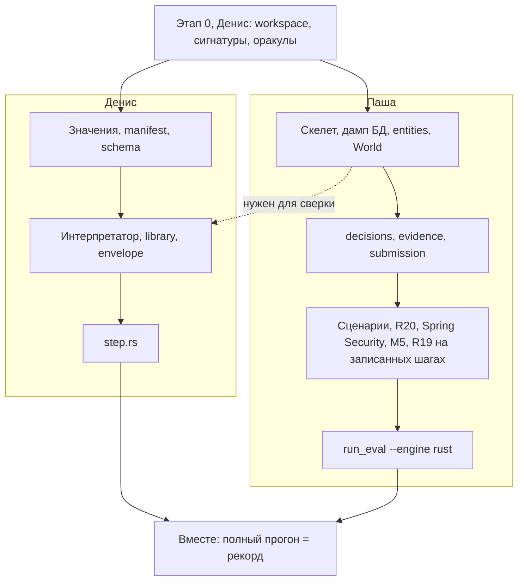

# Перенос engine на Rust: кто что делает

21.10.2026. Раздел работы между Денисом и Пашей по [плану переноса](rust_port_plan.md). Денис — около 60% объёма, Паша — около 40%. archparse не трогаем: он остаётся на Java до отдельного решения.

## Принцип

Конфликтов при мерже нет, если два человека не правят одни и те же файлы. Поэтому:

1. **Владение по файлам.** У каждого файла в `rust/` один владелец. Чужие файлы не правим даже на одну строку: нашёл ошибку — пиши владельцу.
2. **Контракт до разделения.** Первым идёт этап 0 (Денис): workspace, все crate и публичные сигнатуры с телами `todo!()`. После мержа этапа 0 оба пишут только тела своих функций, и код компилируется с первого дня.
3. **Python правит один человек за раз.** Оракулы — Денис на этапе 0, `run_eval.py --engine rust` — Паша в конце.

## Раскладка `rust/`

```
rust/
├── Cargo.toml                 workspace, общие зависимости — Денис, этап 0
├── Cargo.lock
└── crates/
    ├── archonity-model/       контракт — Денис
    │   └── src/  values.rs, request.rs, edges.rs, flags.rs, names.rs
    ├── archonity-io/          загрузка, мир БД, выходы — Паша
    │   └── src/  skeleton.rs, db.rs, entities.rs, world.rs,
    │             decisions.rs, submission.rs, evidence.rs, json_py.rs
    ├── archonity-m4/          исполнитель — Денис
    │   └── src/  manifest.rs, schema.rs, interpreter.rs, library.rs,
    │             envelope.rs, step.rs, ir.rs
    └── archonity-exec/        бинарник: сценарии, правила после шага — Паша
        └── src/  main.rs, pipeline.rs, binding.rs, catalog.rs,
                  security.rs, projection.rs
```

Зависимости идут в одну сторону: `model` ← `io` ← `m4` ← `exec`.

## Кто что делает

### Денис (около 60%)

| Python | Строк | Rust |
|---|---|---|
| Этап 0: workspace, сигнатуры всех crate, оракулы в Python (ниже) | около 400 нового | все crate, `scripts/rust_oracles.py` |
| `engine/executor/values.py` — модель значений | 319 | `model/values.rs` |
| `StepRequest`, контекст пассажира, рёбра шага, флаги правил | около 100 | `model/request.rs`, `edges.rs`, `flags.rs` |
| `engine/manifest.py`, `engine/executor/schema.py` | 216 | `m4/manifest.rs`, `schema.rs` |
| `engine/executor/interpreter.py` | 1431 | `m4/interpreter.rs` |
| `engine/executor/library.py` | 766 | `m4/library.rs` |
| `engine/executor/envelope.py` и `find_ui_dir`, `ui_files` из `ui_catalog.py` | около 160 | `m4/envelope.rs` |
| `engine/executor/step.py` | 708 | `m4/step.rs` |
| Загрузка IR `data/ir/*.json` | около 50 | `m4/ir.rs` |

Итого около 3.8 тыс. строк Python и этап 0. Это самая трудная часть: семантика значений и интерпретатор.

### Паша (около 40%)

| Python | Строк | Rust |
|---|---|---|
| `engine/adapters/skeleton.py` — индекс скелета | 348 | `io/skeleton.rs` |
| `engine/adapters/db.py` — разбор дампа MySQL, `context/README.md` | 491 | `io/db.rs` |
| `engine/entities.py` — `entity_ir.json` | 341 | `io/entities.rs` |
| `engine/executor/world.py` — `TypeIndex` и мир БД | 506 | `io/world.rs` |
| `engine/decisions.py`, `engine/evidence.py`, `engine/adapters/submission.py` и запись JSON как в Python | 611 | `io/decisions.rs`, `evidence.rs`, `submission.rs`, `json_py.rs` |
| `engine/pipeline.py` (путь M4: цикл сценариев, контекст пассажира, R19) | около 150 | `exec/pipeline.rs`, `main.rs` |
| `engine/grounding/binding.py` (R20) и маршруты с параметрами из `HandlerCatalog` | около 160 | `exec/binding.rs`, `catalog.rs` |
| `GraphBuilder.apply_spring_security`, режим `semantic` | около 120 | `exec/security.rs` |
| `engine/projection.py` (M5, R7) | 55 | `exec/projection.rs` |
| `run_eval.py --engine python\|rust`, по умолчанию `python` | около 60 | Python |

Итого около 2.8 тыс. строк Python. Части проще, но их много, и загрузчики стоят на критическом пути (ниже).

Не переносим: `engine/executor/judge.py` (судья M4 при умолчаниях выключен), legacy-контур (`rules.py`, `state.py`, `ir.py`, `branch_rules.py`, `resolver.py`, `GraphBuilder.traverse`): выдачу кода он не строит. Не переносим и доменные литералы (roadmap, П2), включая зашитый UUID пользователя в `resolve_passenger_context`.

## Контракт

Его фиксирует этап 0. Список ниже — что исполнитель (Денис) берёт у Паши и что отдаёт ему. Источник — фактические обращения в `engine/executor/*.py`.

| Что | Владелец | Кто зовёт | Что в нём |
|---|---|---|---|
| Значения: `Unknown`, `Obj`, `EnumV`, `ListV`, `MapV`, `OptionalV`, `Wrapper`, `Lambda`, `MethodRef`, `Bean`, `TypeRef`, `DateV`, `JsonV`, `Concat`, трёхзначная логика | Денис, `model` | оба | Объекты с общей изменяемой ссылкой (`Rc<RefCell<…>>`), равенство по ссылке там, где в Python `eq=False` |
| `SkeletonIndex` | Паша, `io` | Денис | `N` (узлы по ID, порядок вставки), `unit_of`, `cha`, `units`, `module`, `calls`, `over`, `handlers`, рёбра скелета, `entities`, `db_state`, `context` |
| `EntityFacts` | Паша, `io` | Денис | `allowed_ctors`, `calls_by_method`, `collection_table_loaded` |
| `DatabaseState` | Паша, `io` | Денис | `get_table`, `get_columns`, `insert`, `fork` |
| `TypeIndex`, `World` | Паша, `io` | Денис | `resolve`, `resolve_simple`, `all_fields`, `is_enum`, `fqn`, `method_of`, `enum_constants`; `rows`, `columns`, `row_to_obj`, `obj_to_row`, `select`, `save`, `delete`; функции `snake`, `camel`, `fresh_uuid`, `parse_java_args`, `column_of`, `derived_props`, `native_query_conds`, `optional_of` |
| `DecisionLedger` | Паша, `io` | Денис | `begin_scenario`, `begin_step`, `scenario_id`, `include`, `prune`, `discard`, `execute` с деталями (`detail`) |
| `StepRequest`, `ScenarioContext`, `StepEdges`, `RuleFlags` | Денис, `model` | Паша | Шаг до замены R20; рёбра шага `methods`, `calls`, `remote`, `data`; флаги `constructors`, `collection_tables_on_read`, `jackson_ctor`, `lombok_tostring`, `rabbitmq_delivery`, `module_roles`, `ref_kinds` |
| `StepExecutor` | Денис, `m4` | Паша | `new(index, flags, ir_dir, targets_root)`, `begin_scenario(sid)`, `run_step(req, ctx, ledger, scenario) -> StepEdges` |

Правка сигнатуры после этапа 0 — отдельный маленький PR. Второй человек о нём знает до мержа.

## Порядок



**Критический путь — загрузчики Паши (P1).** Интерпретатор Денис пишет параллельно, но сверить с Python его можно только на настоящих скелете, дампе и `World`. Поэтому P1 Паша делает первым и вливает отдельным PR, не дожидаясь P2.

Сценарии Паша проверяет, не дожидаясь исполнителя: `archonity-exec --replay <оракул>` берёт сырые рёбра и записи журнала каждого шага из оракула Python вместо `run_step`. Так R19, M5, Spring Security, R20 и запись файлов сверяются отдельно от интерпретатора.

## Оракулы (этап 0, Денис)

Python выдачу не меняет: после правки sha256 `submission.json` прежний (`94463c41…`).

| Оракул | Для кого | Что в нём |
|---|---|---|
| Шаги до замены R20 | оба | `step_requests` до `rebind`: вход Rust |
| Сырые рёбра и журнал по шагам | Денис, Паша | Выход `StepExecutor.run_step` и записи `DecisionLedger` за шаг, до Spring Security и M5 |
| Ответ по 262 обработчикам | Денис | `scripts/handler_sweep.py` |
| Трасса вызовов | Денис | Порядок `invoke` при флаге `ARCHONITY_TRACE`, по умолчанию выключена. Даёт первое место расхождения, а не итоговый дифф |
| Срезы загрузчиков | Паша | Индекс скелета, таблицы дампа, `EntityFacts` в JSON для сверки |

## Когда готово

| Кто | Что | Готово, когда |
|---|---|---|
| Паша | P1 | срезы загрузчиков совпадают с Python |
| Паша | P2, P3 | `--replay` на S0–S7 даёт `submission.json` с sha256 рекорда, `decisions.json` и `evidence.json` = Python байт в байт |
| Денис | D2 | 262 обработчика = Python, трасса без расхождений |
| Денис | D3 | сырые рёбра и журнал каждого шага S0–S7 = оракул |
| Оба | финал | `archonity-exec` без `--replay` = рекорд по sha256, три файла = Python; затем контрольная точка из [плана](rust_port_plan.md) |

## Как не получить конфликт

- **Ветки.** Этап 0 вливается в `dev` первым. Дальше у каждого своя ветка от `dev` и свой worktree, PR маленькие и частые.
- **`Cargo.toml` workspace** правит только этап 0. Там сразу перечислены общие зависимости: `serde`, `serde_json` с `preserve_order`, `indexmap`, `flate2`, `regex`, `fancy-regex`, `chrono`, `anyhow`, `clap`. Новую зависимость добавляем только в `Cargo.toml` своего crate.
- **`Cargo.lock`.** При конфликте руками не сливаем: берём версию из `dev` и запускаем `cargo build`, он допишет своё. Историю не переписываем, `dev` вливаем в свою ветку обычным merge.
- **Тесты и фикстуры** — в своём crate (`crates/<crate>/tests/`, `crates/<crate>/fixtures/`).
- **Python.** Денис трогает `run_eval.py`, `engine/pipeline.py` и `engine/executor/interpreter.py` только на этапе 0, точечно. Паша трогает `run_eval.py` только в P4, после мержа этапа 0. Миша сейчас удаляет legacy (П2а) в тех же `pipeline.py` и `run_eval.py`, поэтому этап 0 правит их минимально.
- **Правки M4 на Python** на время переноса — только с механизмом и с переносом в Rust тем же человеком, который владеет файлом в Rust (план, «Двойная поддержка»).

## Оговорки

- Python не удаляем, пока Rust не прошёл контрольную точку.
- В roadmap решение Р1 формально ещё открыто, а П4 записан за Пашей. Этот документ делит работу на случай Р1 = да.
- Перед этапом 0 пишем ADR-008: граница Python и Rust, контракт из таблицы выше, режим `--engine`. Код без ADR не начинаем (AGENTS.md).
