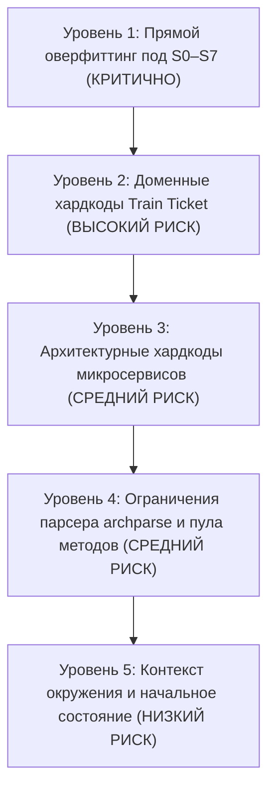

# Аудит пайплайна Archonity: инвентаризация подгонок под Train Ticket и сценарии S0–S7

**Дата аудита:** 18 октября 2026 г.  
**Контекст:** Соревнование TECHARENA 2026, трек «Семантический граф микросервисной архитектуры»  
**Основание:** Требование универсальности анализатора ([case_description.md](../case_description.md), [README.md](../../hackaton/tt-challenge/README.md), [roadmap.md](../roadmap.md), [AGENTS.md](../../AGENTS.md))  
**Режим проверки:** Read-Only аудит кодовой базы  

---

## 1. Введение и цели аудита

Согласно официальному регламенту TECHARENA и [case_description.md](../case_description.md):
> *«Вся идея челленджа заключается в легковесном анализаторе кода, который будет помогать LLM-агентам разбираться в микросервисных проектах, локализовать баги и реализовывать новый функционал. По завершении соревнования код лучших решений перезапускается и верифицируется организаторами на предмет соблюдения правил Local-First и статического анализа».*

В [roadmap.md (п. 106)](../roadmap.md) явно зафиксирован ключевой архитектурный риск проекта:
> *«Риски: Переобучение под 8 сценариев. Правила формулируем через семантику Spring, JPA и Java, не через имена сценариев и шагов».*

Цель настоящего аудита — выявить все места в текущем пайплайне (`engine/`, `archparse/`, `data/`), где:
1. Захардкожены конкретные номера сценариев ($S_0 \dots S_7$) или номера шагов ($step = 4, 9, 10, 14, 15$).
2. Захардкожены эвристики, истинные только для частных случаев тестовой выборки (например, предположение, что перебронирование *всегда* дешевле и не требует доплаты).
3. Захардкожены имена микросервисов, контроллеров, методов, таблиц и enum-констант Train Ticket вместо их обобщенного извлечения из AST, скелета, аннотаций Spring/JPA и SQL-дампа.
4. Захардкожены тестовые пользователи, учетные записи и системные даты.

---

## 2. Сводная классификация уровней специфичности

Все обнаруженные элементы разделены на 5 уровней (от наиболее критичных до допустимых конфигурационных параметров):



| Уровень | Описание | Риск при проверке жюри / на новом проекте | Текущий масштаб в кодовой базе |
|:---|:---|:---|:---|
| **Tier 1** | **Прямой оверфиттинг под сценарии S0–S7 и номера шагов** | **Критический:** При прогоне на сценарии $S_8$ логика сломается или будет отбрасывать валидные ребра | 7 флагов и явных условий в `rules.py`, `builder.py`, `branch_rules.json` |
| **Tier 2** | **Бизнес-домен Train Ticket в ядре движка** | **Высокий:** Анализатор не способен работать ни с каким проектом, кроме Ж/Д перевозок | `ScenarioProfile`, `OrderStatus`, `TrainType`, регулярные выражения по тексту шагов |
| **Tier 3** | **Привязка к конкретным сервисам, таблицам и классам** | **Высокий:** Имена сервисов (`ts-order-service`), контроллеров и сущностей вшиты в логику обхода | `engine/rules.py`, `engine/resolver.py`, `engine/entities.py` |
| **Tier 4** | **Хардкод пула методов в archparse** | **Средний:** Анализируются не все методы проекта, а ручной список из 52 методов | `TargetPool.java`, `pool_ir.json` |
| **Tier 5** | **Хардкод начальных сущностей и дат** | **Низкий:** Контекст задан организаторами для бенчмарка, но вшит константами в код | `ScenarioState` (`fdse_microservice`, `2026-10-01`, `10000.0`) |

---

## 3. Детальная инвентаризация по компонентам

### 3.1. Уровень 1: Прямая подгонка под сценарии S0–S7 и номера шагов

#### 1. Отсев таблицы `station_food_list` на шаге 4 сценариев S2/S3
* **Файлы:** [engine/rules.py#L253-L257](file:///c:/Users/Pavel/IdeaProjects/archonity/engine/rules.py#L253-L257), [engine/graph/builder.py#L224-L231](file:///c:/Users/Pavel/IdeaProjects/archonity/engine/graph/builder.py#L224-L231)
* **Код:**
  ```python
  # rules.py:
  STATION_FOOD_COLLECTION_MODES = ("step4_store_only", "all", "off")
  # step4_store_only (по умолчанию) — на шаге 4 в S2/S3 (listFoodStoresByStationName)
  # читаются только магазины, в S1/S4 — меню

  # builder.py:
  sf_mode = getattr(self.rules, "station_food_collection", "step4_store_only")
  if "station_food_list" in t:
      if sf_mode == "off" or (sf_mode == "step4_store_only" and "listFoodStoresByStationName" in m):
          ledger.prune("data", m, t, "FRAMEWORK_RULE", "station_store_browse_no_food_list")
          continue
  ```
* **В чем подгонка:** Правило явно сформулировано под конкретные номера сценариев и шагов. В $S_2$ и $S_3$ пассажир на шаге 4 смотрит список магазинов, а в $S_1$ и $S_4$ — меню. Решение принято не по анализу SQL/ORM (загружается ли связь `@ElementCollection` в данном вызове), а через имя метода `listFoodStoresByStationName` в сочетании с допущением о шаге.

#### 2. Зондирующий SELECT в S2 (шаги 9 и 10)
* **Файлы:** [engine/rules.py#L259-L262](file:///c:/Users/Pavel/IdeaProjects/archonity/engine/rules.py#L259-L262), [engine/graph/builder.py#L233-L244](file:///c:/Users/Pavel/IdeaProjects/archonity/engine/graph/builder.py#L233-L244)
* **Код:**
  ```python
  # builder.py:
  if (
      getattr(self.rules, "probe_orders_data", "on") == "off"
      and getattr(profile, "train_mode", "") == "regular_only"
      and "OrderServiceImpl#getOrderById" in m
      and "ts-order-service.orders" in t
  ):
      ledger.prune("data", m, t, "STATE", "regular_train_probe_empty_orders")
      continue
  ```
* **В чем подгонка:** Флаг `probe_orders_data` добавлен для абляции зондирующего SELECT в $S_2$. В сценариях обычных поездов запрос идет сначала в скоростной сервис (`ts-order-service`), возвращает 0 строк, затем в `ts-order-other-service`. Это поведение кода `CancelServiceImpl`, но оформлено как переключатель под конкретный сценарий.

#### 3. Абляция вызовов перечисления `AssuranceType` на шаге 15 в S3
* **Файлы:** [engine/rules.py#L264-L267](file:///c:/Users/Pavel/IdeaProjects/archonity/engine/rules.py#L264-L267), [engine/graph/builder.py#L131-L140](file:///c:/Users/Pavel/IdeaProjects/archonity/engine/graph/builder.py#L131-L140)
* **Код:**
  ```python
  # builder.py:
  if (
      getattr(self.rules, "enum_member_calls", "on") == "off"
      and "getAllAssuranceTypes" in m
      and "AssuranceType#" in x
  ):
      ledger.prune("calls", m, x, "DEFAULT_RULE", "enum_member_getter_ablation")
      continue
  ```
* **В чем подгонка:** Специальный фильтр под гипотезу о шаге 15 сценария $S_3$.

#### 4. Безусловное предположение о разнице цен при перебронировании (`priceOld > priceNew`)
* **Файлы:** [data/branch_rules.json#L273-L284](file:///c:/Users/Pavel/IdeaProjects/archonity/data/branch_rules.json#L273-L284)
* **Код:**
  ```json
  {
    "id": "BR_REBOOK_PRICE_DIFFERENCE",
    "code": "R11",
    "description": "RebookServiceImpl#rebook: разница в цене при перебронировании (priceOld.compareTo(priceNew) > 0)",
    "matcher": { "condition_contains": "priceOld.compareTo(priceNew) > 0" },
    "resolver": { "type": "constant", "value": true }
  }
  ```
* **В чем подгонка:** В сценарии $S_2$ перебронирование происходит с 1-го класса на 2-й (дешевле), поэтому возврат денег (`drawBackMoney`) выполняется, а доплата (`payDifferentMoney`) — нет. В ветку зашит константный `true`. Если появится сценарий с перебронированием на более дорогой билет, анализатор ошибочно выберет возврат вместо доплаты.

#### 5. Безусловное предположение о сохранении семейства поезда при перебронировании
* **Файлы:** [data/branch_rules.json#L97-L108](file:///c:/Users/Pavel/IdeaProjects/archonity/data/branch_rules.json#L97-L108), [engine/rules.py#L451-L453](file:///c:/Users/Pavel/IdeaProjects/archonity/engine/rules.py#L451-L453)
* **Код:**
  ```json
  {
    "id": "BR_REBOOK_SAME_FAMILY",
    "code": "R11",
    "description": "RebookServiceImpl#updateOrder: перебронирование всегда происходит внутри одного семейства поездов",
    "matcher": { "condition_contains_all": ["tripGD", "&&"] },
    "resolver": { "type": "constant", "value": true }
  }
  ```
  ```python
  # rules.py:
  if "RebookServiceImpl" in method_id:
      if any(x in method_id for x in ("createOrder", "deleteOrder", "payDifferentMoney")):
          return True
  ```
* **В чем подгонка:** В Java-коде `RebookServiceImpl` смена поезда с обычного на скоростной влечет `deleteOrder` в старом сервисе и `createOrder` в новом. Поскольку в $S_2$ и $S_7$ поезд остается регулярным, методы `createOrder` и `deleteOrder` безусловно объявлены «мертвым кодом».

#### 6. Обнуление цикла заказов для нового пользователя (S4)
* **Файлы:** [engine/rules.py#L541-L545](file:///c:/Users/Pavel/IdeaProjects/archonity/engine/rules.py#L541-L545), [data/branch_rules.json#L35-L48](file:///c:/Users/Pavel/IdeaProjects/archonity/data/branch_rules.json#L35-L48)
* **Код:**
  ```python
  # R17: Для нового пользователя (S4) в БД нет существующих заказов,
  # поэтому цикл по заказам в checkSecurityAboutOrder не выполняется (0 итераций)
  if profile.is_new_user:
      if "checkSecurityAboutOrder" in source and "String2Date" in target:
          return True
  ```
* **В чем подгонка:** Вместо универсального правила «если коллекция из БД пуста при данном состоянии, тело foreach не выполняется» сделан точечный отсев конкретной пары методов `checkSecurityAboutOrder -> String2Date`.

#### 7. Постобработка удаления ребра `queryOrders -> String2Date` по тексту сценария
* **Файлы:** [engine/graph/builder.py#L507-L523](file:///c:/Users/Pavel/IdeaProjects/archonity/engine/graph/builder.py#L507-L523)
* **Код:**
  ```python
  table_targets = {t for _, t in edges_data}
  if any("ts-order-other-service.orders_other" in t for t in table_targets):
      query_orders = "method:ts-order-other-service:other.service.OrderOtherServiceImpl#queryOrders(...)"
      string2date = "method:ts-common:edu.fudan.common.util.StringUtils#String2Date(java.lang.String)"
      if scenario_state is not None:
          if not scenario_state.has_date_filter_query():
              self._discard_edge(edges_calls, "calls", query_orders, string2date, "STATE", "date_filter")
      elif scenario_meta and not any(
          "travel date" in s.lower() or "bought date" in s.lower()
          for s in scenario_meta.get("step_texts", [])
      ):
          self._discard_edge(edges_calls, "calls", query_orders, string2date, "DEFAULT_RULE", "date_filter")
  ```
* **В чем подгонка:** Уже построенное ребро удаляется после обхода графа через проверку подстрок `"travel date"` / `"bought date"` в текстовом описании шагов.

---

### 3.2. Уровень 2: Доменные хардкоды Train Ticket в ядре движка

#### 1. Модель `ScenarioProfile` ([engine/rules.py#L15-L230](file:///c:/Users/Pavel/IdeaProjects/archonity/engine/rules.py#L15-L230))
Класс `ScenarioProfile` позиционируется как промежуточный профиль сценария, но целиком состоит из полей домена Train Ticket:
* `has_assurance` (страховка)
* `has_consign` (багаж)
* `has_food` (питание)
* `train_mode` (`"both"`, `"high_speed_only"`, `"regular_only"`)
* `has_refused_cancel`, `has_refused_rebook` (отказы по Ж/Д билетам)
* `has_consign_weight_change` (изменение веса посылки)

Извлечение этих полей построено на жестких регулярных выражениях:
* `"high-speed"`, `"gaotie"`, `"dongche"` $\rightarrow$ `high_speed_only`
* `"regular"`, `"other"` $\rightarrow$ `regular_only`
* `r"\b(?:\d+(?:\.\d+)?\s*kg|with\s+(?:a\s+)?luggage|consign\w*)\b"` $\rightarrow$ `has_consign`
* `r"\b(?:with\s+food|station\s+food|food\w*\s+menu)\b"` $\rightarrow$ `has_food`

*Последствие для универсальности:* При подаче любого другого проекта (интернет-магазин, банковский сервис, каршеринг) `ScenarioProfile` выдаст бессмысленные флаги, а правила фильтрации заблокируют исполнение.

#### 2. Доменные перечисления в `engine/state.py` ([#L14-L75](file:///c:/Users/Pavel/IdeaProjects/archonity/engine/state.py#L14-L75))
* `OrderStatus(IntEnum)`: полностью копирует `edu.fudan.common.entity.OrderStatus` (значения `NOTPAID=0`, `PAID=1`, `COLLECTED=2`, `CHANGE=3`, `CANCEL=4`, `REFUND=5`, `USED=6`).
* `TrainType(str, Enum)`: жестко зашито разбиение поездов по префиксу: `'G'`, `'D'` $\rightarrow$ `GaoTie`, остальные $\rightarrow$ `Other`.
* `_REF_ENTITY_ALIASES` ([#L78-L109](file:///c:/Users/Pavel/IdeaProjects/archonity/engine/state.py#L78-L109)): словарь сущностей Train Ticket (`contacts`, `orders`, `consignments`, `assurances`, `food_orders`, `stations`, `trains`, `routes`, `trips`, `prices`).
* Синтетические заглушки рейсов ([#L723-L745](file:///c:/Users/Pavel/IdeaProjects/archonity/engine/state.py#L723-L745)): генерация ID по умолчанию `K1235`, `G1234`, `store-shanghai`.

---

### 3.3. Уровень 3: Архитектурные хардкоды микросервисов и фреймворка

#### 1. Модуль гарантированных точек входа `get_intent_guarantees` ([engine/resolver.py#L173-L388](file:///c:/Users/Pavel/IdeaProjects/archonity/engine/resolver.py#L173-L388))
В `resolver.py` реализован механизм `Guarantees-first`: если шаг матчится регуляркой, заземление через BM25 вообще пропускается. Функция содержит **388 строк прямых соответствий текста контроллерам Train Ticket**:
```python
# resolver.py:
if re.search(r"\blog\s*in\b", t):
    intent_eps.add("method:ts-auth-service:auth.controller.UserController#getToken(auth.dto.BasicAuthDto,org.springframework.http.HttpHeaders)")

if re.search(r"\bsearch\b.*?\btrains?\b", t):
    if profile.train_mode == "regular_only":
        intent_eps.add("method:ts-travel2-service:travel2.controller.Travel2Controller#queryInfo(...)")
    else:
        intent_eps.add("method:ts-travel-service:travel.controller.TravelController#queryInfo(...)")

if re.search(r"\b(?:book|reserve)\b.*?\b(?:seat|ticket|trip)\b", t):
    if profile.train_mode == "regular_only":
        intent_eps.add("method:ts-preserve-other-service:preserveOther.controller.PreserveOtherController#preserve(...)")
    else:
        intent_eps.add("method:ts-preserve-service:preserve.controller.PreserveController#preserve(...)")
```
Всего захардкожено **24 метода контроллеров** 16 микросервисов.

#### 2. Списки административных, канареечных и неиспользуемых сервисов ([engine/rules.py#L339-L365](file:///c:/Users/Pavel/IdeaProjects/archonity/engine/rules.py#L339-L365))
```python
self.admin_services = {
    "ts-admin-basic-info-service",
    "ts-admin-order-service",
    "ts-admin-route-service",
    "ts-admin-travel-service",
    "ts-admin-user-service",
}
self.unreferenced_services = {"ts-verification-code-service", "ts-avatar-service", "ts-notification-service"}
self.canary_services.discard("ts-travel2-service")
```

#### 3. Селекция микросервисов-близнецов при межсервисных вызовах ([engine/rules.py#L578-L606](file:///c:/Users/Pavel/IdeaProjects/archonity/engine/rules.py#L578-L606))
Вместо динамического анализа URL из параметров `RestTemplate` в коде прописаны статические пары сервисов:
* Если `high_speed_only`, блокируются remote-вызовы к `ts-order-other-service` от `ts-inside-payment-service`, `ts-seat-service`, `ts-execute-service`, `ts-cancel-service`, `ts-rebook-service`, `ts-preserve-service`.
* Если `regular_only`, блокируются remote-вызовы тех же сервисов к `ts-order-service`.

#### 4. Внедрение графа Spring Security ([engine/graph/builder.py#L461-L502](file:///c:/Users/Pavel/IdeaProjects/archonity/engine/graph/builder.py#L461-L502))
Вместо статического анализа цепочки фильтров Spring Security (`SecurityFilterChain`, `AuthenticationManager`) в `builder.py` жестко вписаны идентификаторы методов авторизации Train Ticket:
```python
user_details_method = "method:ts-auth-service:auth.security.UserDetailsServiceImpl#loadUserByUsername(java.lang.String)"
jwt_filter = "method:ts-common:edu.fudan.common.security.jwt.JWTFilter#doFilterInternal(...)"
user_methods = [
    "method:ts-auth-service:auth.entity.User#getAuthorities()",
    "method:ts-auth-service:auth.entity.User#getPassword()",
    "method:ts-auth-service:auth.entity.User#getUsername()",
    "method:ts-auth-service:auth.entity.User#isAccountNonExpired()",
    "method:ts-auth-service:auth.entity.User#isAccountNonLocked()",
    "method:ts-auth-service:auth.entity.User#isCredentialsNonExpired()",
    "method:ts-auth-service:auth.entity.User#isEnabled()",
]
jwt_prov = "method:ts-auth-service:auth.security.jwt.JWTProvider#createToken(auth.entity.User)"
```

#### 5. Имена таблиц в `engine/entities.py` ([#L34-L39](file:///c:/Users/Pavel/IdeaProjects/archonity/engine/entities.py#L34-L39))
```python
OWNER_COLUMNS = ("account_id", "user_id")
STATE_TRACKED_TABLES = ("orders", "orders_other", "contacts")
```

---

### 3.4. Уровень 4: Ограничения archparse и пула методов

#### 1. Статический пул методов в Java-парсере ([archparse/src/main/java/com/v39a/config/TargetPool.java](file:///c:/Users/Pavel/IdeaProjects/archonity/archparse/src/main/java/com/v39a/config/TargetPool.java))
* Класс `TargetPool` содержит явный жестко закодированный список из **52 методов** Train Ticket с путями к Java-файлам и типами аргументов (`CancelServiceImpl`, `ExecuteServiceImpl`, `InsidePaymentServiceImpl`, `RebookServiceImpl`, `PreserveServiceImpl`, `PreserveOtherServiceImpl`, `ConsignServiceImpl`, `OrderServiceImpl`, `OrderOtherServiceImpl`, `TokenServiceImpl`, `UserServiceImpl`, `SeatServiceImpl`, `TravelServiceImpl`).
* Хотя в archparse реализован режим `--mode bodies` для разбора всех 1196 методов скелета, файл `data/pool_ir.json`, на котором работает `engine/ir.py`, генерируется из этого ограниченного пула.

#### 2. Хардкод связывания Enum в `engine/ir.py` ([#L25-L32](file:///c:/Users/Pavel/IdeaProjects/archonity/engine/ir.py#L25-L32), [#L258-L275](file:///c:/Users/Pavel/IdeaProjects/archonity/engine/ir.py#L258-L275))
Разрешение методов enum-констант (правило R7) жестко привязано к двум конкретным FQN Train Ticket:
```python
ORDER_STATUS_GET_CODE = "method:ts-common:edu.fudan.common.entity.OrderStatus#getCode()"
SEAT_CLASS_GET_CODE = "method:ts-common:edu.fudan.common.entity.SeatClass#getCode()"
```
Если в проекте появятся другие перечисления, их геттеры не будут сопоставлены со скелетом.

---

### 3.5. Уровень 5: Контекст окружения и начальное состояние

#### 1. Константы по умолчанию в `engine/state.py` ([#L138-L143](file:///c:/Users/Pavel/IdeaProjects/archonity/engine/state.py#L138-L143))
```python
DEFAULT_ACCOUNT_ID = "4d2a46c7-71cb-4cf1-b5bb-b68406d9da6f"
DEFAULT_USERNAME = "fdse_microservice"
DEFAULT_BALANCE = 10000.0
DEFAULT_TRAVEL_DATE = "2026-10-01"
DEFAULT_SYSTEM_DATE = "2026-09-15"
```
Эти значения заданы в `context/README.md` организаторами для бенчмарка. Однако в универсальном решении они должны читаться из `context/` или SQL-дампа, а не быть зашиты дефолтными значениями в код Python-класса.

---

## 4. Оценка рисков и выводы

### 4.1. Почему текущий пайплайн сейчас дает высокий балл (0.920+)
Текущий результат (0.920060 на NSUTS) достигнут именно за счет тщательного ручного разбора всех 8 сценариев Train Ticket. Каждая эвристика уровня 1 и 2 отсекала конкретные ложноположительные ребра (FP), выявленные в S0–S7.

### 4.2. Где кроются риски
1. **Риск дисквалификации или снижения балла при аудите жюри:**
   Организаторы TechArena проверяют код победителей в репозитории. Наличие явных условий вроде `if sf_mode == "step4_store_only"` или `if "CancelServiceImpl" in method_id` сразу показывает, что программа не является общим статическим анализатором, а содержит захардкоженные правила под конкретный тестовый набор.
2. **Риск регрессии на скрытых тестах со скрытыми ветками:**
   Если в скрытых сценариях платформы $S_1 \dots S_7$ есть шаг перебронирования с доплатой или сценарий с отменой билета без возврата, константы `BR_REBOOK_PRICE_DIFFERENCE: true` и `BR_CANCEL_NOTPAID_ZERO_REFUND: false` приведут к потере точности.

---

## 5. Дорожная карта обобщения (Roadmap to Universality)

Чтобы превратить Archonity в честный, универсальный статический анализатор без потери текущего скора, рекомендуется следующий поэтапный рефакторинг:

### Этап 1. Замена `resolver.py` на универсальный `M1` (Grounding через UI-каталог и LLM)
* **Проблема:** 388 строк ручных связок в `get_intent_guarantees`.
* **Решение:** Модуль `engine/grounding/` уже умеет извлекать маршруты из JS/HTML (`build_ui_context`) и сопоставлять их через BM25/Dense + LLM-выбор. Переключить дефолтный режим пайплайна на `grounder = "m1"` и исключить словарь `get_intent_guarantees`.

### Этап 2. Универсальный исполнитель M4 по полному IR тел методов
* **Проблема:** `TargetPool.java` (52 метода) и таблица `branch_rules.json` с именами классов Train Ticket.
* **Решение:** 
  1. Перевести M4 на чтение полного IR (`data/ir/<module>.json`), где для всех 1196 методов уже построены деревья AST.
  2. Заменить поиск подстрок вроде `totalExpand.compareTo(money) > 0` на вычисление условий в трехзначной логике (`TRUE`, `FALSE`, `UNKNOWN`) на основе состояния `ScenarioState` и переданных параметров шага.

### Этап 3. Семантическое моделирование Spring Security и фреймворка
* **Проблема:** Хардкод `UserDetailsServiceImpl` и методов `auth.entity.User` в `builder.py`.
* **Решение:** 
  Определять цепочки безопасности через семантику Spring:
  - Поиск классов, реализующих `UserDetailsService` (через скелет / аннотации `@Service`).
  - Поиск классов, реализующих `UserDetails` $\rightarrow$ их геттеры вызываются при аутентификации.
  - Поиск наследников `OncePerRequestFilter` / `GenericFilterBean` $\rightarrow$ их методы `doFilterInternal` активны для веб-запросов.

### Этап 4. Динамическая маршрутизация межсервисных вызовов
* **Проблема:** Статическое исключение `ts-order-service` vs `ts-order-other-service` по имени сервиса.
* **Решение:** 
  В `RestTemplate` URL формируется из переменных: `getServiceUrl(serviceName) + path`. Вычислять значение `serviceName` и пути через анализ констант и параметров вызова в M4. Целевой сервис определяется по вычисленному URL, а не по глобальному флагу `train_mode`.

### Этап 5. Инициализация состояния из SQL-дампа
* **Проблема:** Дефолтный пользователь `fdse_microservice`, баланс 10 000 и даты прописаны в коде.
* **Решение:**
  Загружать активного пользователя, его баланс и существующие записи динамически из MySQL дампа (`context/db-after-warmup.sql.gz`) через уже реализованный `engine/adapters/db.py`.

---

## 6. Резюме

Пайплайн Archonity обладает мощным математическим и графовым фундаментом (скелет, обратимый MySQL парсер, AST IR тел методов, трехзначная логика, журнал решений evidence v2). Однако поверх этого фундамента сейчас надстроен слой временных эвристик и хардкодов Train Ticket, созданных для быстрой валидации гипотез на лидерборде.

Устранение этих хардкодов по предложенной дорожной карте позволит сохранить высокий балл на бенчмарке Train Ticket и одновременно гарантировать полную универсальность решения при проверке организаторами.
