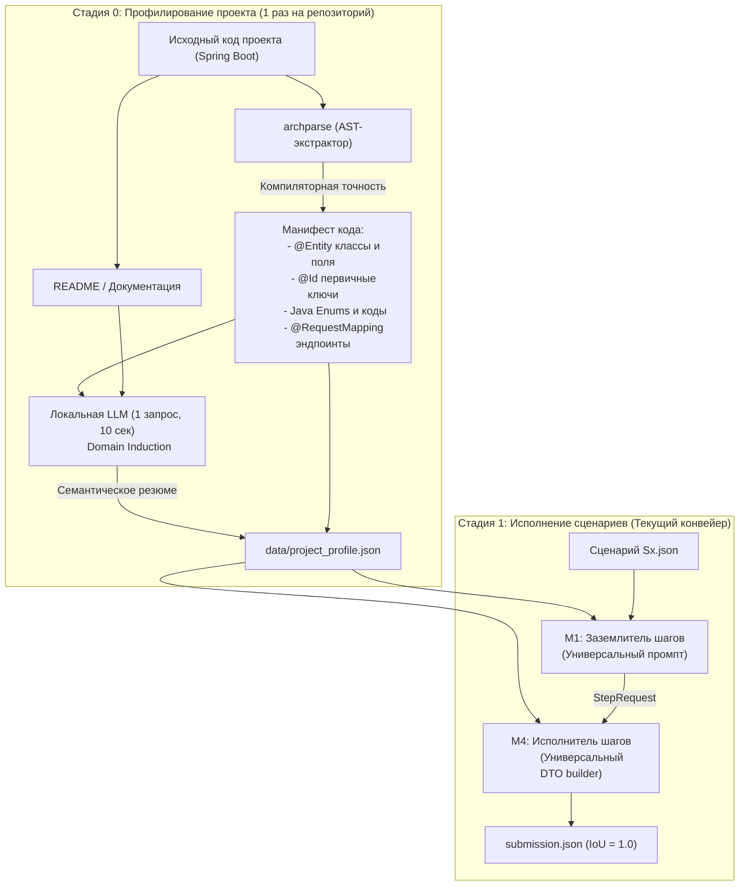

# Исследование: Двухстадийный пайплайн анализа (Stage 0: Project Profiling)

Дата: 19.10.2026  
Цель: переход от доменных хардкодов Train Ticket к универсальному анализу любого Spring Boot проекта  
Связано: universality_audit_after_1_0.md, ADR-005, prompts.py, step.py  

---

## 1. Проблема и мотивация

В текущей кодовой базе Archonity достигнут максимальный результат **1.00000** на сценариях Train Ticket. Однако детальный аудит выявил ряд доменных концентраций специфики:
- Текст системного промпта M1 жестко описывает Train Ticket и поезда;
- В `step.py` зашиты словари 12 сущностей (`_KIND_HINTS`), первичных ключей (`_ID_FIELDS`) и синтетические моки DTO (телефон `13800000000`, капча `verificationCode`);
- В `request.py` зафиксирован кортеж `REF_ENTITIES`.

Пытаться решить эту проблему чисто процедурными правилами (хардкодить регулярки на все случаи жизни) невозможно: в каждом новом проекте (банковский сервис, e-commerce, логистика) будут свои сущности, свои форматы первичных ключей и свои правила разделения сервисов.

Решение: **двухстадийный пайплайн (Two-Stage Architecture)**.
1. **Стадия 0 (Project Profiling):** однократный запуск при знакомстве с новым репозиторием. Компиляторный AST-парсер извлекает точные факты о коде, а легковесная локальная LLM обобщает семантику домена в единый артефакт — `project_profile.json`.
2. **Стадия 1 (Scenario Execution):** основной конвейер (M1 заземление + M4 исполнение), где промпты и структуры данных параметризуются из `project_profile.json`.

---

## 2. Архитектура двухстадийного пайплайна

---

## 3. Детализация компонентов Стадии 0

### 3.1. Компонент A: AST-манифест (`archparse`) — 100% точность без LLM

Компиляторные факты не должны угадываться нейросетью. Их собирает `archparse` (JavaParser/Tree-sitter) за считанные секунды:

1. **Сущности и первичные ключи (`entities`):**
   * Сканирование аннотаций `@Entity`, `@Table(name = "...")`.
   * Извлечение поля с аннотацией `@Id` (или `@EmbeddedId`).
   * *Результат:* словарь вида `{"order": {"class": "order.entity.Order", "table": "orders", "id_field": "orderId"}}`.
   * Это полностью устраняет хардкоды `_KIND_HINTS`, `_ID_FIELDS` и `REF_ENTITIES` из Python-кода.
2. **Справочники кодов (`enums`):**
   * Обход всех `enum` проекта, сбор имен констант и их числовых кодов (`getCode()`).
   * *Результат:* секция `{enums}` для промпта генерируется без участия человека.
3. **Обнаружение кандидатов в близнецы (`twin_candidates`):**
   * Нахождение эндпоинтов в разных модулях с одинаковыми или почти совпадающими путями запросов (`order/refresh` и `orderOther/refresh`).
   * Формирование списка парных сервисов для анализа семантики.

---

### 3.2. Компонент B: LLM-профилировщик (Domain Induction)

Локальная модель (Qwen) запускается **ровно один раз** для всего репозитория.

**Вход промпта профилирования:**
- `README.md` целевого проекта (или первые 100 строк документации);
- Список модулей и краткий список найденных сущностей;
- Список обнаруженных сервисов-близнецов.

**Задача модели:**
Вернуть структурированный JSON с тремя полями:
1. `domain_summary`: краткое описание домена (1–2 предложения, например: *«Railway ticket reservation platform with high-speed and regular train separation»*).
2. `twin_rules`: семантическое правило выбора между парными сервисами (например: *«ts-*-other-service serves regular trains (K/T/Z), while plain services serve high-speed trains (G/D)»*).
3. `naming_conventions`: особенности валидации или нормализации (например: *«Station names are alphanumeric lowercase»*).

---

## 4. Как сохранить рекорд 1.00000 и кеш LLM

Критическое ограничение проекта: **выдача на 8 сценариях Train Ticket должна сохраняться ребро в ребро**, а запуск `run_eval.py` без сервера LLM должен попадать в кеш `cache/llm/`.

В `prompts.py` ключ кеша зависит от полного текста промпта (`PROMPT_VERSION = "m1-v7"`). Если изменить хотя бы один символ в тексте `SYSTEM`, все кешированные ответы для S0–S7 станут невалидными.

### Стратегия безопасной миграции:

1. **Создание эталонного профиля Train Ticket:**
   * В репозитории фиксируется файл `data/project_profile.json`, содержащий факты о Train Ticket.
2. **Форматирование с сохранением инварианта:**
   * Шаблон системного промпта проектируется так, чтобы при подстановке значений из `data/project_profile.json` результирующий текст `system_prompt` **байт в байт совпадал с текущей константой `m1-v7`**.
   * Проверка: `assert formatted_prompt == SYSTEM`.
   * Результат: кеш LLM сохраняется на 100%, балл 1.00000 остаётся нетронутым.
3. **Режим для новых проектов (`--profile-project`):**
   * При анализе нового проекта флаг запускает связку `archparse --mode manifest` + скрипт профилирования, перезаписывая `data/project_profile.json` под новый проект.

---

## 5. Важнейшие заметки для работы с командой

1. **Не усложнять моделью то, что решает парсер:**
   Все первичные ключи (`@Id`), таблицы (`@Table`) и перечисления (`enum`) должны извлекаться строго через `archparse`. Модели доверяем только высокоуровневое резюме домена и формулирование правил маршрутизации.
2. **Универсальный Mock-генератор DTO в M4:**
   Вместо точечных условий на телефон `13800000000` и капчу в `step.py` сделать генератор фиктивных значений по аннотациям `@NotNull`, `@NotBlank`, `@Size`. Если поле строковое — `mock_str`, если числовое — `0` или `1`, если UUID — `fresh_uuid()`.
3. **Готовность к защите перед организаторами:**
   На защите решения двухстадийный пайплайн демонстрирует зрелую архитектуру:
   * «Наш статический анализатор не переобучен под Train Ticket: при подаче любого нового репозитория на Spring Boot движок за секунды профилирует домен и адаптирует промпты и семантику исполнения M4 без единой правки кода».

---

## 6. Пошаговый план реализации

| Этап | Задача | Затрагиваемые модули | Риск для скора 1.0 |
|---|---|---|---|
| **Этап 1** | Выделение `data/project_profile.json` для Train Ticket | `data/project_profile.json` | 🟢 Нулевой (новый файл) |
| **Этап 2** | Параметризация `prompts.py` и `step.py` через профиль с проверкой инварианта байт в байт | `prompts.py`, `step.py` | 🟢 Нулевой (сверка с рекордом) |
| **Этап 3** | Реализация извлечения сущностей и `@Id` в `archparse` (режим манифеста) | `archparse/src/main/...` | 🟢 Нулевой (изолировано в Java) |
| **Этап 4** | Скрипт `scripts/profile_project.py` для вызова локальной LLM на новом проекте | `scripts/profile_project.py` | 🟢 Нулевой (автономный скрипт) |
