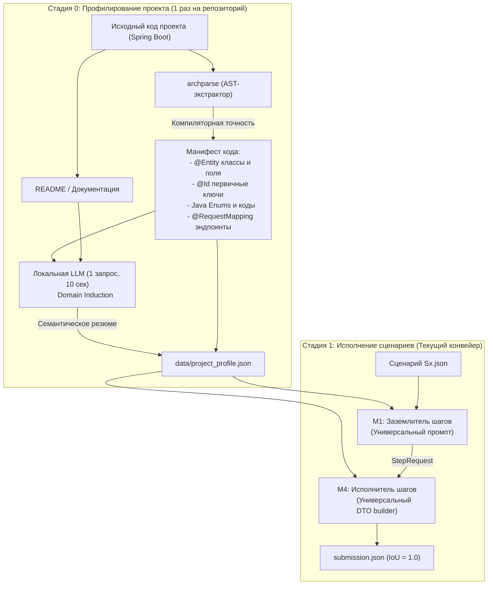

# Исследование: Двухстадийный пайплайн анализа (Stage 0: Project Profiling)

Дата: 19.10.2026  
Цель: переход от доменных хардкодов Train Ticket к универсальному анализу любого Spring Boot проекта  
Связано: universality_audit_after_1_0.md, ADR-005, prompts.py, step.py  

---

## 1. Проблема и мотивация

В текущей кодовой базе Archonity достигнут максимальный результат **1.00000** на сценариях Train Ticket. Однако детальный аудит выявил ряд доменных концентраций специфики:
- Текст системного промпта M1 жестко описывает Train Ticket и поезда;
- В `step.py` зашиты словари 12 сущностей (`_KIND_HINTS`), первичных ключей (`_ID_FIELDS`) и синтетические моки DTO (телефон `13800000000`, капча `verificationCode`);
- В `request.py` зафиксирован кортеж `REF_ENTITIES`.

Пытаться решить эту проблему чисто процедурными правилами (хардкодить регулярки на все случаи жизни) невозможно: в каждом новом проекте (банковский сервис, e-commerce, логистика) будут свои сущности, свои форматы первичных ключей и свои правила разделения сервисов.

Решение: **двухстадийный пайплайн (Two-Stage Architecture)**.
1. **Стадия 0 (Project Profiling):** однократный запуск при знакомстве с новым репозиторием. Компиляторный AST-парсер извлекает точные факты о коде, а легковесная локальная LLM обобщает семантику домена в единый артефакт — `project_profile.json`.
2. **Стадия 1 (Scenario Execution):** основной конвейер (M1 заземление + M4 исполнение), где промпты и структуры данных параметризуются из `project_profile.json`.

---

## 2. Архитектура двухстадийного пайплайна

---

## 3. Детализация компонентов Стадии 0

### 3.1. Компонент A: манифест кода — без LLM

Компиляторные факты не должны угадываться нейросетью. Новый режим `archparse` для них не нужен: почти всё уже есть в скелете организаторов и в наших артефактах. В узлах `type` скелета есть аннотации классов (`@Entity` — 27 классов, `@Table` — 11), в узлах `field` — аннотации полей (`@Id`/`@EmbeddedId` — 28 полей); `data/entity_ir.json` уже содержит сущности и вызовы репозиториев; коды перечислений M1 уже читает автоматически (`enum_codes` в `grounder.py` подставляет их в `{enums}` промпта). Манифест — это скрипт на Python поверх скелета:

1. **Сущности и первичные ключи (`entities`):**
   * Аннотации `@Entity`, `@Table(name = "...")` из узлов `type` скелета.
   * Извлечение поля с аннотацией `@Id` (или `@EmbeddedId`).
   * *Результат:* словарь вида `{"order": {"class": "order.entity.Order", "table": "orders", "id_field": "orderId"}}`.
   * Это полностью устраняет хардкоды `_KIND_HINTS`, `_ID_FIELDS` и `REF_ENTITIES` из Python-кода.
2. **Справочники кодов (`enums`):**
   * Уже сделано: `enum_codes` собирает константы и коды из исходников, секция `{enums}` промпта генерируется без участия человека. В `archparse` код статусов заказа зашит отдельно (`EnumResolver.ORDER_STATUS_FQN`) — его обобщить на все перечисления.
3. **Обнаружение кандидатов в близнецы (`twin_candidates`):**
   * Нахождение эндпоинтов в разных модулях с одинаковыми или почти совпадающими путями запросов (`order/refresh` и `orderOther/refresh`).
   * Формирование списка парных сервисов для анализа семантики.

---

### 3.2. Компонент B: LLM-профилировщик (Domain Induction)

Локальная модель (Qwen) запускается **ровно один раз** для всего репозитория.

**Вход промпта профилирования:**
- `README.md` целевого проекта (или первые 100 строк документации);
- Список модулей и краткий список найденных сущностей;
- Список обнаруженных сервисов-близнецов.

**Задача модели:**
Вернуть структурированный JSON с тремя полями:
1. `domain_summary`: краткое описание домена (1–2 предложения, например: *«Railway ticket reservation platform with high-speed and regular train separation»*).
2. `twin_rules`: семантическое правило выбора между парными сервисами (например: *«ts-*-other-service serves regular trains (K/T/Z), while plain services serve high-speed trains (G/D)»*).
3. `naming_conventions`: особенности валидации или нормализации (например: *«Station names are alphanumeric lowercase»*).

---

## 4. Как сохранить рекорд 1.00000 и кеш LLM

Критическое ограничение проекта: **выдача на 8 сценариях Train Ticket должна сохраняться ребро в ребро**, а запуск `run_eval.py` без сервера LLM должен попадать в кеш `cache/llm/`.

В `prompts.py` ключ кеша зависит от полного текста промпта (`PROMPT_VERSION = "m1-v7"`). Если изменить хотя бы один символ в тексте `SYSTEM`, все кешированные ответы для S0–S7 станут невалидными.

### Стратегия безопасной миграции:

1. **Создание эталонного профиля Train Ticket:**
   * В репозитории фиксируется файл `data/project_profile.json`, содержащий факты о Train Ticket.
2. **Форматирование с сохранением инварианта:**
   * Шаблон системного промпта проектируется так, чтобы при подстановке значений из `data/project_profile.json` результирующий текст `system_prompt` **байт в байт совпадал с текущей константой `m1-v7`**.
   * Проверка: `assert formatted_prompt == SYSTEM`.
   * Результат: кеш LLM сохраняется на 100%, балл 1.00000 остаётся нетронутым.
3. **Режим для новых проектов (`--profile-project`):**
   * При анализе нового проекта флаг запускает связку `archparse --mode manifest` + скрипт профилирования, перезаписывая `data/project_profile.json` под новый проект.

---

## 5. Важнейшие заметки для работы с командой

1. **Не усложнять моделью то, что решает парсер:**
   Все первичные ключи (`@Id`), таблицы (`@Table`) и перечисления (`enum`) должны извлекаться строго через `archparse`. Модели доверяем только высокоуровневое резюме домена и формулирование правил маршрутизации.
2. **Генератор значений DTO в M4 — по смыслу, а не только по типу:**
   Значения в `build_dto` несут смысл для исполнения: имя зарегистрированного пользователя нужно следующему шагу входа (S4), уникальный номер документа — чтобы `ContactsServiceImpl#create` не нашёл дубликат (S3). Правила: значение, которого нет в мире БД, — для полей, по которым создающий метод ищет дубликат (`findBy<Поле>` перед `save`); значение, записанное шагом, — переиспользуется следующими; остальное — по типу (`@NotNull`, `@NotBlank`, `@Size`). Пустой код подтверждения при входе — условие организаторов (`context` скелета), его брать оттуда.
3. **Что можно честно сказать на защите:**
   * Доменные знания вынесены из кода в данные (`project_profile.json`), факты о коде берутся из скелета, а не пишутся руками.
   * Для Train Ticket профиль составлен так, чтобы промпт совпал с текущим байт в байт, — это подтверждает, что параметризация не меняет выдачу, но **не** подтверждает, что LLM-профилировщик сам выведет такие правила на другом проекте. Эталона на втором проекте нет; проверить можно только косвенно (метаморфные тесты, ручной разбор пары сценариев). Фразу «на любом проекте без единой правки кода» без такой проверки не говорить.

---

## 6. Пошаговый план реализации

| Этап | Задача | Затрагиваемые модули | Риск для скора 1.0 |
|---|---|---|---|
| **Этап 1** | Выделение `data/project_profile.json` для Train Ticket | `data/project_profile.json` | 🟢 Нулевой (новый файл) |
| **Этап 2** | Параметризация `prompts.py` (проверка `formatted == SYSTEM`) и `step.py` через профиль | `prompts.py`, `step.py` | 🟡 Низкий при сверке sha256 `submission.json` с рекордом после каждой правки: `step.py` меняет путь исполнения, не только текст |
| **Этап 3** | Манифест сущностей, `@Id`, `@Table` скриптом поверх скелета и `entity_ir.json` | `scripts/` | 🟢 Нулевой (новый скрипт, выдачу не трогает) |
| **Этап 4** | Скрипт `scripts/profile_project.py` для вызова локальной LLM на новом проекте | `scripts/profile_project.py` | 🟢 Нулевой (автономный скрипт) |

---

## 7. Чего Stage 0 не решает

Профиль убирает специфику словарей и промпта, но не всю. Остаётся то, что зависит от семантики кода и фреймворка, а не от словаря домена:

- R20: выбор рабочего обработчика вместо несвязываемого (`binding.py`) — эвристика по имени параметра;
- Spring Security из `builder.apply_spring_security` — вход по именам методов (аудит, раздел 2.5);
- модель состояния M3 (`state.py`): статусы заказа и типы поездов;
- конвенция ответа об отказе (`*.Response`, `status != 1`) и нормализация строковых параметров при повторе шага.

## 8. Независимая проверка (19.10)

Утверждения документа сверены с кодом ветки `feature/83` (база — `dev` после PR #82).

- Верно: ключ кеша LLM — sha256 от модели, версии промпта, полного текста сообщений и схемы (`engine/grounding/llm.py`), поэтому параметризация промпта должна давать тот же текст байт в байт.
- Исправлено: компонент A не требует нового режима `archparse` — аннотации `@Entity`/`@Id`/`@Table` есть в скелете, `entity_ir.json` уже собран, коды перечислений M1 читает автоматически.
- Исправлено: генератор значений DTO только по типу сломает S3 и S4; нужны правила по смыслу (раздел 5).
- Исправлено: риск этапа 2 не нулевой — правка `step.py` меняет исполнение; страховка — sha256.
- Добавлено: что Stage 0 не решает (раздел 7), формулировка для защиты без обещания «любого проекта».

