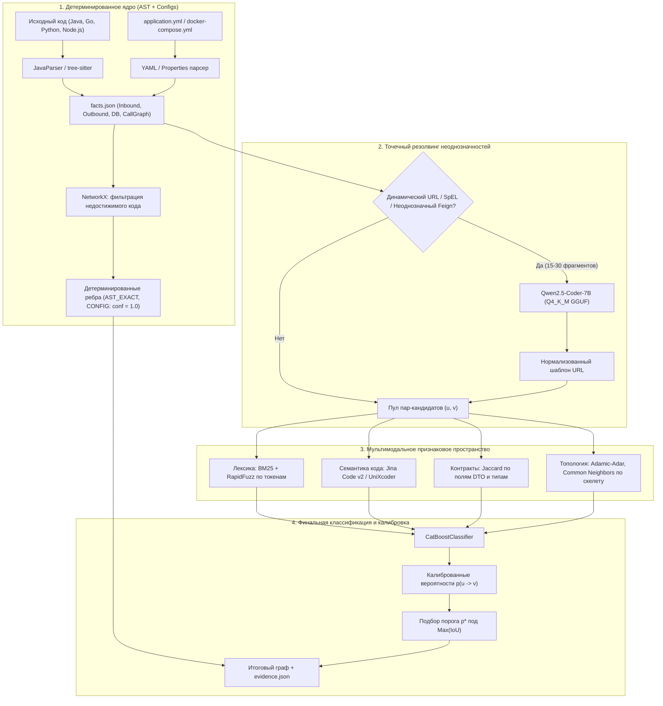
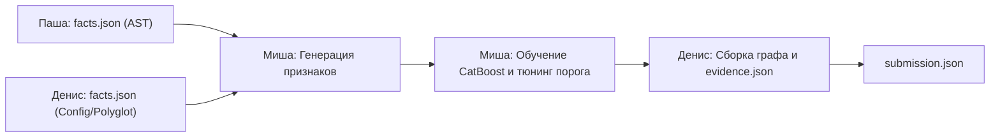

# RFC-02: Мультимодальная AI-архитектура (Compound AI Pipeline)

- **Статус:** На ревью
- **Автор:** Archonity Team
- **Ревьюер:** Миша (@vocisyy)
- **Дата:** 15 октября 2026

---

## 1. Мотивация и постановка вопроса

В проекте Archonity решается задача реконструкции ориентированного типизированного графа runtime-зависимостей микросервисной архитектуры по исходному коду и конфигурациям. Целевая метрика — **IoU (Intersection over Union)**:

$$\text{IoU} = \frac{|E_{\text{pred}} \cap E_{\text{gold}}|}{|E_{\text{pred}} \cup E_{\text{gold}}|} = \frac{TP}{TP + FP + FN}$$

В данном документе под термином **«мультимодальность»** понимается архитектура **Compound AI**: применение ансамбля специализированных компактных моделей и алгоритмов, каждая из которых оптимизирована под конкретный тип данных (AST, конфигурации, сигнатуры методов, топология графа, динамические строковые выражения), вместо использования одной большой монолитной LLM.

### Почему монолитная LLM не подходит как ядро пайплайна

1. **Асимметричный штраф за False Positives в метрике IoU.** Монолитные LLM склонны к галлюцинациям связей на основе общих знаний о предметной области (например, «OrderService обязан вызывать PaymentService»), даже если в конкретном репозитории вызов удален или закомментирован. Каждое лишнее ребро ($FP$) увеличивает знаменатель дроби IoU. В ансамбле вероятность ребра калибруется через градиентный бустинг с прямым поиском порога отсечки под максимум IoU.
2. **Требование к Evidence Log (`evidence.json`).** Каждое добавленное ребро обязано содержать точный путь к файлу, номер строки и детерминированное обоснование. Генеративные модели не способны стабильно воспроизводить номера строк для сотен распределенных вызовов.
3. **Фильтрация мертвого кода (Dead Code Elimination).** В Golden Set входят только связи, достижимые из публичных точек входа (контроллеры, слушатели очередей, cron-задачи). Межпроцедурный анализ достижимости эффективно и детерминированно решается графовыми алгоритмами обхода внутрисервисного Call Graph (NetworkX), а не генерацией текста.
4. **Ограничение Local-First и скорость инференса.** Анализ декартова произведения микросервисов ($40 \times 40 = 1600$ пар) через большую модель занимает десятки минут. Ансамбль малых моделей отрабатывает за 20-40 секунд на локальной машине.

---

## 2. Архитектура пайплайна: Compound AI

Пайплайн разделен на детерминированное ядро, точечный семантический резолвер, мультимодальное признаковое пространство и калибровочный бустинг.



---

## 3. Слой 1: Эмбеддинги кода и семантика (Code Embeddings)

Эмбеддинг-модели применяются для вычисления косинусной близости между AST-фрагментами вызывающего метода (включая сигнатуру клиента) и входными эндпоинтами контроллеров кандидатов.

### Сравнительный анализ моделей

| Модель | Параметры | VRAM (fp16) | Контекст | Размерность | Языки | Лицензия | Особенности и бенчмарки |
|:---|:---|:---|:---|:---|:---|:---|:---|
| **UniXcoder** (`microsoft/unixcoder-base`) | 125M | ~250 MB | 512 токенов | 768 | 9 языков (включая Java, Go, Python, JS) | MIT | Обучен на AST + комментариях + коде (CodeXGLUE Code-to-Code MRR 0.51). Очень быстрый инференс (5-10 мс/батч на CPU). |
| **Jina Code v2** (`jinaai/jina-embeddings-v2-base-code`) | 161M | ~350 MB | **8192 токена** | 768 | 30+ языков | Apache 2.0 | Топ-1 на CoIR среди моделей до 1B. Контекст 8k позволяет передавать класс контроллера целиком вместе с DTO. |
| **CodeSage-Small-v2** (`codesage/codesage-small-v2`) | 130M | ~260 MB | 2048 токенов | 1024 | 9+ языков | Apache 2.0 | SOTA на CodeSearchNet в классе < 200M. Поддержка Matryoshka Embeddings (MRL) позволяет усекать вектор до 256. |
| **GraphCodeBERT** (`microsoft/graphcodebert-base`) | 125M | ~250 MB | 512 токенов | 768 | 6 языков | MIT | Учитывает Data Flow Graph (DFG). Требует отдельного парсера DFG перед инференсом, усложняя пайплайн без явного прироста к UniXcoder. |
| **StarEncoder** (`bigcode/starencoder`) | 125M | ~250 MB | 1024 токена | 768 | 86 языков | OpenRAIL-M | Обучен на The Stack. В кодовом поиске и сопоставлении сигнатур уступает специализированным моделям (UniXcoder, Jina). |
| **CodeBERT** (`microsoft/codebert-base`) | 125M | ~250 MB | 512 токенов | 768 | 6 языков | MIT | Базовая модель 2020 года, чистый MLM без знания структуры AST. |

### Рекомендация для команды
- **Быстрый локальный бейзлайн:** `microsoft/unixcoder-base`. Легко запускается через HuggingFace `transformers`, не требует тяжелых зависимостей, стабильно кодирует методы и сигнатуры.
- **Целевая модель для длинного контекста:** `jinaai/jina-embeddings-v2-base-code`. Рекомендуется для случаев, когда вызывающий код опирается на сложную структуру DTO или весь класс сервиса (благодаря окну 8192 токена).
- **План действий:** начинаем с UniXcoder для быстрого запуска пайплайна признаков. Если валидация покажет нехватку контекста DTO, переключаем энкодер на Jina Code v2 без изменения логики бустинга.

---

## 4. Слой 2: Компактная кодовая LLM для резолвинга динамических вызовов

Модель привлекается **исключительно точечно** (не более 15-30 обращений на весь проект Train Ticket), когда детерминированный анализ констант не смог собрать целевой URL (например, сложная интерполяция строк, использование SpEL, чтение пути через промежуточный хелпер).

### Сравнительный анализ компактных LLM

| Модель | Параметры | VRAM (Q4_K_M) | Контекст | HumanEval | Скорость инференса | Лицензия |
|:---|:---|:---|:---|:---|:---|:---|
| **Qwen2.5-Coder-1.5B-Instruct** | 1.54B | ~1.1 GB | 32k | 71.3% | ~100-120 t/s | Apache 2.0 |
| **Qwen2.5-Coder-3B-Instruct** | 3.09B | ~2.1 GB | 32k | 81.7% | ~70-90 t/s | Apache 2.0 |
| **Qwen2.5-Coder-7B-Instruct** | 7.61B | ~4.7 GB | 32k / 128k | **88.4%** | ~35-45 t/s | Apache 2.0 |
| **DeepSeek-Coder-1.3B-Instruct** | 1.3B | ~1.0 GB | 16k | 65.2% | ~90 t/s | DeepSeek License |
| **Granite-3B-Code-Instruct** | 3.5B | ~2.4 GB | 4k | 68.5% | ~50 t/s | Apache 2.0 |
| **StarCoder2-3B** | 3.0B | ~2.2 GB | 16k | 35.4% (base) | ~60 t/s | OpenRAIL-M |

### Обоснование выбора с учетом оборудования
На рабочей машине Миши установлена видеокарта **RTX 5070 Ti (16 GB VRAM) и 32 GB RAM**. 

1. С данным объемом памяти модель уровня **Qwen2.5-Coder-7B-Instruct** в квантовании `Q4_K_M` занимает всего **~4.7 GB VRAM** (или ~8.5 GB в `Q8_0`). Это оставляет более 7-11 GB свободной видеопамяти под параллельную работу эмбеддеров и кэш системы.
2. Прирост точности у 7B версии существенный: HumanEval 88.4% против 71.3% у 1.5B. Модель демонстрирует почти идеальное следование JSON-схемам и понимание аннотаций Spring Framework.
3. **Формат работы:** запуск через локальный `llama-cpp-python` или `Ollama` в режиме Structured Outputs (Grammar-based sampling) с жесткой схемой:
   ```json
   {
     "resolved_url_pattern": "/api/v1/travelservice/trips/{tripId}",
     "http_method": "GET",
     "confidence": 0.95
   }
   ```

---

## 5. Слой 3: Текстовое и лексическое сопоставление (Lexical Matching)

Практика анализа микросервисных архитектур показывает, что до 70-80% неразрешенных связей надежно сопоставляются по совпадению имен сервисов, сегментов URL и методов контроллеров без применения нейронных сетей.

### Состав компонентов
1. **Декомпозиция токенов:** преобразование CamelCase и kebab-case в списки лексем (`ts-order-service` $\to$ `['order', 'service']`, `getTripByTripId` $\to$ `['trip', 'id']`).
2. **BM25 (`rank_bm25`):** вычисление релевантности между токенами исходящего вызова и зарегистрированными точками входа контроллеров.
3. **RapidFuzz (C++ реализация Jaro-Winkler и Token Sort Ratio):** нечеткое сравнение путей URL, устойчивое к вариациям версионирования (`/api/v1/` vs `/api/v2/`) и суффиксам (`-service`, `Controller`). Время вычисления одного сопоставления — менее 0.05 мс.
4. **Сравнение схем DTO:** коэффициент Жаккара по именам полей входных и выходных DTO-классов.

---

## 6. Слой 4: Графовые признаки и топология (Graph Features vs GNN)

### Анализ применимости GNN (R-GCN, GAT, CompGCN)
Графовые нейросети были рассмотрены для задачи Link Prediction на скелете архитектуры. Однако для графа Train Ticket выявлены следующие ограничения:
- **Размер графа:** всего ~40-50 узлов (микросервисов). Количество обучающих ребер скелета мало ($|E| \approx 100-200$).
- **Риск переобучения:** глубокие графовые свертки (R-GCN, GAT) на графах менее 100 узлов быстро переобучаются под топологию конкретного графа и теряют обобщающую способность.
- **Вычислительный оверхед:** настройка message passing и negative sampling в PyG усложняет отладку и не дает преимуществ по сравнению с табличным бустингом.

### Решение: классические топологические эвристики
Вместо обучения GNN топология входного скелета графа кодируется набором детерминированных признаков для каждой пары вершин $(u, v)$:
- **Adamic-Adar Index:** мера связности через общих соседей с учетом их степени.
- **Jaccard Similarity соседей:** пересечение входящих и исходящих связей.
- **Длина кратчайшего пути по скелету:** расстояние между $u$ и $v$ в ненаправленном скелете.
- **Степени вершин (In-degree, Out-degree):** выявление сервисов-хабов (API Gateway) и сервисов-листьев.

Эти признаки рассчитываются через `NetworkX` за доли секунды и передаются напрямую в CatBoost.

---

## 7. Слой 5: Финальный классификатор и максимизация IoU

### Выбор модели: CatBoostClassifier
В качестве итогового классификатора выбран **CatBoost**:
- **Устойчивость к переобучению на малых выборках:** симметричные (обливиусные) деревья обеспечивают сильную регуляризацию.
- **Нативная работа с категориальными признаками:** протоколы вызова, HTTP-глаголы, типы DTO обрабатываются без One-Hot кодирования.
- **Интерпретируемость (Tree SHAP):** CatBoost позволяет извлекать вклад каждого признака в решение, что используется для заполнения поля `details` в `evidence.json`.

### Калибровка порога под метрику IoU
В отличие от стандартной максимизации ROC-AUC или LogLoss, порог вероятности $p^*$ подбирается прямой одномерной оптимизацией на валидационных фолдах:

$$p^* = \arg\max_{p \in [0.1, 0.9]} \text{IoU}\left( E_{\text{pred}}(p), E_{\text{gold}} \right)$$

Все детерминированные ребра из AST получают фиксированный скор $1.0$. Для предсказанных бустингом ребер добавляются только те, у которых $P(u \to v) \ge p^*$.

---

## 8. Сравнение подходов

| Критерий | Монолитная LLM (7B-14B) | Compound AI Pipeline (Archonity) |
|:---|:---|:---|
| **Время прогона** | 30-60 минут на датасет | **20-40 секунд суммарно** |
| **Потребление памяти** | 8-16 GB VRAM постоянно | **~5-6 GB VRAM пиково** |
| **Калибровка под IoU** | Невозможна (дискретный ответ Да/Нет) | **Прямой подбор порога $p^*$ под максимум IoU** |
| **Evidence Log** | Галлюцинации путей и строк | **100% точные строки для AST, SHAP-объяснения для ML** |
| **Правило БД** | Путает независимые ребра к одной таблице | **Детерминированное выделение узлов таблиц через AST** |
| **Dead Code Elimination** | Ошибается в длинных цепочках вызовов | **Детерминированный граф достижимости в NetworkX** |

---

## 9. Аппаратный профиль и системные требования

### Конфигурация стенда Миши
- **GPU:** NVIDIA GeForce RTX 5070 Ti (16 GB VRAM GDDR7)
- **RAM:** 32 GB DDR5
- **CPU:** 8+ ядер

### Бюджет памяти при работе пайплайна
- `UniXcoder` / `Jina Code v2`: ~350 MB VRAM
- `Qwen2.5-Coder-7B-Instruct (Q4_K_M)`: ~4.7 GB VRAM
- `CatBoost` + `NetworkX`: ~500 MB RAM
- **Итого занято:** ~5.1 GB VRAM из 16 GB, ~4 GB RAM из 32 GB.
- **Запас:** более 10 GB VRAM свободно. Система гарантированно защищена от Out-Of-Memory (OOM).

### Зависимости окружения (`requirements-ml.txt`)
```text
torch>=2.2.0
transformers>=4.40.0
sentence-transformers>=2.7.0
catboost>=1.2.5
networkx>=3.2.1
rank-bm25>=0.2.2
rapidfuzz>=3.8.0
llama-cpp-python>=0.2.75
optuna>=3.6.0
scikit-learn>=1.4.0
```

---

## 10. План интеграции и зоны ответственности



1. **Этап 1 (Входные факты):** Паша формирует `facts.json` для Java-сервисов (контроллеры, клиенты, вызовы БД). Денис закрывает конфигурации и полиглот-сервисы.
2. **Этап 2 (ML-признаки):** Миша реализует скрипт генерации датасета: UniXcoder косинусное расстояние, BM25/RapidFuzz скоры, топологические метрики из скелета.
3. **Этап 3 (Бустинг и порог):** Миша обучает CatBoost на парах с известной разметкой из бейзлайна/скелета и калибрует порог $p^*$ под метрику IoU.
4. **Этап 4 (Точечный резолвинг):** Для неразрешенных динамических URL подключается Qwen2.5-Coder-7B.
5. **Этап 5 (Финализация):** Денис объединяет детерминированные и ML-ребра, формирует `evidence.json` и проверяет схему перед сабмитом в NSUTS.
