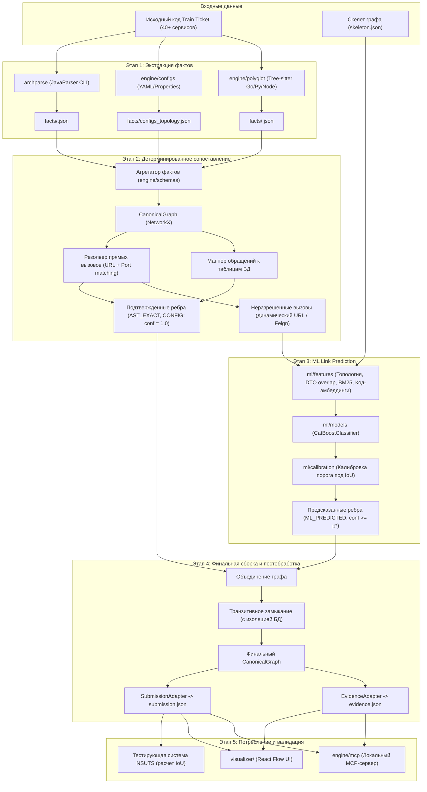
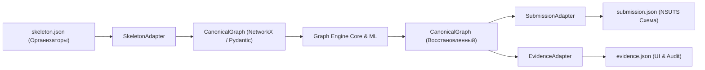

# RFC-03: Межмодульные контракты данных и архитектура системы Archonity

- **Статус:** На ревью
- **Автор:** Денис (@ischademadda)
- **Ревьюеры:** Паша (@Pavelgrr7), Миша (@vocisyy)
- **Дата:** 15 октября 2026

---

## TL;DR
Спецификация модулей монорепозитория (`archparse/` на Java 21, `engine/` и `ml/` на Python 3.11+, `visualizer/` на Vite+React) и типизированных Pydantic v2 контрактов: единый дамп синтаксических фактов `facts.json`, детальный лог обоснований `evidence.json`, каноническая модель графа и адаптеры экспорта в `submission.json` организаторов.

---

## 1. Назначение и контекст

Документ специфицирует архитектурное разделение обязанностей, структуру репозитория и типизированные контракты данных между ключевыми компонентами системы **Archonity**:
1. Модуль детерминированного статического анализа Java/Spring (`archparse/`, Паша).
2. Модуль анализа конфигураций, топологии и не-Java сервисов (`engine/configs/`, `engine/polyglot/`, Денис).
3. Графовое ядро и алгоритмы сборки зависимостей (`engine/graph/`, Денис).
4. Мультимодальный ML-модуль Link Prediction и калибровки порога IoU (`ml/`, Миша).
5. Локальный интерактивный визуализатор графа (`visualizer/`, Денис).

### Ключевые требования и ограничения
- **Strict Local-First:** все модули исполняются исключительно на локальной машине без обращения к внешним облачным API.
- **Точность и типизация ребер:** каждое ребро ориентировано и типизировано (`REST_HTTP`, `DATABASE`, `MESSAGE_QUEUE`, `TRANSITIVE`).
- **Правило баз данных:** обращения разных микросервисов к одной таблице БД формируют отдельные независимые ребра от сервисов к таблице.
- **Отсев мертвого кода:** в целевой граф попадают только вызовы, достижимые из публичных точек входа (контроллеры, слушатели очередей, cron-задачи).
- **Объяснимость (Evidence Log):** каждое ребро сопровождается трассировочной записью с источником (`AST_EXACT`, `CONFIG`, `ML_PREDICTED`, `TRANSITIVE`), файлом, строкой и оценкой уверенности.

---

## 2. Архитектура репозитория и модулей

Проект организуется как координированный монорепозиторий с разделением по языкам и зонам ответственности:

```text
archonity/
├── archparse/              # Детерминированный парсер Spring (Java 21, Gradle, JavaParser)
│   ├── src/main/java/      # Экстракция Inbound/Outbound/DB, Call Graph, отсев мертвого кода
│   └── build.gradle
├── engine/                 # Ядро сборки графа и оркестрации (Python 3.11+, менеджер uv)
│   ├── configs/            # Парсинг application.yml, docker-compose.yml, env vars
│   ├── polyglot/           # Tree-sitter парсеры для сервисов на Go, Python, Node.js
│   ├── graph/              # NetworkX ядро: матчинг эндпоинтов, reachability, транзитивность
│   ├── evidence/           # Валидация и генерация evidence.json
│   ├── adapters/           # Адаптеры входного skeleton.json и выходного submission.json
│   ├── mcp/                # Локальный MCP-сервер для ИИ-агентов (blast radius, explain)
│   ├── schemas/            # Pydantic v2 модели контрактов facts, evidence, canonical graph
│   ├── cli.py              # Единый CLI-раннер пайплайна (archonity run, build-graph)
│   └── pyproject.toml
├── ml/                     # Модуль предсказания связей (Python, CatBoost, Transformers)
│   ├── features/           # Извлечение признаков (эмбеддинги UniXcoder, DTO overlap, BM25)
│   ├── models/             # Обучение и инференс CatBoostClassifier
│   └── calibration/        # Калибровка вероятностного порога под максимум IoU (Optuna)
├── visualizer/             # Автономный SPA-визуализатор (Vite, React Flow, TypeScript, elkjs)
├── docs/                   # Документация, RFC, ADR, паспорта задач
│   ├── rfc/                # Проектные предложения (RFC-01, RFC-02, RFC-03)
│   ├── adr/                # Принятые архитектурные решения (ADR-002)
│   └── open-questions.md   # Открытые вопросы и альтернативы
└── data/                   # Данные и бенчмарк Train Ticket
```

---

## 3. Общая схема движения данных (Data Flow)



---

## 4. Спецификация контракта фактов (`facts/<service_name>.json`)

### 4.1. Принцип организации
Каждый анализатор сервиса пишет результат в изолированный файл `facts/<service_name>.json`. Это позволяет:
- Выполнять парсинг параллельно в независимых процессах.
- Изолировать сбои парсера одного сервиса от остальных.
- Переиспользовать результаты кеширования для неизмененных сервисов.

`engine` предоставляет модуль агрегации, способный читать как директорию `facts/`, так и объединенный файл `facts.json`.

### 4.2. JSON-схема сервисных фактов

Ниже приведен типизированный пример структуры для сервиса `ts-travel-service`:

```json
{
  "$schema": "https://json-schema.org/draft/2020-12/schema",
  "service_name": "ts-travel-service",
  "language": "java",
  "framework": "spring-boot",
  "repo_path": "data/train-ticket/ts-travel-service",
  "service_metadata": {
    "server_port": 12346,
    "context_path": "/api/v1/travelservice",
    "env_vars": {
      "ORDER_SERVICE_HOST": "ts-order-service",
      "SEAT_SERVICE_PORT": "18898"
    }
  },
  "inbound_endpoints": [
    {
      "id": "ts-travel-service:GET:/api/v1/travelservice/routes",
      "path": "/api/v1/travelservice/routes",
      "http_method": "GET",
      "handler_class": "travel.controller.TravelController",
      "handler_method": "getRoutes",
      "file_path": "src/main/java/travel/controller/TravelController.java",
      "line_number": 42,
      "request_dto": {
        "class_name": "travel.entity.TripInfo",
        "fields": [
          {"name": "startPlace", "type": "String"},
          {"name": "endPlace", "type": "String"},
          {"name": "departureTime", "type": "Date"}
        ]
      },
      "response_dto": {
        "class_name": "travel.entity.TravelResult",
        "fields": [
          {"name": "status", "type": "boolean"},
          {"name": "message", "type": "String"},
          {"name": "routes", "type": "List<Route>"}
        ]
      }
    }
  ],
  "outbound_calls": [
    {
      "id": "ts-travel-service:CALL:ts-seat-service:querySeat",
      "client_type": "REST_TEMPLATE",
      "target_service_hint": "ts-seat-service",
      "target_url_template": "http://ts-seat-service:18898/api/v1/seatservice/seat",
      "raw_expression": "getServiceUrl(\"ts-seat-service\") + \"/api/v1/seatservice/seat\"",
      "http_method": "POST",
      "caller_class": "travel.service.TravelServiceImpl",
      "caller_method": "querySeat",
      "file_path": "src/main/java/travel/service/TravelServiceImpl.java",
      "line_number": 115,
      "is_reachable": true,
      "call_chain": [
        "travel.controller.TravelController.getRoutes",
        "travel.service.TravelServiceImpl.querySeat"
      ],
      "request_dto": {
        "class_name": "travel.entity.SeatQuery",
        "fields": [
          {"name": "tripId", "type": "String"},
          {"name": "seatType", "type": "int"}
        ]
      },
      "response_dto": {
        "class_name": "travel.entity.SeatResult",
        "fields": [
          {"name": "available", "type": "boolean"}
        ]
      },
      "code_snippet": "restTemplate.postForObject(seatServiceUrl + \"/seat\", query, SeatResult.class)"
    }
  ],
  "db_access": [
    {
      "id": "ts-travel-service:DB:trip",
      "table_name": "trip",
      "db_type": "MYSQL",
      "operation": "READ_WRITE",
      "entity_class": "travel.entity.Trip",
      "caller_class": "travel.repository.TripRepository",
      "caller_method": "findByTripId",
      "file_path": "src/main/java/travel/repository/TripRepository.java",
      "line_number": 28,
      "is_reachable": true,
      "call_chain": [
        "travel.controller.TravelController.getRoutes",
        "travel.service.TravelServiceImpl.getRoutes",
        "travel.repository.TripRepository.findByTripId"
      ]
    }
  ],
  "messaging": [
    {
      "id": "ts-travel-service:MQ:order_queue",
      "broker": "RABBITMQ",
      "role": "PRODUCER",
      "destination": "order_queue",
      "routing_key": "order.create",
      "caller_class": "travel.service.TravelServiceImpl",
      "caller_method": "notifyOrder",
      "file_path": "src/main/java/travel/service/TravelServiceImpl.java",
      "line_number": 154,
      "is_reachable": true,
      "call_chain": [
        "travel.controller.TravelController.getRoutes",
        "travel.service.TravelServiceImpl.notifyOrder"
      ]
    }
  ]
}
```

### 4.3. Обязанности Java-парсера (`archparse`)
1. **Построение внутрисервисного Call Graph:** парсер анализирует граф вызовов между методами внутри сервиса.
2. **Анализ достижимости (Reachability Analysis):** выполняет поиск пути (DFS) от всех публичных точек входа (`@RestController`, `@RabbitListener`, `@Scheduled`).
3. **Заполнение флага и цепочки:** выставляет `is_reachable: true/false` и сохраняет массив `call_chain` (путь вызовов).
4. **Контекст для ML:** при динамическом формировании URL сохраняет сырое строковое выражение `raw_expression`, сниппет кода и DTO.

---

## 5. Спецификация Evidence Log (`evidence.json`)

`evidence.json` служит математическим и программным доказательством детерминированности и точности графа для жюри и интерактивного инспектора [ADR-002](../adr/adr-002_react_flow_visualizer.md).

### 5.1. Типы источников доказательств (`source_type`)
- `AST_EXACT`: прямое совпадение вызова из статического анализа кода (confidence = 1.0).
- `CONFIG`: связь выведена из конфигурационных файлов сетевой топологии (docker-compose, application.yml, confidence = 1.0).
- `ML_PREDICTED`: связь предсказана моделью CatBoost на основе мультимодальных признаков ($p \ge p_{\text{threshold}}$).
- `TRANSITIVE`: связь выведена алгоритмом транзитивного замыкания ($A \to B \to C \implies A \to C$).

### 5.2. Структура записи
Базовая модель одной записи в Evidence Log:

```json
{
  "edge_id": "ts-travel-service->ts-seat-service:REST_HTTP",
  "source": "ts-travel-service",
  "target": "ts-seat-service",
  "relation_type": "REST_HTTP",
  "source_type": "AST_EXACT",
  "confidence": 1.0,
  "evidence_details": {
    "file_path": "src/main/java/travel/service/TravelServiceImpl.java",
    "line_number": 115,
    "caller": "travel.service.TravelServiceImpl.querySeat",
    "matched_endpoint": "POST /api/v1/seatservice/seat",
    "call_chain": [
      "travel.controller.TravelController.getRoutes",
      "travel.service.TravelServiceImpl.querySeat"
    ],
    "code_snippet": "restTemplate.postForObject(seatServiceUrl + \"/seat\", query, SeatResult.class)"
  }
}
```

Для ребер, полученных из ML (`ML_PREDICTED`):
```json
{
  "edge_id": "ts-order-service->ts-inside-payment-service:REST_HTTP",
  "source": "ts-order-service",
  "target": "ts-inside-payment-service",
  "relation_type": "REST_HTTP",
  "source_type": "ML_PREDICTED",
  "confidence": 0.874,
  "evidence_details": {
    "model_name": "CatBoost_LinkPredictor_v1",
    "threshold": 0.730,
    "top_features": {
      "jina_code_similarity": 0.892,
      "dto_field_overlap_jaccard": 0.750,
      "bm25_token_similarity": 0.814,
      "adamic_adar_topology_index": 1.420
    }
  }
}
```

Альтернативные форматы организации словаря и списка зафиксированы в [open-questions.md](../open-questions.md#oq-01-evidence-schema).

---

## 6. Каноническая модель графа (CanonicalGraph) и слой адаптеров

Для изоляции графового ядра от официальной схемы организаторов (публикация которой ожидается 16 октября), вводится внутренний канонический формат `CanonicalGraph`:



### Преимущества подхода
1. Если организаторы изменят названия ключей (например, `target` вместо `to`, `dependencies` вместо `edges`), изменяется ровно один файл `SubmissionAdapter.py`.
2. Логика графовых обходов, фильтрации мертвого кода и расчета Blast Radius не зависит от внешнего формата.

---

## 7. Этапы реализации и зоны ответственности

| Этап | Задача | Ответственный | Модуль | Результат |
|---|---|---|---|---|
| 1 | Реализация экстракции `facts/<service>.json` с Call Graph | Паша (@Pavelgrr7) | `archparse/` | Сгенерированные JSON-факты по сервисам Train Ticket |
| 2 | Создание Pydantic v2 схем контрактов и валидатора | Денис (@ischademadda) | `engine/schemas/` | Типизированные структуры данных, тесты контрактов |
| 3 | Парсинг `docker-compose.yml`, `application.yml` | Денис (@ischademadda) | `engine/configs/` | `facts/configs_topology.json` |
| 4 | Реализация Feature Extractor для неразрешенных пар | Миша (@vocisyy) | `ml/features/` | Таблица признаков пар (CodeBERT, DTO, BM25) |
| 5 | NetworkX Graph Engine (детерминированный матчинг) | Денис (@ischademadda) | `engine/graph/` | Базовый граф `confirmed_edges` (conf = 1.0) |
| 6 | Обучение CatBoost и калибровка порога под $\text{IoU}$ | Миша (@vocisyy) | `ml/models/` | `predicted_edges.json`, отчет калибровки |
| 7 | Сборка графа, транзитивное замыкание, экспорт | Денис (@ischademadda) | `engine/` | `submission.json`, `evidence.json` |
| 8 | Интеграция с React Flow Visualizer | Денис (@ischademadda) | `visualizer/` | Интерактивный UI с инспектором доказательств |
