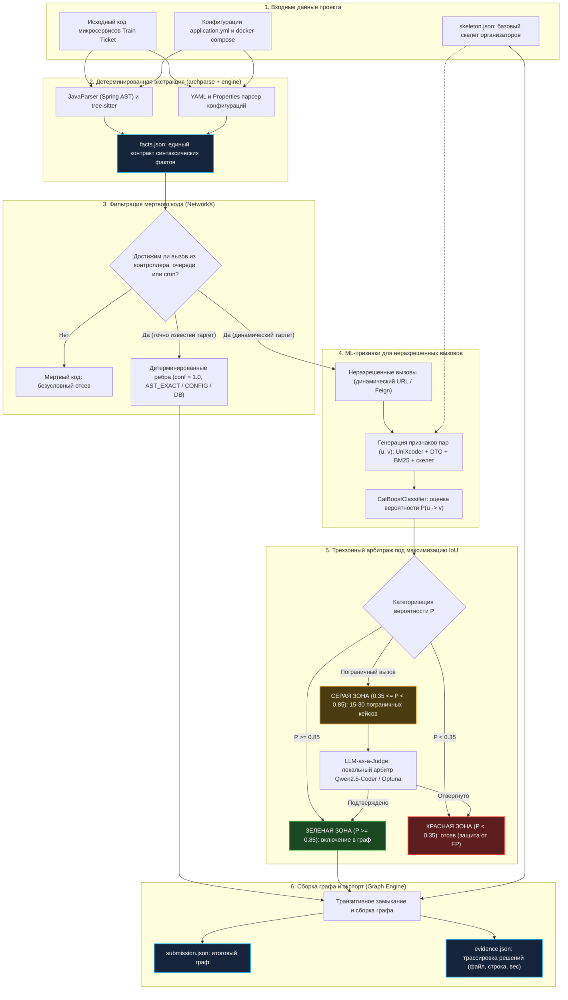

# RFC-05: Гибридный пайплайн реконструкции графа и трехзонный арбитраж

* **Статус:** На ревью (объединение RFC-01 и RFC-04)
* **Авторы:** Паша (@Pavelgrr7), Денис (@ischademadda), Миша (@vocisyy)
* **Дата:** 15 октября 2026
* **Связанные документы:** 
  * Заменяет/объединяет: [RFC-01](rfc-01_graph_recovery_pipeline_architecture.md), [RFC-04](rfc-04_dual_parse_pipeline_architecture.md)
  * Контракты данных: [RFC-03](rfc-03_data_contracts_and_system_architecture.md)
  * AI-модели и признаки: [ADR-003](../adr/adr-003_multimodal_ai_architecture.md) (ранее [RFC-02](rfc-02_multimodal_ai_architecture.md))

---

## TL;DR
Целевой синтез RFC-01 и RFC-04: сквозной локальный пайплайн объединяет детерминированную экстракцию Spring-фактов, БД и очередей в `facts.json`; отсев мертвого кода по графу вызовов (Reachability); извлечение признаков (эмбеддинги, DTO, топология скелета) и трёхзонный арбитраж вероятностей под асимметрию штрафов IoU (Green / Red / Gray с концепцией LLM-as-a-Judge на базе локальной Qwen2.5-Coder-7B).

---

## 1. Контекст и мотивация

В проекте Archonity решается задача реконструкции ориентированного типизированного графа runtime-зависимостей микросервисной архитектуры Train Ticket (~40 сервисов Spring Boot) с восстановлением вырезанных организаторами рёбер. 

Целевая метрика соревнования — **IoU (Intersection over Union)**:

$$\text{IoU} = \frac{|E_{\text{pred}} \cap E_{\text{gold}}|}{|E_{\text{pred}} \cup E_{\text{gold}}|} = \frac{TP}{TP + FP + FN}$$

### Почему потребовался синтез RFC-01 и RFC-04:
1. **[RFC-01](rfc-01_graph_recovery_pipeline_architecture.md)** заложил строгую системную базу: фильтрацию недостижимого мертвого кода (Dead Code Elimination) через внутрисервисный Call Graph, извлечение связей с базами данных и брокерами сообщений, а также сквозной журнал доказательств (`evidence.json`). Однако он описывал стыковку AST и ML на верхнем уровне («детерминированное = 1.0, остальное в бустинг»).
2. **[RFC-04](rfc-04_dual_parse_pipeline_architecture.md)** поднял критическую практическую проблему сопряжения: статический анализатор не может разрешить конкатенированные или динамические URL (`getServiceUrl(...) + "/order"`). RFC-04 предложил выделить такие вызовы в отдельный список `unresolved_calls` и ввести трехзонный арбитраж вероятностей под асимметрию штрафов IoU (где каждый $FP$ фатально увеличивает знаменатель дроби).

**Решение:** RFC-05 объединяет макро-архитектуру RFC-01 с механикой трехзонного арбитража RFC-04 в единый согласованный стандарт.

---

## 2. Архитектурная схема пайплайна



---

## 3. Детальное описание этапов

### Этап 1: Детерминированная синтаксическая экстракция
Парсер `archparse` (Java 21, `JavaParser`) и вспомогательные модули `engine` (`PyYAML`, `tree-sitter`) производят первичный анализ исходного кода без запуска рантайма:
* **Точки входа (`inbound_endpoints`):** классы с `@RestController`, методы с `@RequestMapping`, `@GetMapping`, `@PostMapping` и т.д. Сохраняются HTTP-метод, нормализованный путь и типы входных/выходных DTO.
* **Исходящие вызовы (`outbound_calls`):** вызовы `RestTemplate`, `WebClient`, интерфейсы `@FeignClient`. При наличии константного URL путь извлекается детерминированно. Если URL формируется динамически (переменные, хелперы `getServiceUrl(...)`), вызов помечается как `unresolved_call` с сохранением AST-сниппета, DTO-полей и HTTP-метода.
* **Базы данных и брокеры (`db_access`, `broker_access`):** маппинг `@Entity`, `@Table`, `@Document`, `spring.datasource.url`, `@RabbitListener`, `@KafkaListener`.
* **Внутрисервисный граф вызовов (`internal_call_graph`):** ребра между методами сервиса для последующей проверки достижимости.

Все результаты сериализуются строго по схеме [RFC-03](rfc-03_data_contracts_and_system_architecture.md) в единый `facts.json`.

### Этап 2: Фильтрация мертвого кода (Reachability Analysis)
В соответствии с требованиями [AGENTS.md](../../AGENTS.md), в итоговый граф попадают только связи, активные в рантайме.
* Графовое ядро на `NetworkX` строит ориентированный граф методов внутри каждого сервиса.
* Для каждого исходящего вызова проверяется существование пути от публичного корня:
  $$\text{Root} \in \{\text{ControllerMethod}, \text{MessageListener}, \text{ScheduledTask}\}$$
* Если путь отсутствует — вызов отсекается как мертвый код (`DEAD_CODE`) и не передается ни в граф, ни в ML-пайплайн.

### Этап 3: ML-пайплайн для неразрешенных вызовов
Для вызовов, прошедших проверку достижимости, но имеющих динамический URL, формируются пары-кандидаты $(u, v)$ с публичными эндпоинтами других сервисов:
* **Семантика кода:** косинусное сходство эмбеддингов метода и целевого эндпоинта (`UniXcoder-base` / `Jina Code v2`).
* **Контракты DTO:** коэффициент Жаккара по наборам полей входных/выходных моделей данных.
* **Лексическое сходство:** BM25 и RapidFuzz по токенам имен методов, сервисов и URL-сегментов.
* **Топология скелета:** топологические метрики вершин в графе `skeleton.json` (общие соседи, Adamic-Adar индекс).

Модель `CatBoostClassifier` рассчитывает некалиброванную вероятность наличия ребра $P(u \to v)$.

### Этап 4: Механика трехзонного арбитража и концепция LLM-as-a-Judge
Оптимизация под метрику IoU диктует строгое разделение пространства решений:

1. **Зеленая зона ($P \ge 0.85$ или детерминированный факт AST/Config):**
   * Связи с абсолютной или высокой уверенностью.
   * Действие: безусловно включаются в граф с фиксацией в `evidence.json` источника (`AST_EXACT`, `CONFIG` или `ML_HIGH_CONFIDENCE`).
2. **Красная зона ($P < 0.35$):**
   * Слабые и зашумленные гипотезы.
   * Действие: безусловно отбрасываются. Включение сомнительных ребер критически штрафует знаменатель IoU ($FP$).
3. **Серая зона ($0.35 \le P < 0.85$):**
   * Узкая полоса пограничных вызовов (обычно 15–30 случаев на репозиторий Train Ticket).
   * Действие: точечный арбитраж через механизм **LLM-as-a-Judge** (с математическим фолбэком по порогу `Optuna` $p^*$):

#### Архитектура LLM-as-a-Judge (локальный кодовый арбитр)
Вместо примитивного бинарного промпта, локальная модель `Qwen2.5-Coder-7B (Q4_K_M)` (инференс через `llama-cpp-python` / `ollama`) функционирует как структурированный экспертный судья:

1. **Досье кандидата (Case Dossier):** на вход судье подается полный контекст спорного вызова:
   * **Вызывающий узел:** имя сервиса, метод, AST-сниппет, HTTP-метод, параметры/DTO запроса и динамическое выражение URL (`raw_url_expr`).
   * **Целевой узел-кандидат:** контроллер, аннотация эндпоинта (`@PostMapping(...)`), сигнатура входных аргументов и типы DTO.
   * **Сигналы первого уровня:** оценка `CatBoost` ($P$), сходство по `UniXcoder`, лексический `BM25`, пересечение полей DTO (`Jaccard`).
   * **Топология скелета:** существование пути в `skeleton.json`.

2. **Структурированный вердикт (Structured Verdict):**
   Судья генерирует ответ в строгом JSON-формате по Pydantic-контракту:
   ```json
   {
     "verdict": "ACCEPT",
     "confidence": 0.87,
     "reasoning": "Метод preserveTicket передает параметры userId и tripId в теле POST, что совпадает с OrderDTO в ts-order-service. Динамический URL getServiceUrl('ts-order-service') однозначно указывает на целевой сервис.",
     "contradictions_detected": []
   }
   ```

3. **Интеграция с Explainability (`evidence.json`):**
   При принятии ребра поле `reasoning` напрямую ложится в `evidence.json` со статусом `LLM_JUDGE_VERIFIED`. Это делает обоснование полностью прозрачным для визуализатора ([ADR-002](../adr/adr-002_react_flow_visualizer.md)) и жюри.

4. **LLM-as-a-Judge для валидации обучающей выборки (Offline Dataset Judge):**
   При искусственном маскировании графа Train Ticket для обучения CatBoost и подбора порогов Optuna, LLM-as-a-Judge используется для автоматической валидации сложных синтетических негативных и позитивных примеров, исключая зашумление обучающего датасета.

5. **Ограничения и защита от галлюцинаций (Local-First Guardrails):**
   * **Строгий бюджет инференса:** не более 30 вызовов на весь прогон (строго по серой зоне). Время инференса на CPU/Metal $\approx 1.5$–2.5 сек на кейс, суммарно $< 1$ минуты на весь пайплайн.
   * **Few-Shot антипаттерны:** системный промпт включает примеры ложных связей (например, совпадение глагола POST и фрагмента пути при несовместимых типах DTO).

### Этап 5: Сборка графа и артефакты сабмита
1. **Транзитивное замыкание:** генерация косвенных зависимостей $A \to B \to C \implies A \to C$ выполняется только по ребрам зеленой зоны (чтобы исключить каскадное распространение ошибок от $FP$). Узлы баз данных исключаются из транзитивного транзита.
2. **Артефакт `submission.json`:** целевой граф в канонической структуре организаторов.
3. **Артефакт `evidence.json`:** полный лог подтверждений с указанием файла, номера строки, сниппета кода и уровня уверенности.

---

## 4. Сравнение подходов

| Критерий | RFC-01 (Базовый) | RFC-04 (Dual-Source) | **RFC-05 (Гибридный синтез)** |
|:---|:---|:---|:---|
| **Сбор фактов** | Единый `facts.json` | Раздельный дублирующий парсинг Java и Python | **Единый синтаксический контракт `facts.json` (RFC-03)** |
| **Неразрешенные вызовы** | Концептуальное упоминание | Выделение `unresolved_calls` со сниппетами | **Структурированный экспорт `unresolved_calls` в ML** |
| **Мертвый код** | Reachability через Call Graph | Не учитывался | **Детерминированный NetworkX reachability до передачи в ML** |
| **Базы данных и очереди** | Детально специфицированы | Проигнорированы | **Полный учет БД и очередей (правило независимых ребер)** |
| **Принятие решений по ребрам** | Единый порог классификатора | Трехзонный арбитраж (Green / Red / Gray) | **Трехзонная модель под IoU + LLM-as-a-Judge (Qwen2.5-Coder) для серой зоны** |
