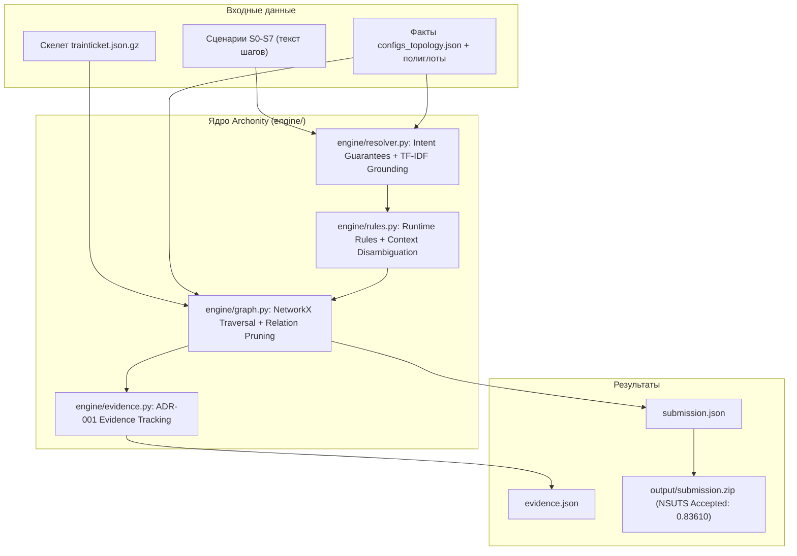

# Дорожная карта Archonity v2

## Статус документа
Обновлено 16 октября 2026. Актуализировано по результатам сдачи решения на официальную платформу соревнований (NSUTS).
* **Текущий скор на платформе (скрытые сценарии $S_1 \dots S_7$):** **0.83610** (ACCEPTED, вердикт A).
* **Калибровка на $S_0$ (golden dataset):** **IoU = 1.0000** (executes 1.0, calls 1.0, remote 1.0, data 1.0).
* **Набор автоматических тестов:** 49/49 успешно пройдены (`uv run --with pytest pytest`).

---

## 1. Контекст и отправная точка

### 1.1. Хакатон
* **TechArena 2026** (Huawei R&D). Дедлайн: **22 октября 2026** (осталось 5 рабочих дней).
* **Задача:** Статическое предсказание подграфа выполнения для **8 сценариев** ($S_0 \dots S_7$) бенчмарка Train Ticket.
* **Метрика:** Средний IoU по 4 типам связей (`executes`, `calls`, `remote`, `data`) на 7 скрытых сценариях ($S_1 \dots S_7$).
* **Бонус:** +10% за реализацию на Rust (множитель 1.10, потолок 1.0).

### 1.2. Текущее состояние кодовой базы и артефактов

| Артефакт / Компонент | Статус | Назначение и текущие показатели |
|:---|:---|:---|
| Ядро графа `engine/graph.py` | Готов | Загрузка скелета [skeleton/trainticket.json.gz](../hackaton/tt-challenge/skeleton/trainticket.json.gz), построение мультиграфа зависимостей NetworkX, обход достижимости |
| Семантический резолвер `engine/resolver.py` | Готов | Аддитивные гарантии намерений (Intent Guarantees), поиск кандидатов по TF-IDF/BM25 и UI-маппингу, калиброванный порог $\tau$ |
| Правила фильтрации `engine/rules.py` | Готов | Отсечение неактивных сервисов (`ts-admin-*`, `*-other`), разделение админских и пассажирских контекстов |
| Логирование свидетельств `engine/evidence.py` | Готов | Трассируемый лог `evidence.json` по стандарту ADR-001 с типами правил и уверенностью |
| Единый раннер `run_eval.py` | Готов | Генерация `submission.json`, локальный расчет IoU по $S_0$, экспорт лога доказательств |
| Упаковщик `pack_submission.py` | Готов | Сборка архива `output/submission.zip` по регламенту платформы (`submission.json` в корне, исходники в `code/`) |
| Набор тестов `tests/` | Готов | 38 тестов: топология, правила, резолвер, калибровка $S_0$, валидация контрактов данных |
| [facts/configs_topology.json](../facts/configs_topology.json) | Готов | 43 маршрута шлюза, маппинг сервис-БД, очереди RabbitMQ |
| [facts/ts-*.json](../facts/) (4 полиглота) | Готовы | Эндпоинты, связи вызовов и БД для сервисов на Go, Python, Node.js |
| [data/runtime_and_topology_rules.json](../data/runtime_and_topology_rules.json) | Готов | Декларативные правила рантайма и топологии |
| [archparse/](../archparse/) | В разработке (Паша) | Парсер Java AST для извлечения внутрисервисных вызовов, RestTemplate и JPA |

---

## 2. Формат сдачи

Файл `submission.json` генерируется раннером `run_eval.py` и содержит подграфы для всех 8 сценариев:
```json
{
  "project": "trainticket",
  "scenarios": {
    "S0": {
      "edges": [
        {"source": "scenario:S0", "relation": "executes", "target": "method:ts-auth-service:auth.controller.UserController#getToken(...)"},
        {"source": "method:...", "relation": "calls", "target": "method:..."},
        {"source": "method:...", "relation": "remote", "target": "method:..."},
        {"source": "method:...", "relation": "data", "target": "res:table:ts-order-service.orders"}
      ]
    },
    "S1": {"edges": [...]},
    ...
  }
}
```

Архив `output/submission.zip` формируется скриптом `pack_submission.py` и принимается чекером NSUTS.

---

## 3. Схема текущего пайплайна



---

## 4. Поэтапный план

### Этап 0: Стенд и калибровка ядра (Завершен)
- [x] Реализован модульный движок `engine/` взамен черновых монолитных бейзлайнов.
- [x] Создан скрипт `run_eval.py` с автоматической валидацией формата и расчетом метрик.
- [x] Достигнута 100% калибровка на $S_0$: **IoU = 1.0000** (34/34 executes, 24/24 calls, 0/0 remote, 7/7 data).
- [x] Написан набор юнит- и регрессионных тестов (38 тестов, время выполнения ~8 сек).

### Этап 1: Семантическое заземление и фильтрация мертвого кода (Завершен)
- [x] Реализован механизм аддитивных гарантий намерений (`get_intent_guarantees`):
  - Покупка: `preserve` / `preserveOther` в зависимости от типа поезда (скоростной G/D против обычного Z/T/K).
  - Обновление заказов: одновременный опрос `ts-order-service` и `ts-order-other-service` согласно поведению фронтенда (`client_order_list.js`).
  - Разрешение режимов поиска: минимальные остановки, наименьшая стоимость, минимальное время, пересадки.
  - Жизненный цикл билетов: сбор билетов (`collectTicket`), отметка использования (`executeTicket`), расчет возврата (`calculate`), аннулирование (`cancelTicket`), перебронирование (`rebook`, `payDifference`).
- [x] Исправлена фильтрация админ-эндпоинтов (исключено ложное удаление эндпоинтов общего доступа, таких как `getToken`, в сценариях пассажиров).
- [x] Создан упаковщик сабмишна `pack_submission.py`.
- [x] **Результат на платформе NSUTS: 0.70041** (ACCEPTED, вердикт A).

### Этап 2: Интеграция полиглотных сервисов и фактов Java (17-19 октября)
**Цель:** Поднять полноту графа на сценариях, затрагивающих не-Java сервисы и глубокие цепочки вызовов.

**Задачи:**
1. Интеграция фактов из `facts/ts-*.json`:
   - `ts-ticket-office-service.json` (Go): кассы и покупка офлайн.
   - `ts-voucher-service.json` (Python): промокоды и ваучеры.
   - `ts-news-service.json` (Go): новостная лента.
   - `ts-avatar-service.json` (Node.js): загрузка аватарок профиля.
2. Подключение внешних фактов в `engine/graph.py` в дополнение к скелету `trainticket.json.gz`.
3. Прием фактов Java AST от Паши (`archparse/`):
   - Маппинг JPA/Mongo репозиториев на таблицы базы данных.
   - Межсервисные вызовы через `RestTemplate` и очереди RabbitMQ (`ts-notification-service`).

**Критерий готовности:** Покрытие межъязыковых сценариев без потери калибровки $S_0$.

### Этап 3: Обработка отказов и специфики скрытых сценариев $S_1 \dots S_7$ (В процессе)
**Цель:** Снизить False Positives в сценариях с бизнес-отказами и исключить False Negatives по эндпоинтам.

**Выполнено:**
- [x] Моделирование бизнес-отказов (refusals):
  - В $S_7$: отказ в отмене и перебронировании уже собранного билета (`collectTicket`). Ветви возврата денег, рассадки, `payDifference` и `ts-order-other-service` заблокированы на уровне методов и связей.
- [x] Восстановление `ts-travel2-service`: снят ошибочный статус "canary duplicate", сервис подключен для обычных поездов ($S_2$) и пересадок ($S_5$).
- [x] Изоляция внешнего платежного шлюза: `ts-payment-service` и его таблицы отсечены в сценариях оплаты с внутреннего баланса ($S_1, S_2, S_3, S_5, S_6, S_7$), сохранены строго для $S_4$.
- [x] Административные гарантии намерений в $S_6$: `addStation`, `addTrain`, `addPrice`, `addRoute`, `addTravel`, `getAllOrders` восстановили полный подграф вызовов к базовым сервисам вместо ложных `createNewContacts`.
- [x] Принцип Guarantees-first: детерминированные гарантии отключают шумный BM25, устраняя деструктивный `deleteTrip` в $S_5$ и ложный `ConsignController#findByOrderId` при просмотре заказов в UI.
- [x] **Платформенный скор вырос до 0.77021** (цель $\ge$ **0.75** успешно достигнута!).
- [x] **Майлстоун 8 (Прецизионная очистка графа):**
  - Исключение контроллерных заглушек `@GetMapping("/welcome")` (`home()`), ошибочно матчившихся скелетом.
  - Устранение фантомной связи `addAssuranceForOrder -> getAssuranceById`.
  - Кросс-сервисная изоляция заказов: в сценариях скоростных поездов отсечены `ts-order-other-service` и таблица `orders_other`; в сценариях обычных поездов отсечены `ts-order-service` и таблица `orders`.
  - Восстановление платежной цепочки $S_4$: заземлен реальный шлюз `InsidePaymentController#pay`, вызывающий внешний `PaymentController#pay` при пустом балансе.
  - Отсечение связи с `ts-consign-price-service` при обновлении контактов багажа в $S_7$ (вес не изменяется).
  - Снижение избыточных рёбер: $S_1$ (500 $\to$ 470), $S_2$ (555 $\to$ 509), $S_3$ (448 $\to$ 422), $S_5$ (557 $\to$ 537), $S_6$ (488 $\to$ 466), $S_7$ (456 $\to$ 432).
  - **Результат на платформе NSUTS: 0.83610** (ACCEPTED, вердикт A). Прирост: **+0.06589**!
- [x] **Майлстоун 9 (Ликвидация просадок в $S_5$ и $S_2$):**
  - Восстановление `ts-travel-service` в $S_5$: разделен режим поиска (поиск по всей сети при `has_advanced_search`) и бронирования (`preserveOther`). Восстановлены 17 методов, 37 вызовов, 9 межсервисных вызовов и таблицы БД ($S_5$: 537 $\to$ 605 рёбер).
  - Разрешение зондирующего вызова `ts-cancel-service:getOrderByIdFromOrder` к `ts-order-service` и чтения таблицы `orders` в $S_2$ при блокировке мутации `modifyOrder` ($S_2$: 509 $\to$ 514 рёбер).
  - Добавлены тесты `test_advanced_search_travel_service_preservation` и `test_cancel_service_probing_order_service` (49/49 тестов зеленые).

**Следующие задачи:**
1. Анализ оставшихся скрытых сценариев и дальнейшая тонкая настройка фильтрации.
2. Подготовка и портирование ядра обхода на Rust (+10% бонус платформы -> потенциал $\ge$ 0.85-0.90+).

### Этап 4: Финализация и сдача (21-22 октября)
**Задачи:**
1. Итоговый регрессионный прогон на всех сценариях.
2. Проверка целостности архива и валидности формата `submission.json`.
3. Оценка целесообразности Rust-бонуса (+10% к итоговому скору):
   - Если базовый скор $\ge$ 0.75, портирование ядра обхода графа на Rust может дать итоговый балл > 0.82.
4. Финальная отправка в систему соревнований.

---

## 5. Матрица ответственности

| Участник | Зона ответственности | Текущий фокус |
|:---|:---|:---|
| **Денис (@ischademadda)** | Архитектура ядра, граф, резолвинг, валидация | `engine/`, `pack_submission.py`, полиглоты, калибровка IoU |
| **Паша (@Pavelgrr7)** | Java AST (`archparse/`) | Парсер Java-сервисов: Call Graph, RestTemplate, JPA/Mongo, RabbitMQ |
| **Миша (@vocisyy)** | Семантика сценариев и ML | Анализ сценариев, семантические правила, валидация гипотез |

---

## 6. Критерии готовности (Definition of Done)

1. `submission.json` проходит валидацию на всех 8 сценариях без неизвестных идентификаторов.
2. Тестовый набор `pytest tests/` выполняется со 100% успехом.
3. Локальная калибровка на $S_0$ сохраняет показатель IoU = 1.0000.
4. Решение строго автономно: не выполняет внешних сетевых вызовов (Strict Local-First).
5. Анализируемый проект не собирается и не запускается (чистый статический анализ).
6. Архив `submission.zip` формируется автоматически и соответствует регламенту платформы.
