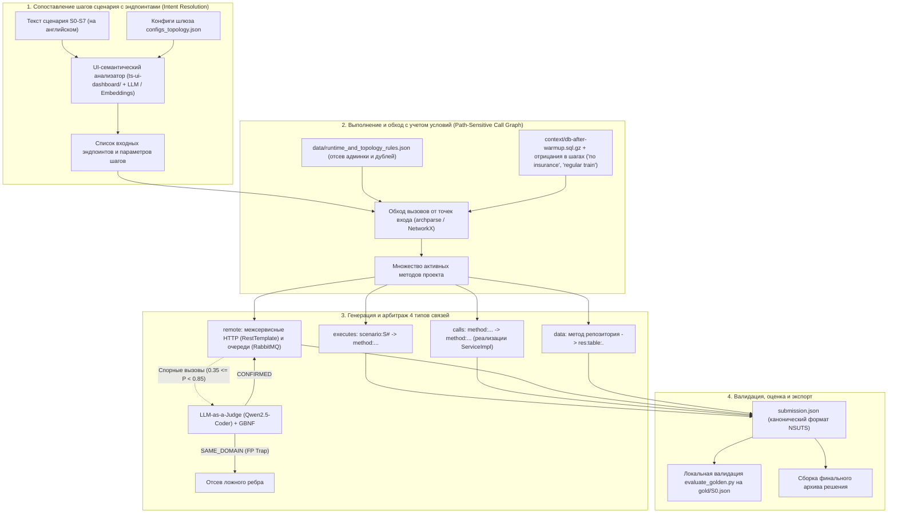

# Дорожная карта реализации проекта Archonity (Roadmap)

## Статус документа
Утверждено на основе анализа пакета участника TechArena 2026 ([hackaton/tt-challenge/](../hackaton/tt-challenge/)), открытого эталона S0 ([gold/S0.json](../hackaton/tt-challenge/gold/S0.json)), принятых архитектурных решений ([docs/adr/](adr/)) и аналитических артефактов ([docs/analytics/trainticket_artifacts_summary.md](analytics/trainticket_artifacts_summary.md)).

---

## 1. Контекст, цели и соревновательные вводные

* **Хакатон:** TechArena 2026 (Huawei R&D). Дедлайн сдачи: **22 октября 2026**.
* **Предметная область:** Бенчмарк **Train Ticket** (41 сервис Spring Boot, вспомогательные сервисы на Go, Python, Node.js, веб-интерфейс `ts-ui-dashboard`, MySQL, MongoDB, RabbitMQ).
* **Специфика задачи:** Статическое предсказание подграфа выполнения для **8 пользовательских сценариев** ($S_0 \dots S_7$) по их текстовому описанию и исходному коду **без рантайм-запуска проекта**.
* **Целевая метрика:** Средний **IoU (Intersection over Union)** по 4 типам связей на 7 скрытых сценариях ($S_1 \dots S_7$):
  $$\text{IoU} = \frac{|P \cap G|}{|P \cup G|} = \frac{TP}{TP + FP + FN}$$
  *Сценарий $S_0$ открыт ([gold/S0.json](../hackaton/tt-challenge/gold/S0.json)) для локальной разработки и валидации, но не входит в итоговый балл платформы.*
* **Формат сдачи:** ZIP-архив с кодом и обязательным файлом `submission.json` в корне ([hackaton/sample/README.md](../hackaton/sample/README.md)).
* **Бонус за Rust:** +10% к итоговому баллу (множитель 1.10) при реализации анализа кода и построения графа на Rust.

---

## 2. Сопоставление с наработанными аналитическими артефактами

В проекте уже подготовлена аналитическая база ([docs/analytics/trainticket_artifacts_summary.md](analytics/trainticket_artifacts_summary.md)), которая напрямую закрывает ключевые этапы нового пайплайна:

| Артефакт в репозитории | Назначение в контексте сценариев $S_0 \dots S_7$ | Применение в дорожной карте |
|:---|:---|:---|
| [facts/configs_topology.json](../facts/configs_topology.json) | 43 маршрута Spring Cloud Gateway (`ts-gateway-service:18888`), Nginx-прокси, порты, топология MySQL/MongoDB, очередь RabbitMQ `email`. | Маппинг URL-запросов из UI в целевые микросервисы и резолвинг очередей. |
| [facts/ts-*.json](../facts/) (4 полиглота) | Эндпоинты, DTO, доступ к БД и вызовы сервисов на Node.js, Python, Go. | Готовые факты для шагов, затрагивающих вспомогательные сервисы (аватары, новости, ваучеры). |
| [data/runtime_and_topology_rules.json](../data/runtime_and_topology_rules.json) | Правила отсева административных сервисов (`ts-admin-*`), канареечных дублей (`ts-travel2-service`), сервисов медленных поездов (`*-other`). | Защита от False Positives ($FP$) при анализе сценариев без администраторов и с фильтрами типов поездов. |
| [data/llm_judge_dossiers_and_traps.json](../data/llm_judge_dossiers_and_traps.json) | Каталог семантических ловушек (одинаковые DTO без HTTP-связи), GBNF-грамматика вердиктов для `Qwen2.5-Coder-7B`. | Локальный арбитраж пограничных вызовов в серой зоне ($0.35 \le P < 0.85$). |
| [docs/analytics/trainticket_reference.md](analytics/trainticket_reference.md) | Шаблоны AST JavaParser для `RestTemplate`, распаковки generic-ответов `ParameterizedTypeReference<Response<T>>`. | Извлечение вызовов и типов возвращаемых данных в `archparse/`. |
| [visualizer/](../visualizer/) | React Flow + ELK.js интерактивный визуализатор с инспектором доказательств. | Визуальный Error Analysis: подсветка $TP$ (зеленый), $FP$ (красный) и $FN$ (фиолетовый) на открытом $S_0$. |

---

## 3. Схема целевого пайплайна реконструкции сценариев

---

## 4. Контракт выходных данных (`submission.json`)

В соответствии со спецификацией организаторов, выходной файл содержит единый JSON с 4 типами отношений:

| Отношение (`relation`) | Источник (`source`) | Приёмник (`target`) | Правило включения в граф |
|:---|:---|:---|:---|
| **`executes`** | `scenario:S<N>` | `method:...` | Метод проекта выполнился хотя бы один раз в ходе сценария. |
| **`calls`** | `method:...` | `method:...` | Прямой вызов внутри одного сервиса. При вызове через интерфейс указывается **конкретная реализовавшаяся реализация** (`ServiceImpl`). |
| **`remote`** | `method:...` | `method:...` (другого сервиса) | Сетевой REST-запрос (`RestTemplate`, Feign) или сообщение RabbitMQ (`email`), обработанное методом целевого сервиса. |
| **`data`** | `method:...` | `res:table:<service>.<table_name>` | SQL-запрос к таблице. Источник — **метод, в котором расположен вызов репозитория**; включает таблицы сущностей и таблицы коллекций (`user_roles`, `route_stations`). |

*Все идентификаторы методов и таблиц строго копируются из `nodes` графа-скелета [skeleton/trainticket.json.gz](../hackaton/tt-challenge/skeleton/trainticket.json.gz).*

---

## 5. Поэтапный план реализации (Этапы и спринты)

### Этап 0: Локальный бенчмарк и воспроизводимый стенд (16 октября)
* **Цель:** Зафиксировать воспроизводимый baseline и инфраструктуру тестирования на $S_0$.
* **Задачи:**
  1. Развернуть скрипт локального замера метрики на базе [evaluate_golden.py](../hackaton/tt-challenge/platform/evaluate_golden.py).
  2. Зафиксировать базовый скор [baseline_nlp.py](../hackaton/sample/code/baseline_nlp.py) на $S_0$ ($0.431$).
  3. Сформировать утилиту сборки zip-посылки с валидацией целостности структуры.
* **Результат:** Единый раннер `python3 run_eval.py`, выдающий подробный отчёт по $S_0$ ($TP/FP/FN$) и валидирующий формат $S_1 \dots S_7$.

---

### Этап 1: Семантическое сопоставление сценариев (Intent & Step Resolver) (16–17 октября)
* **Цель:** Исключить ошибки определения входных точек доступа на этапе интерпретации текста сценария.
* **Проблема текущего бейзлайна:** Лексический BM25 по UI путает похожие сервисы (`ts-order-service` vs `ts-order-other-service`) и не учитывает отрицания («no insurance», «without luggage»).
* **Задачи:**
  1. Собрать реестр соответствий «кнопка/функция UI в `ts-ui-dashboard` $\leftrightarrow$ URL/HTTP-метод $\leftrightarrow$ `@RequestMapping` в Spring».
  2. Использовать конфигурацию [facts/configs_topology.json](../facts/configs_topology.json) для сопоставления URL через предикаты Spring Cloud Gateway.
  3. Реализовать синтаксический анализатор отрицаний и фильтров в тексте шагов (исключение веток страховки, багажа, выбора типа поезда).
  4. (Опционально) Подключить локальную модель `Qwen2.5-Coder-7B` в режиме Structured Outputs для точного маппинга сложных шагов в эндпоинты.
* **Критерий готовности:** Точность выбора входных методов (`executes` верхнего уровня) на $S_0$ равна 100%.

---

### Этап 2: Граф вызовов внутри сервиса и отсев неактивных веток (17–18 октября)
* **Цель:** Устранить False Positives в `calls` и `executes`, возникающие из-за слепого статического замыкания.
* **Задачи:**
  1. Доработать синтаксический парсер [archparse/](../archparse/) на JavaParser:
     - Разрешение интерфейсов в конкретные классы: `OrderService` $\to$ `OrderServiceImpl`.
     - Извлечение прямых вызовов методов, включая методы доменных сущностей и утилит (`StringUtils.Date2String`, `OrderStatus.getCode`), входящие в эталон.
     - Исключение инфраструктурного кода Spring/библиотек (фильтры JWT не порождают `calls` к контроллерам).
  2. Интегрировать правила [data/runtime_and_topology_rules.json](../data/runtime_and_topology_rules.json):
     - Безусловное отсечение мертвого кода административных модулей (`ts-admin-*`), канареечных дубликатов (`ts-travel2-service`).
     - Отсечение ветки `ts-order-other-service` при сценариях с высокоскоростными поездами.
  3. Проверка предусловий по [context/db-after-warmup.sql.gz](../hackaton/tt-challenge/context/db-after-warmup.sql.gz): аккаунт уже существует, баланс достаточен, в контактах есть `Contacts_One`.
* **Критерий готовности:** IoU по `calls` на $S_0$ возрастает с 0.533 до $>0.75$.

---

### Этап 3: Межсервисные вызовы (`remote`) и доступ к базам данных (`data`) (18–19 октября)
* **Цель:** Точное предсказание сетевых связей и обращений к таблицам БД.
* **Задачи:**
  1. **Резолвинг `remote`:**
     - Разбор вызовов `RestTemplate` (`postForObject`, `getForObject`, `exchange`) с извлечением целевого сервиса из `getServiceUrl(...)` и конкатенаций строк (по чек-листу [docs/analytics/trainticket_reference.md](analytics/trainticket_reference.md)).
     - Разрешение очередей RabbitMQ: сопоставление вызовов `rabbitTemplate.convertAndSend("email", ...)` с обработчиками `@RabbitListener(queues = "email")` в `ts-notification-service`.
     - Направление неоднозначных вызовов на локальный арбитраж `Qwen2.5-Coder-7B` с отсевом FP-ловушек по [data/llm_judge_dossiers_and_traps.json](../data/llm_judge_dossiers_and_traps.json).
  2. **Резолвинг `data`:**
     - Привязка ребра `data` строго к методу, вызывающему репозиторий (Spring Data JPA `JpaRepository` или Mongo `MongoRepository`).
     - Учет таблиц коллекций сущностей (например, чтение `user_roles` при обращении к `auth_user`, чтение `route_stations` при обращении к `route`).
     - Исключение фиктивных `data`-связей от сервисов, не выполнявших запросы в данном сценарии.
* **Критерий готовности:** IoU по `data` на $S_0$ возрастает с 0.714 до $>0.85$, отсутствие ложных `remote` на $S_0$.

---

### Этап 4: Комплексная калибровка и Error Analysis (20 октября)
* **Цель:** Достижение максимального интегрального балла на $S_0$ и верификация всех 8 сценариев.
* **Задачи:**
  1. Визуальный анализ расхождений на $S_0$ в [visualizer/](../visualizer/) через режим сравнения (Diff Mode: $TP$ / $FP$ / $FN$).
  2. Тонкая настройка порогов и правил для сценариев $S_1 \dots S_7$:
     - Сценарии покупки билетов с различными опциями (страховка, еда, багаж).
     - Сценарии отмены и перебронирования заказов.
     - Сценарии административных действий.
  3. Проверка сгенерированного файла `submission.json` скриптом `platform/evaluate_golden.py` на отсутствие синтаксических ошибок и неизвестных ID.
* **Критерий готовности:** Суммарный IoU на сценарии $S_0$ достигает $>0.80$.

---

### Этап 5: Оценка бонуса за Rust (+10%) и финальная упаковка (21–22 октября)
* **Цель:** Максимизация финального балла с учетом правил соревнования и оформление архива.
* **Задачи:**
  1. Оценить возможность портирования/компиляции ядра обхода графа на Rust:
     - Организаторы начисляют надбавку **10%** (множитель 1.10 к итоговому результату), если анализ кода и построение ответа реализованы на Rust.
     - Если ядро обхода скелета и сопоставления связей пишется на Rust (крейты `serde_json`, `petgraph`, `flate2`), это дает существенное преимущество в лидерборде.
  2. Формирование чистого ZIP-архива посылки:
     - `submission.json` в корне архива.
     - Исходный код решения и скрипты воспроизведения.
     - Технический отчет README с описанием архитектуры и обоснованием детерминированного подхода без рантайма.
  3. Контрольный прогон проверки и отправка в тестирующую систему NSUTS.

---

## 6. Матрица ответственности в команде

| Участник | Зона ответственности | Задачи в дорожной карте |
|:---|:---|:---|
| **Паша (@Pavelgrr7)** | Java / Spring AST (`archparse/`) | • Реализация Call Graph внутри сервисов (Spring controllers $\to$ service implementations $\to$ repositories). • Точное извлечение вызовов утилит и доменных методов. • Маппинг JPA/Mongo сущностей и коллекций на ID таблиц скелета. |
| **Миша (@vocisyy)** | ML, Семантика и LLM-арбитраж | • Семантическое сопоставление шагов сценария с эндпоинтами UI/бэкенда. • Развертывание локального арбитра `Qwen2.5-Coder-7B` с GBNF-грамматикой для серой зоны. • Фильтрация архитектурных FP-ловушек (по `data/llm_judge_dossiers_and_traps.json`). |
| **Денис (@ischademadda)** | Архитектура, Graph Engine, Rust & Интеграция | • Оркестрация сквозного пайплайна (сборка сценариев в `submission.json`). • Интеграция топологии шлюзов и RabbitMQ из `facts/configs_topology.json`. • Оценка и реализация графового обхода на Rust (для получения +10% надбавки). • Локальный валидатор и визуальный diff в `visualizer/`. |

---

## 7. Критерии готовности (Definition of Done)

1. **Валидность формата:** Файл `submission.json` успешно и без предупреждений проходит проверку `python3 platform/evaluate_golden.py gold/S0.json submission.json` по всем 8 сценариям ($S_0 \dots S_7$).
2. **Точность на открытом эталоне:** Метрика IoU на сценарии $S_0$ превышает **0.80** (против $0.431$ у бейзлайна).
3. **Строгий Local-First:** Решение не выполняет никаких сетевых запросов и не обращается к облачным API.
4. **Статический анализ:** Анализируемый проект Train Ticket не компилируется и не запускается в рантайме.
5. **Готовность архива:** Итоговый ZIP-архив содержит валидный `submission.json` в корне, компилируемый/запускаемый исходный код и техническое описание решения.
