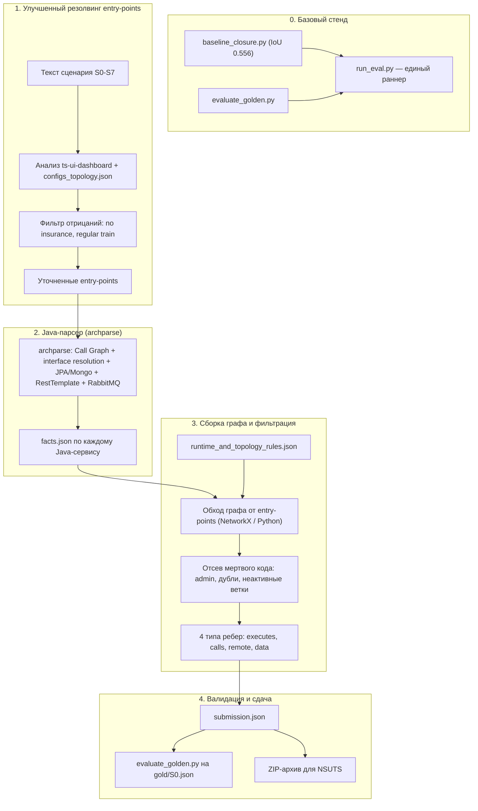

# Дорожная карта Archonity v2

## Статус документа
Обновлено 16 октября 2026. Переработано с учетом фактического состояния кодовой базы, результатов бейзлайнов организаторов и жесткого дедлайна **22 октября**.

---

## 1. Контекст и отправная точка

### 1.1. Хакатон
* **TechArena 2026** (Huawei R&D). Дедлайн: **22 октября 2026** (осталось 5 рабочих дней).
* **Задача:** Статическое предсказание подграфа выполнения для **8 сценариев** ($S_0 \dots S_7$) бенчмарка Train Ticket.
* **Метрика:** Средний IoU по 4 типам связей (`executes`, `calls`, `remote`, `data`) на 7 скрытых сценариях ($S_1 \dots S_7$).
* **Бонус:** +10% за реализацию на Rust (множитель 1.10, потолок 1.0).

### 1.2. Что уже есть (реальный код и данные)

| Артефакт | Готовность | Что дает |
|:---|:---|:---|
| Бейзлайн `baseline_closure.py` (организаторов) | Рабочий | **IoU 0.556** на $S_0$ (executes 0.389, calls 0.462, remote 1.000, data 0.375) |
| Бейзлайн `baseline_nlp.py` (организаторов) | Рабочий | **IoU 0.431** на $S_0$ (executes 0.475, calls 0.533, remote 0.000, data 0.714) |
| `evaluate_golden.py` | Рабочий | Локальный скорер, идентичный платформе |
| [facts/configs_topology.json](../facts/configs_topology.json) | Готов | 43 маршрута шлюза, маппинг сервис-БД, RabbitMQ |
| [facts/ts-*.json](../facts/) (4 полиглота) | Готовы | Эндпоинты, call graph, БД для Python/Go/Node.js сервисов |
| [data/runtime_and_topology_rules.json](../data/runtime_and_topology_rules.json) | Готов | Правила отсева мертвого кода: `ts-admin-*`, `ts-travel2-service`, ветки `*-other` |
| [data/llm_judge_dossiers_and_traps.json](../data/llm_judge_dossiers_and_traps.json) | Готов | Каталог FP-ловушек, промпты и GBNF для арбитра |
| [visualizer/](../visualizer/) | Готов | Error Analysis, diff TP/FP/FN |
| [archparse/](../archparse/) | ~5% | Парсит только `@PostMapping` и два метода RestTemplate. Нет Call Graph, нет Reachability, нет JPA/Mongo. Баг в `build.gradle` (`org.v39a` вместо `com.v39a`) |

Директории `engine/` и `ml/` не существуют.

### 1.3. Стратегия

Строить решение **поверх closure-бейзлайна** (уже 0.556 из коробки), обогащая его:
1. Точным резолвингом entry-points из шагов сценария (поднимет `executes`).
2. Фильтрацией мертвого кода по правилам и контексту сценария (снизит FP).
3. Полноценным Java-парсером для уточнения `calls` и `data` (основная работа, 3-4 дня).

---

## 2. Формат сдачи

Файл `submission.json` содержит ответ на все 8 сценариев:
```json
{
  "project": "trainticket",
  "scenarios": {
    "S0": {
      "edges": [
        {"source": "scenario:S0", "relation": "executes", "target": "method:ts-auth-service:auth.controller.UserController#getToken(...)"},
        {"source": "method:...", "relation": "calls", "target": "method:..."},
        {"source": "method:...", "relation": "remote", "target": "method:..."},
        {"source": "method:...", "relation": "data", "target": "res:table:ts-order-service.orders"}
      ]
    },
    "S1": {"edges": [...]},
    ...
  }
}
```

Все ID методов и таблиц копируются строго из `nodes` скелета [skeleton/trainticket.json.gz](../hackaton/tt-challenge/skeleton/trainticket.json.gz).

---

## 3. Схема целевого пайплайна



---

## 4. Поэтапный план

### Этап 0: Стенд и воспроизводимый бейзлайн (16 октября, 0.5 дня)

**Цель:** Зафиксировать стартовую точку, убедиться что пайплайн запускается и генерирует валидный `submission.json`.

**Задачи:**
1. Запустить `baseline_closure.py` на всех 8 сценариях, получить `submission.json`.
2. Прогнать `evaluate_golden.py` на $S_0$, зафиксировать скор 0.556.
3. Запустить `baseline_nlp.py`, зафиксировать скор 0.431.
4. Собрать утилиту `run_eval.py`: единый скрипт, который генерирует submission и считает IoU.
5. Понять, что closure лучше в `remote` (1.0 vs 0.0), а NLP лучше в `calls` (0.533 vs 0.462) и `data` (0.714 vs 0.375).

**Результат:** Рабочий бейзлайн 0.556, раннер для быстрой итерации, понимание сильных/слабых сторон каждого подхода.

---

### Этап 1: Улучшенный резолвинг entry-points и фильтрация (16-17 октября, 1 день)

**Цель:** Поднять `executes` за счет точного маппинга шагов сценария в контроллеры и снизить FP за счет фильтрации.

**Задачи:**
1. Проанализировать, где NLP-бейзлайн точнее closure в выборе entry-points (NLP дает `executes` 0.475 vs 0.389 у closure) и взять лучшее из обоих.
2. Интегрировать маршруты шлюза из [facts/configs_topology.json](../facts/configs_topology.json) для точного сопоставления URL.
3. Реализовать фильтр отрицаний в шагах сценария: «no insurance» исключает `ts-assurance-service`, «regular train» переключает на `ts-order-other-service`/`ts-travel2-service`, и наоборот.
4. Применить правила мертвого кода из [data/runtime_and_topology_rules.json](../data/runtime_and_topology_rules.json): отсечь `ts-admin-*` в пользовательских сценариях, канареечные дубли.
5. Проверить предусловия по [context/db-after-warmup.sql.gz](../hackaton/tt-challenge/context/db-after-warmup.sql.gz): аккаунт существует, баланс достаточен, контакт `Contacts_One` есть.

**Критерий готовности:** IoU на $S_0$ поднимается выше 0.60. Точность entry-points: 100% на $S_0$.

**Fallback (если не хватает времени):** Взять гибрид closure + NLP: closure для `remote`, NLP для `calls`/`data`, объединение `executes`.

---

### Этап 2: Java-парсер archparse (17-20 октября, 3-4 дня)

**Цель:** Получить полноценный Call Graph, `remote` и `data` по Java-сервисам.

Текущее состояние `archparse/`: 50 строк, парсит только `@PostMapping` и `postForObject`/`getForObject`. Нужна полная реализация.

**Задачи:**

#### 2.1. Инфраструктура (первые полдня)
- Исправить баг в `build.gradle`: `mainClass = 'com.v39a.Main'`.
- Добавить все HTTP-маппинги: `@GetMapping`, `@PutMapping`, `@DeleteMapping`, `@RequestMapping`.
- Определить выходной формат: `facts.json` по контракту [ADR-001](adr/adr-001_data_contracts_and_system_architecture.md) (или минимальный формат, совместимый с ядром сборки).

#### 2.2. Call Graph внутри сервиса (1-1.5 дня)
- Разрешение интерфейсов в конкретные классы: `OrderService` $\to$ `OrderServiceImpl` (по Spring DI: один `@Service`-класс реализует интерфейс).
- Извлечение прямых вызовов методов, включая утилиты (`StringUtils.Date2String`, `OrderStatus.getCode`).
- Исключение инфраструктурного кода Spring/библиотек: фильтры JWT не порождают `calls` к контроллерам.
- Рекурсивный обход: Controller -> Service -> Repository, с отслеживанием полной цепочки.

#### 2.3. Межсервисные вызовы `remote` (0.5-1 день)
- Разбор `RestTemplate`: `postForObject`, `getForObject`, `exchange`, `getForEntity`, `postForEntity`.
- Извлечение целевого сервиса из `getServiceUrl(...)` и конкатенаций строк.
- Разрешение очередей RabbitMQ: `rabbitTemplate.convertAndSend("email", ...)` $\to$ `@RabbitListener(queues = "email")` в `ts-notification-service`.

#### 2.4. Доступ к БД `data` (0.5 дня)
- Маппинг JPA-репозиториев (`JpaRepository<Entity, ID>`) на таблицы через `@Entity`/`@Table`.
- Маппинг Mongo-репозиториев (`MongoRepository`) на коллекции.
- Привязка ребра `data` к методу, вызывающему репозиторий.
- Учет таблиц коллекций: `user_roles`, `route_stations`.

**Критерий готовности:** IoU по `calls` на $S_0$ возрастает до > 0.70. IoU по `data` на $S_0$ возрастает до > 0.80.

---

### Этап 3: Сборка графа, калибровка и Error Analysis (20-21 октября, 1-1.5 дня)

**Цель:** Собрать полный пайплайн, прогнать все 8 сценариев, максимизировать IoU.

**Задачи:**
1. Написать Python-скрипт (или доработать closure-бейзлайн), который:
   - Загружает скелет и факты из `archparse`.
   - Для каждого сценария: резолвит entry-points, обходит граф, генерирует 4 типа ребер.
   - Применяет фильтрацию: мертвый код, отрицания, контекст БД.
   - Экспортирует `submission.json`.
2. Визуальный Error Analysis на $S_0$ в [visualizer/](../visualizer/): подсветка TP/FP/FN.
3. Тонкая настройка для сценариев $S_1 \dots S_7$:
   - Покупка билета с опциями (страховка, еда, багаж).
   - Отмена и перебронирование.
   - Различия скоростных и обычных поездов.
4. Прогон `evaluate_golden.py --check` для верификации формата на всех сценариях.

**Критерий готовности:** Суммарный IoU на $S_0$ > 0.80.

---

### Этап 4: Финализация и сдача (21-22 октября, 0.5-1 день)

**Задачи:**
1. Контрольный прогон полного пайплайна.
2. Проверка `submission.json` скриптом `evaluate_golden.py` на:
   - Корректность формата.
   - Отсутствие неизвестных ID.
   - Наличие ответов на все 8 сценариев.
3. Оценка Rust-бонуса: если IoU $\ge$ 0.70, рассмотреть портирование компактного ядра обхода на Rust. Если нет -- не тратить время.
4. Формирование ZIP-архива:
   - `submission.json` в корне.
   - Исходный код.
   - README с описанием подхода.
5. Отправка в NSUTS.

---

## 5. Fallback-стратегия

Если `archparse` не успевают довести до уровня, закрывающего `calls` и `data`:

| Ситуация | Действие | Ожидаемый IoU |
|:---|:---|:---|
| `archparse` готов к 20 октября | Полный пайплайн | 0.75-0.85 |
| `archparse` частично готов (есть Call Graph, нет JPA) | Closure + частичные факты archparse | 0.65-0.75 |
| `archparse` не готов | Гибрид closure + NLP с фильтрацией | 0.60-0.65 |

В любом случае команда сдает `submission.json` не позднее 21 октября вечером, оставляя 22 октября на исправления.

---

## 6. Матрица ответственности

| Участник | Зона ответственности | Задачи |
|:---|:---|:---|
| **Паша (@Pavelgrr7)** | Java AST (`archparse/`) | Этап 2 целиком: Call Graph, interface resolution, RestTemplate, JPA/Mongo, RabbitMQ. |
| **Миша (@vocisyy)** | Семантика и резолвинг | Этап 1: маппинг шагов сценария в entry-points, анализ UI, отрицания, фильтрация. |
| **Денис (@ischademadda)** | Архитектура и интеграция | Этап 0 + Этап 3: стенд, сборка пайплайна, Error Analysis в визуализаторе, финальная упаковка. |

---

## 7. Что не входит в скоуп (по приоритету)

Эти пункты из ADR описаны, но реализуются **только** если основные этапы завершены досрочно:

1. **ML-модуль (CatBoost, UniXcoder)** -- при текущем дефиците времени overengineering. Closure + правильные правила дают конкурентный результат.
2. **LLM-as-a-Judge (Qwen2.5-Coder-7B)** -- полезен для серой зоны, но требует инфраструктуры развертывания. Рассматривать после IoU > 0.75.
3. **Rust-порт** -- только при IoU $\ge$ 0.70 и наличии свободного времени 22 октября.
4. **evidence.json** -- внутренний артефакт для визуализатора, не влияет на скор.

---

## 8. Критерии готовности (Definition of Done)

1. `submission.json` проходит `evaluate_golden.py` без ошибок по всем 8 сценариям.
2. IoU на $S_0$ > **0.80** (цель), > **0.65** (минимум для сдачи).
3. Решение не выполняет сетевых запросов (Local-First).
4. Проект Train Ticket не компилируется и не запускается (статический анализ).
5. ZIP-архив содержит `submission.json` в корне и исходный код.
